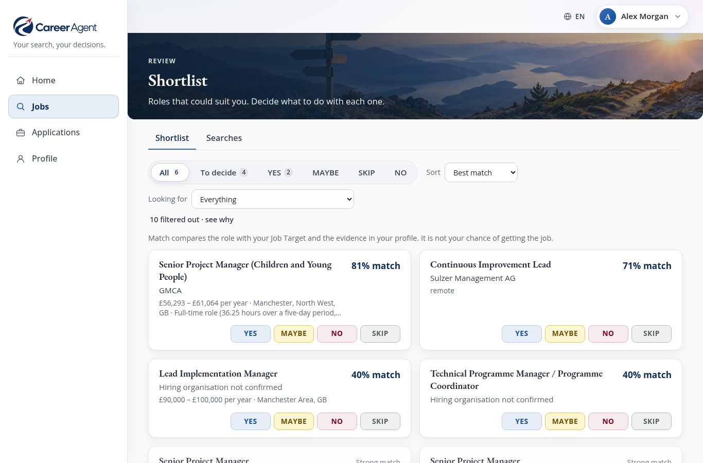

# Career Agent downloads

Career Agent is a local-first job-search and application assistant. It helps you find and assess opportunities,
organise a shortlist, prepare truthful application documents and practise for interviews. It never submits an
application or contacts an employer for you: you review, decide and send.



## Download Career Agent 1.0.0

These links download the installer itself; no GitHub sign-in is required.

| Platform | Direct download | Installation guide |
| --- | --- | --- |
| Windows 10/11, 64-bit | [CareerAgent-Setup-1.0.0.exe](https://github.com/pistio/career-agent-downloads/releases/download/v1.0.0/CareerAgent-Setup-1.0.0.exe) | [Windows](docs/install-windows.md) |
| macOS, Apple silicon | [CareerAgent-1.0.0-arm64.pkg](https://github.com/pistio/career-agent-downloads/releases/download/v1.0.0/CareerAgent-1.0.0-arm64.pkg) | [macOS](docs/install-macos.md) |
| macOS, Intel | [CareerAgent-1.0.0-x86_64.pkg](https://github.com/pistio/career-agent-downloads/releases/download/v1.0.0/CareerAgent-1.0.0-x86_64.pkg) | [macOS](docs/install-macos.md) |
| Linux | [career-agent-1.0.0-linux.tar.gz](https://github.com/pistio/career-agent-downloads/releases/download/v1.0.0/career-agent-1.0.0-linux.tar.gz) | [Linux](docs/install-linux.md) |

Windows and macOS installers include their own Python. The Linux archive requires Python 3.12 or newer.

## Before installing

- Career Agent is free under the MIT licence. Searching and AI-assisted writing use your own OpenAI API key by
  default, and the provider charges separately by use. Set a spending limit in your provider account.
- The Windows and macOS installers are unsigned, and the macOS packages are not notarised. Your operating system may
  show a warning; the installation guides explain the expected prompts.
- Native installers were tested on Windows Server 2022, macOS 14 on Apple silicon and macOS 15 on Intel. Windows 10
  and 11 were not tested directly. Linux archive installation was tested on Ubuntu 24.04; other distributions may
  need the system libraries described by the installer.
- No job search, paid AI call, application submission or message was sent during installer testing.

See the [v1.0.0 release notes](release-notes-v1.0.0.md) for the complete testing scope and known limitations.

## Verify a download

The release includes `SHA256SUMS` plus a separate `.sha256` file for each installer. The expected SHA-256 values are:

```text
68140ec3628b49619cdee2848adacee4329e2160adeb1f5d302ac8a444f4a56a  CareerAgent-Setup-1.0.0.exe
c0c499ed416e8a4978fbb19c45d9b6d2195ca46c90e8bd1a7fd460c1a366b9af  CareerAgent-1.0.0-arm64.pkg
72b222d105a05f8ee594c766f2559019e111e7b21adb508902ae834cfeecd2d4  CareerAgent-1.0.0-x86_64.pkg
defa1f2cfb13c9746bcc5a5e9b772e67bfbfc6350b92372712f1696c468219ac  career-agent-1.0.0-linux.tar.gz
```

On Windows, run `Get-FileHash <filename>` in PowerShell. On macOS or Linux, run `shasum -a 256 <filename>`.

## Guides

The user guide is available in
[English](docs/manual.en.md), [Deutsch](docs/manual.de.md), [한국어](docs/manual.ko.md),
[Français](docs/manual.fr.md), [Español](docs/manual.es.md) and [Português](docs/manual.pt.md).
Everything about a person stays in their local profile and data folders. Keep a private backup; the
[backup guide](docs/backup.md) explains what to copy.

## Licence

Career Agent is distributed under the [MIT licence](LICENSE).
