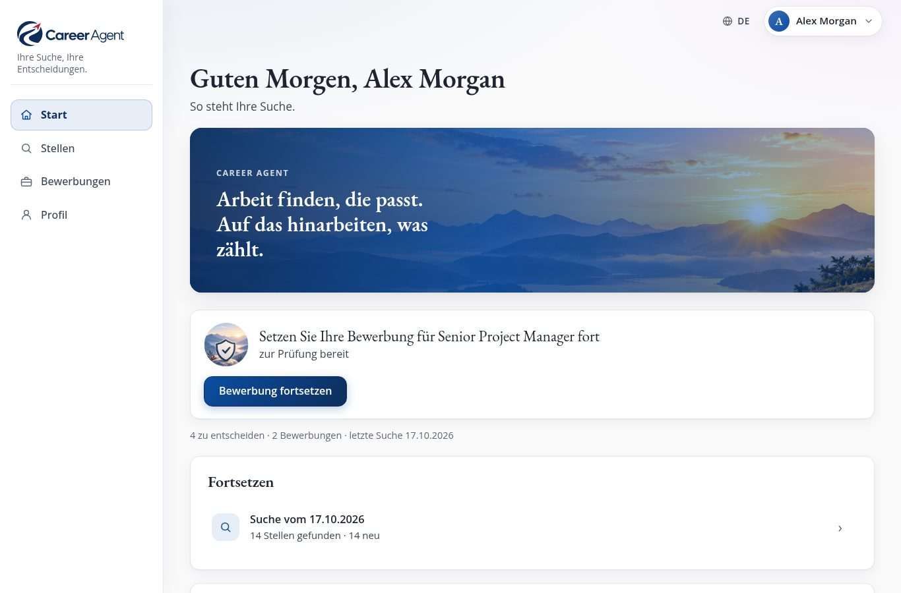
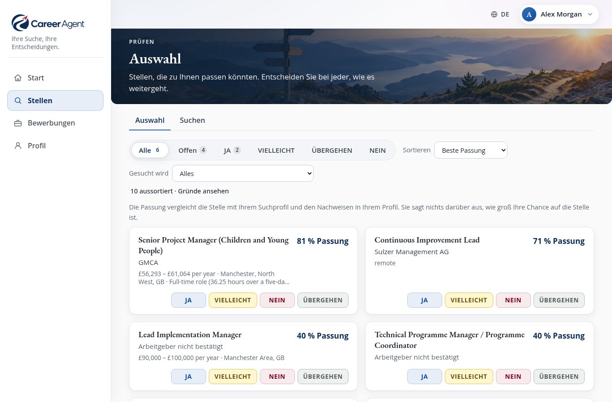
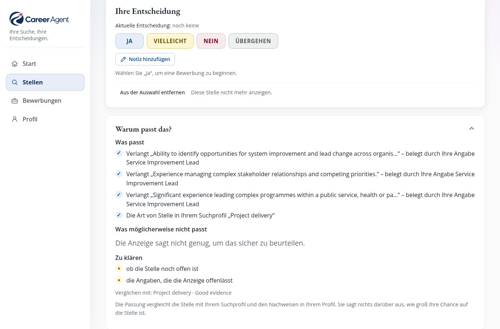
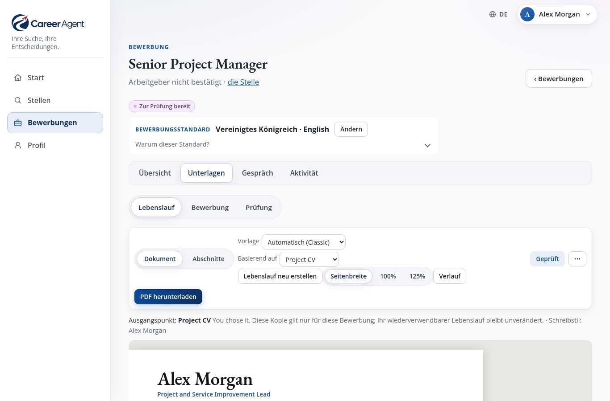
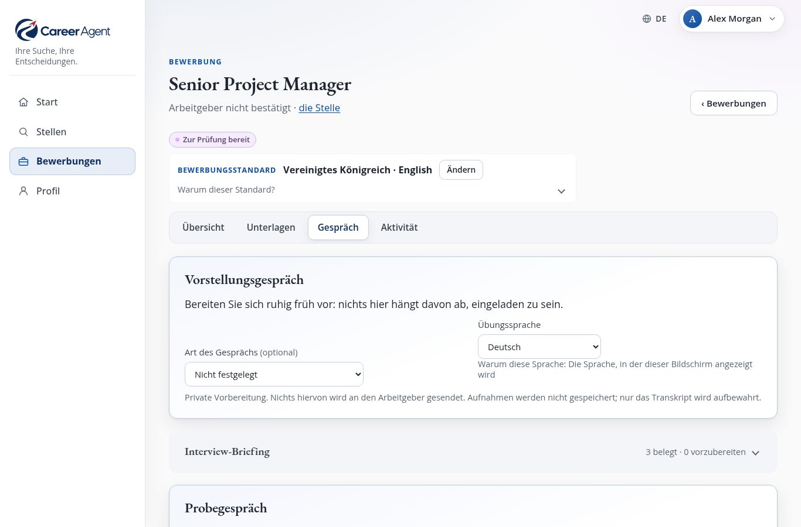

# Career Agent: das Benutzerhandbuch

[English](manual.en.md) · **Deutsch** · [한국어](manual.ko.md) · [Français](manual.fr.md) · [Español](manual.es.md) · [Português](manual.pt.md)

<b>Ihre Suche, Ihre Entscheidungen.</b> Kostenlos · läuft auf Ihrem eigenen Computer · sechs Sprachen · Version 1.0

---

## Career Agent in einer Minute

Wer eine neue Stelle sucht, verbringt meist Stunden auf Jobportalen, kopiert Anzeigen in Notizen, schreibt den
Lebenslauf für jede Bewerbung neu und versucht, den Überblick zu behalten, wem man wann geschrieben hat.

**Career Agent nimmt Ihnen die mühsame Arbeit ab und überlässt jede Entscheidung Ihnen.**

Sie beschreiben mit Ihren eigenen Worten, welche Art von Arbeit Sie suchen. Dann:

1. **sucht Career Agent im Internet nach passenden Stellen**: auf Jobportalen, Arbeitgeber-Websites und in
   offiziellen Stellenbörsen;
2. **liest jede Anzeige** und prüft die wichtigen Fakten (Vergütung, Ort, Vertrag, Bewerbungsschluss) auf der
   Seite der Anzeige selbst;
3. **misst jede Stelle an dem, was Sie sich wünschen**, und erklärt in verständlichen Sätzen, warum;
4. **führt eine übersichtliche Auswahl**, in der Sie einfach mit Ja, Vielleicht, Nein oder Übergehen antworten;
5. **schreibt einen auf die Stelle zugeschnittenen Lebenslauf und ein Anschreiben** und nutzt dafür nur Fakten aus
   Ihrem eigenen Werdegang;
6. **hilft Ihnen bei der Vorbereitung auf das Vorstellungsgespräch**, einschließlich eines Probegesprächs, das Sie
   laut beantworten können;
7. **behält jede Bewerbung im Blick** und erinnert Sie, wann Sie nachhaken sollten.

Career Agent kann sogar **jede Woche ganz von selbst** eine Suche für Sie durchführen und Ihnen eine kurze
Zusammenfassung aufs Handy schicken.

Und ein Versprechen ist wichtiger als alles andere: **Career Agent bewirbt sich nie auf eine Stelle, nimmt nie
Kontakt zu einem Arbeitgeber auf und verschickt nie etwas in Ihrem Namen.** Career Agent bereitet vor; Sie
entscheiden und Sie senden.

---

## Was Career Agent besonders macht

- **Sie erfahren das Warum.** Zu jeder Stelle gibt es *Was passt*, *Was möglicherweise nicht passt* und *Zu
  klären*, nicht nur eine Zahl.
- **Zwei Fragen, sauber getrennt.** „Passt diese Stelle jetzt zu mir?“ (Vergütung, Arbeitszeit, Ort, Vertrag) und
  „Bringt sie mich dorthin, wo ich hinwill?“ werden getrennt beurteilt, denn eine Stelle kann beim einen gut
  abschneiden und beim anderen nicht.
- **Career Agent sagt ehrlich, was es nicht weiß.** Nennt eine Anzeige keine Vergütung, sagt Career Agent das
  auch. Ein Fakt gilt nur dann als *geprüft*, wenn er auf der Seite des Arbeitgebers, in einer offiziellen
  Stellenbörse oder bei einer seriösen Personalvermittlung gelesen wurde, nie aus einer Suchzusammenfassung.
- **Ihr Lebenslauf bleibt wahr.** Neue Unterlagen entstehen aus Ihren eigenen beruflichen Angaben. Erfundene
  Zahlen, Daten, Berufsbezeichnungen, Namen und Qualifikationen werden von automatischen Prüfungen erkannt: Ein
  KI-Entwurf, der so etwas erfindet, wird nicht angenommen, und eigene Änderungen, die so etwas hinzufügen,
  werden Ihnen als *Zu prüfen* angezeigt.
- **Ihre Daten bleiben bei Ihnen.** Alles wird auf Ihrem eigenen Computer gespeichert, nicht in der Cloud eines
  anderen.
- **Sieben Sprachen für die Oberfläche.** Englisch, Deutsch, Koreanisch, Französisch, Spanisch und Portugiesisch
  (Portugal und Brasilien). Bewerbungen lassen sich in jeder dieser Sprachen schreiben.

---

## Neu in Version 1.0

- **Klarere Werte.** Der Prozentwert ist jetzt die **Passung zum Suchprofil**, daneben stehen **Jetzt** und
  **Berufliche Richtung**. Vergütungen werden nur auf gleicher Grundlage verglichen, und „nicht zwingend
  erforderlich“ wird nicht mehr als Anforderung gelesen.
- **Eine ruhigere Auswahl.** Der Hinweis **Neu** markiert, was die letzte Suche gefunden hat, **In dieser Liste
  finden** grenzt die Liste ein, und eine Anzeige bleibt eine Stelle, auch wenn sie über einen leicht anderen Link
  erreicht wird. Ändern Sie eine Entscheidung, bleibt Ihre Notiz erhalten.
- **Strengere Ehrlichkeitsprüfungen.** Erfundene Organisationen, Abschlüsse, Zertifikate und Lizenzen werden jetzt
  ebenfalls erkannt.
- **Anschreiben als PDF.** Das Anschreiben und die Darstellung der Eignung lassen sich wie der Lebenslauf als PDF
  herunterladen.
- **Nach der Bewerbung.** Erfassen Sie ein Vorstellungsgespräch, ein Angebot oder eine Absage direkt nach dem
  Versand, mit dem **Datum, an dem es geschah**.
- **Klare Worte, wenn etwas schiefgeht**, immer mit einem nächsten Schritt.

---

## Ein kurzer Rundgang: vier Bereiche

*Die Seite **Start** zeigt, was als Nächstes ansteht. Die Bilder zeigen das mitgelieferte Beispielprofil: eine erfundene Person, echte Stellenanzeigen.*

Sie sehen immer dieselben vier Bereiche: am Computer oder Tablet in einem Menü an der Seite, am Handy in einer
Leiste am unteren Rand.

| Bereich | Was Sie dort tun |
| --- | --- |
| **Start** | Sehen, was als Nächstes am meisten lohnt, was *Demnächst* ansteht und Ihre letzten Suchen. |
| **Stellen** | Die **Auswahl** (Stellen, über die Sie entscheiden) und **Suchen** (eine Suche starten, frühere ansehen). |
| **Bewerbungen** | Jede Bewerbung, die Sie begonnen haben, jeweils mit *Übersicht*, *Unterlagen*, *Gespräch* und *Aktivität*, dazu **Fortschritt**, wo Sie sehen, wie alles steht. |
| **Profil** | Alles über Sie: *Über Sie*, *Wonach ich suche*, *Lebensläufe und Texte* und *Einstellungen*. |

Die Startseite bietet Ihnen immer **einen** klaren nächsten Schritt an, zum Beispiel *„5 Stellen brauchen Ihre
Entscheidung“* mit der Schaltfläche **Auswahl prüfen**. Gibt es gerade nichts zu tun, bietet sie **Stellen
finden** an.

> **Tipp:** Wenn Sie neu sind, erklären kleine Hinweiskarten jede Seite. Sie können sie unter
> **Profil → Einstellungen → Hinweise anzeigen** aus- und wieder einschalten.

---

## Bevor Sie loslegen: was Sie brauchen

**Career Agent selbst ist kostenlos.** Es gibt kein Abo und kein Konto, und der Quellcode ist offen
(MIT-Lizenz). Kosten entstehen nur für die KI, die Sie direkt bei OpenAI bezahlen (siehe unten).

Career Agent ist ein Programm, das Sie selbst betreiben, auf Ihrem eigenen Computer oder einem kleinen
Heimserver. Es ist keine Website, bei der Sie sich anmelden. Genau das schützt Ihre Daten, bedeutet aber:
**Für die erste Einrichtung braucht es einmalig jemanden, der sich mit Computern auskennt**, etwa eine Stunde
lang. Die technischen Schritte stehen in der [README](../README.md#install) („Install“).

Was Sie brauchen:

- **Einen Computer, der eingeschaltet bleiben kann**, am besten mit Linux, wenn Sie die wöchentliche automatische
  Suche nutzen möchten. Für gelegentliche Nutzung genügt jeder Computer, auf dem das Programm läuft, solange Sie
  damit arbeiten.
- **Ein OpenAI-Konto und einen API-Schlüssel.** Career Agent nutzt die KI von OpenAI, um zu suchen, Anzeigen zu
  lesen und zu schreiben. Der Schlüssel ist so etwas wie ein Passwort, mit dem Career Agent Ihr Konto nutzen darf.
  OpenAI rechnet nach Nutzung ab; legen Sie in Ihrem OpenAI-Konto ein monatliches Ausgabenlimit fest, damit es
  keine Überraschungen gibt.
- **Ein privates Netzwerk.** Career Agent hat keine Anmeldeseite. Es darf deshalb nur von Ihrem eigenen Computer
  oder aus Ihrem eigenen privaten Netzwerk erreichbar sein, nie aus dem offenen Internet. Das richtet Ihre
  Helferin oder Ihr Helfer für Sie ein.
- **Optional:** ein Telegram-Konto, wenn Sie die wöchentliche Zusammenfassung aufs Handy bekommen möchten.

Was **ohne** KI-Schlüssel funktioniert: alles bereits Gefundene lesen, Ihre Entscheidungen, Profil und
Lebensläufe bearbeiten, Vorlagen, das Interview-Briefing, Erinnerungen und die Nachverfolgung. Für die Suche, das
Schreiben von Unterlagen, KI-Vorschläge, Interviewfragen und Rückmeldungen braucht es den Schlüssel.

### Ihr Profil wird einmal angelegt

Ihre Helferin oder Ihr Helfer legt Ihr Profil an, indem sie oder er das mitgelieferte Beispielprofil (eine
erfundene Person namens Alex Morgan) kopiert und anpasst. Danach **erledigen Sie fast alles im Browser**: Ihre
Angaben, Ihren beruflichen Werdegang, wonach Sie suchen, Ihre Lebensläufe und Ihren Schreibstil.

---

## Schritt 1: Erzählen Sie Career Agent von sich

Öffnen Sie **Profil → Über Sie**.

- **Persönliche Angaben** und **Kontaktdaten**: das, was oben auf Ihrem Lebenslauf steht.
- **Berufliche Angaben**: die Fakten, die Ihre Lebensläufe und Anschreiben verwenden dürfen, als Karten:
  Stellen, Qualifikationen, Erfolge, Ehrenamt, Fähigkeiten. Mit **Eintrag hinzufügen** legen Sie einen neuen an.

Je mehr ehrliche Details Sie hier eintragen, desto besser werden Ihre Bewerbungen. Career Agent schreibt nur, was
es hier findet. Verlangt eine Stelle etwas, das Sie nicht beschrieben haben, sagt Career Agent das (*Nicht
belegt*), statt etwas zu erfinden.

> **Beispiel:** Schreiben Sie statt „Projekte geleitet“ lieber „2024 ein Team von 6 Personen geführt, das 400
> Kundinnen und Kunden auf ein neues Buchungssystem umgestellt hat, drei Wochen früher als geplant.“ Career Agent
> kann dann diese echten Zahlen verwenden, und nur diese.

---

## Schritt 2: Sagen Sie, wonach Sie suchen

Öffnen Sie **Profil → Wonach ich suche** und wählen Sie **+ Suchprofil hinzufügen**. Ein *Suchprofil* steht für
eine Art von Stelle, die Sie suchen. Sie können mehrere haben, zum Beispiel „Projektmanagement“ und „Betrieb und
Organisation“.

Für jedes beschreiben Sie:

- **Art der Tätigkeit**: Berufsbezeichnungen und die Art der Rolle, in ganz normalen Worten.
- **Was eine Stelle passend macht**: worum es in der Stelle wirklich gehen muss.
- **Ort und Remote**: wo Sie arbeiten können und ob Remote- oder Hybridarbeit für Sie in Frage kommt.
- **Vergütung** und **Arbeitsumfang**: was Sie verdienen müssen und welche Tage oder Stunden zu Ihnen passen.
- **Was bei dieser Art von Stelle zählt**, in vier Stufen: *Erforderlich*, *Wichtig*, *Nützlich* und *Vermeiden*.

So geht Career Agent mit Ihren Wünschen um:

| Sie sagen | Was passiert |
| --- | --- |
| **Pflichtkriterium / Erforderlich** | Eine Stelle kann aussortiert werden, wenn die Anzeige es **eindeutig** nicht erfüllt. Sagt die Anzeige einfach nichts dazu, wird die Stelle **nicht** ausgeschlossen. |
| **Bevorzugt / Wichtig / Nützlich** | Macht eine Stelle passender, schließt aber allein nie eine aus. |
| **Vermeiden** | Orte, die Sie ausschließen, lassen Stellen mit Präsenzpflicht dort wegfallen. Alles andere, was Sie hier angeben, wird vermerkt, aber nicht gefiltert. |

Jedes Suchprofil lässt sich ein- oder ausschalten, duplizieren oder löschen. Gesucht wird nur nach eingeschalteten
Suchprofilen.

> **Tipp:** Es muss nicht beim ersten Versuch perfekt sein. Starten Sie eine Suche, schauen Sie sich die
> Ergebnisse an und passen Sie dann an.

---

## Schritt 3: Stellen finden

Gehen Sie zu **Stellen → Suchen** und wählen Sie **Stellen finden**.

1. Career Agent fragt: **Wonach soll Career Agent suchen?** Haken Sie ein oder mehrere Suchprofile an und wählen
   Sie **Stellen finden**.
2. Eine Rückfrage lautet **Suche starten?** Sie sagt, wonach gesucht wird, dass es einige Minuten dauern kann und
   dass nichts an andere gesendet wird. Wählen Sie **Suche starten**. Vor Ihrer Bestätigung wird nichts angelegt:
   Brechen Sie ab, bleibt keine Suche zurück.
3. Die Seite der Suche öffnet sich. Sie können sie schließen und die App weiter nutzen; die Suche läuft weiter.
   Start und Suchen zeigen, dass eine Suche läuft und was sie gerade tut, zum Beispiel *„Prüft die
   Stellenanzeigen“*.

Während eine Suche läuft:

- sucht Career Agent im Internet nach Stellen, die zu jedem Suchprofil passen;
- sortiert es die Funde und entfernt Doppelte (dieselbe Stelle, die auf mehreren Seiten ausgeschrieben ist,
  erscheint **nur einmal**);
- sortiert es Stellen aus, die eindeutig nicht passen;
- öffnet es jede verbleibende Anzeige und **prüft** ihre Fakten auf der Seite der Anzeige selbst;
- vergleicht es jede Stelle mit Ihren Wünschen und schreibt seine Begründung auf.

Ist sie fertig, zeigt die Seite der Suche **Suche abgeschlossen** an, zum Beispiel:

> *32 Stellen gefunden · 9 zur Prüfung bereit · 23 aussortiert. 7 sind neu. 2 waren schon bekannt.*

und bietet genau eine Schaltfläche an: **Auswahl prüfen**. Neben den neuen Stellen öffnet **Neue Stellen in Ihrer
Auswahl ansehen** die Auswahl mit nur den Stellen, die diese Suche zum ersten Mal gefunden hat.

Manchmal kann eine Suche nicht alles erledigen:

- **Einige Websuchen konnten nicht durchgeführt werden.** Das Ergebnis sagt es dann, zum Beispiel *„3 von 40
  Websuchen konnten nicht durchgeführt werden, daher fehlen vielleicht einige Stellen. Eine neue Suche versucht
  sie erneut.“*
- **Die Suche konnte nicht durchgeführt werden.** Keine ihrer Websuchen hat funktioniert, daher wurden keine
  Stellen gefunden. Wählen Sie **Erneut suchen**: Career Agent legt eine neue Suche für dieselben Suchprofile an
  und fragt wie gewohnt zuerst **Suche starten?**
- **Die Suche wurde angehalten, während sie die Anzeigen las.** Wählen Sie **Anzeigenprüfung abschließen**. Dabei
  werden nur die bereits gefundenen Anzeigen gelesen; es wird nicht erneut gesucht, deshalb gibt es keine
  Rückfrage.

Wurde eine Suche unterbrochen (etwa weil der Computer ausgeschaltet wurde), bietet ihre Seite **Suche fortsetzen**
an. Sie macht dort weiter, wo sie stehen geblieben ist, und wiederholt nichts, was schon erledigt war.

---

## Schritt 4: Über Ihre Auswahl entscheiden

*Die **Auswahl**: jede Stelle mit ihrer Passung und vier Knöpfen für Ihre Entscheidung.*

**Stellen → Auswahl** sammelt die Stellen, die zu Ihnen passen könnten, aus **allen** Suchen in einer Liste.

Bei jeder Stelle sehen Sie die Rolle, **wer einstellt** (oder *Arbeitgeber nicht bestätigt*, wenn eine
Personalvermittlung den Arbeitgeber nicht nennt), ihre Passung wie **„86 % Passung zum Suchprofil“**, eine Zeile
wie **„Jetzt: Stark · Berufliche Richtung: Eingeschränkt“** und vier Schaltflächen. Ein Hinweis **Neu** markiert
die Stellen, die die letzte Suche zum ersten Mal gefunden hat.

| Schaltfläche | Bedeutung |
| --- | --- |
| **Ja** | Ich möchte mich bewerben. Damit wird auch gleich **eine Bewerbung begonnen**. |
| **Vielleicht** | Interessant; ich entscheide später. |
| **Nein** | Nichts für mich. |
| **Übergehen** | Gerade nicht. |

Sie können Ihre Meinung jederzeit ändern; frühere Entscheidungen bleiben im Verlauf erhalten. Ändern Sie nur die
Entscheidung, bleibt die Notiz, die Sie dazu geschrieben haben, erhalten.

**Was die Prozentzahl bedeutet:** wie gut die Stelle zu dem passt, was dieses Suchprofil verlangt, und zu den
Nachweisen in Ihrem Profil. Sie ist **nicht** Ihre Chance, die Stelle zu bekommen. Die beiden anderen Fragen
werden getrennt bewertet, in der Zeile darunter: **Jetzt** (passt die Stelle jetzt zu mir: Vergütung,
Arbeitszeit, Ort, Vertrag?) und **Berufliche Richtung** (bringt sie mich dorthin, wo ich hinwill?). Jede lautet
*Stark*, *Gemischt*, *Eingeschränkt* oder *Zu wenig Informationen*.

Hilfreiche Bedienelemente:

- **Alle · Offen · Ja · Vielleicht · Nein · Übergehen**, um die Liste zu filtern.
- **Gesucht wird**, um nur ein Suchprofil anzuzeigen; **Beste Passung** oder **Neueste** zum Sortieren.
- **In dieser Liste finden**: Geben Sie einen Teil des Stellentitels oder einer Organisation ein, um die Liste
  einzugrenzen.
- Eine sehr lange Liste wird in Teilen geladen: **500 von 620 angezeigt** und **Mehr anzeigen** am Ende sagen es.
- **12 aussortiert · Gründe ansehen**: die Stellen, die nicht passen können (die Anzeige ist verschwunden, sie
  erfüllt ein Pflichtkriterium eindeutig nicht, oder sie passte nicht gut genug). Nichts wird gelöscht, und bei
  jeder steht der Grund, mit einem Zitat aus der Anzeige.
- **Aus der Auswahl entfernen** blendet eine Stelle aus, die Sie nie wieder sehen möchten. **In die Auswahl
  zurückholen** holt sie zurück.

---

## Schritt 5: Eine Stelle genauer ansehen

***Warum passt das?** auf der Seite einer Stelle: was passt, was möglicherweise nicht passt und was zu klären ist.*

Klicken Sie auf eine Stelle, um ihre Seite zu öffnen. Oben sehen Sie:

- die Rolle, den Arbeitgeber und den Ort sowie eine Zeile mit Passung, Vergütung, Vertrag und Bewerbungsschluss;
- **Auf einen Blick**: zwei oder drei Sätze darüber, worum es in der Stelle wirklich geht, geschrieben auf
  Grundlage der Anzeige;
- **Ihre Entscheidung**: die vier Schaltflächen, dazu **Notiz hinzufügen** für einen Grund oder eine Erinnerung an
  sich selbst. Die Notiz zu Ihrer aktuellen Entscheidung wird hier angezeigt.

Der Bewerbungsschluss wird aus der Anzeige übernommen, auch wenn er nur im Text steht, zum Beispiel
*„Bewerbungsschluss: 1. September 2026“*. Es zählt nur ein vollständiges Datum; Career Agent rät nie.

Darunter öffnen sich drei Abschnitte, wenn Sie sie anklicken:

- **Warum passt das?** *Was passt*, *Was möglicherweise nicht passt*, *Nützlich für Ihre berufliche Richtung* und
  *Zu klären*.
- **Anzeigendetails**: jeder Fakt aus der Anzeige, jeweils als geprüft oder nicht geprüft markiert, ein Link zur
  Originalanzeige und die Quellen.
- **Technische Details**: für Neugierige; Sie brauchen das nie.

Hat Career Agent wenig in der Hand, sagt es genau, warum, zum Beispiel *„Wir haben nur begrenzte Informationen zu
dieser Stelle.“* oder *„Anzeige nicht mehr verfügbar“*.

---

## Schritt 6: Eine Bewerbung vorbereiten

Wenn Sie bei einer Stelle **Ja** wählen, beginnt eine Bewerbung. Öffnen Sie sie direkt bei der Stelle
(**Bewerbung öffnen**) oder unter **Bewerbungen**.

### Übersicht

Zeigt den nächsten Schritt als eine Schaltfläche (zum Beispiel **Lebenslauf erstellen**), den Stand jeder
Unterlage (*Bereit*, *Überarbeiten*, *Fehlt*, *Nicht nötig*) und was Ihr Lebenslauf abdeckt und was noch nicht.
**Alles auf einmal vorbereiten** erledigt alle Schritte in einem Durchgang und gibt Ihnen einen Entwurf.

### Unterlagen: Lebenslauf, Bewerbung, Prüfung

*Ein Lebenslauf, eigens für diese eine Stelle geschrieben, bereit zur Prüfung und zum Herunterladen als PDF.*

- **Lebenslauf**: Wählen Sie **Lebenslauf erstellen**. Career Agent passt einen Ihrer wiederverwendbaren
  Lebensläufe an diese Stelle an und nutzt dafür Ihre beruflichen Angaben, die Anforderungen der Stelle und Ihren
  Schreibstil. Der Lebenslauf erscheint **als echte Seite**, und Sie bearbeiten ihn direkt dort, wie ein Dokument.
- **Bewerbung**: das Anschreiben, eine ergänzende Stellungnahme und Antworten auf Fragen, die Sie aus dem
  Formular des Arbeitgebers einfügen.
- **KI-Hilfe für jeden Absatz:** Markieren Sie Text und wählen Sie **Formulierung verbessern**, **Kürzen**,
  **Prägnanter formulieren**, **Bezug zur Stelle betonen** oder **KI fragen…**. Sie bekommen immer zuerst einen
  *Vorschlag*: **Übernehmen**, **Erneut versuchen** oder **Abbrechen**. Nichts ändert sich, bevor Sie es
  übernehmen, und nichts wird gespeichert, bevor Sie speichern.
- **Vorlagen** ändern das Aussehen, nie die Worte. Unter **Abschnitte** können Sie Teile dieses Lebenslaufs
  umsortieren oder ausblenden, ohne Ihr Profil anzurühren.
- Der **Verlauf** bewahrt jede Fassung auf; Sie können zu jeder zurückkehren.
- **PDF herunterladen** für den Lebenslauf, das Anschreiben und die Darstellung der Eignung. Fehlt ein PDF, erzeugt
  **PDF erstellen** es. Lassen sich auf dieser Installation keine PDFs erstellen, sagt Career Agent das: Öffnen Sie
  die Vorschau und drucken Sie sie oder speichern Sie sie im Browser als PDF. Heruntergeladene Dateien sind nach
  Arbeitgeber und Stelle benannt.

**Prüfungen.** Jede Unterlage wird mit Ihren beruflichen Angaben abgeglichen: Datumsangaben, Zahlen, Namen (etwa
von Arbeitgebern und anderen Organisationen) und Qualifikationen wie Abschlüsse, Zertifikate und Zulassungen.
Schreibt die KI etwas, das Ihre Nachweise nicht stützen, versucht Career Agent es erneut; klappt es dann immer
noch nicht, sagt es Ihnen das und speichert nichts. Was Sie selbst schreiben, wird nie blockiert: Es wird als
*Prüfen: 2 Aussagen brauchen Aufmerksamkeit* markiert, und Sie entscheiden, was bleibt. Ist alles in Ordnung,
sehen Sie *Datumsangaben, Zahlen, Namen und Qualifikationen mit Ihren Belegen abgeglichen* und den Hinweis: *Die
Prüfungen können nicht alles beurteilen: Lesen Sie vor der Freigabe jeden Satz.*

### Prüfung und Freigabe

Wenn Sie zufrieden sind, öffnen Sie **Prüfung**. Career Agent zeigt Ihnen genau, was Sie freigeben: den
Lebenslauf, das Anschreiben, die Antworten und die Prüfungen, dazu alles, was noch fertig werden muss. Wählen Sie
**Bewerbung freigeben**.

Ändern Sie nach der Freigabe noch etwas, bemerkt Career Agent das und bittet Sie, erneut zu prüfen. Sie können
auch **Änderungen wünschen**, **Zurückstellen** oder **Zurückziehen**, jeweils mit einer kurzen Begründung.

### Das Absenden: immer Sie selbst

**Es gibt absichtlich keine „Senden“-Schaltfläche.** Sie schicken die Bewerbung selbst ab, per E-Mail, über die
Website des Arbeitgebers oder per Post. Danach wählen Sie unter **Aktivität** die Option **Einreichung erfassen**
und notieren, wie Sie sie verschickt haben. Haben Sie sie vor ein paar Tagen verschickt, tragen Sie das **Datum, an
dem es geschah** ein (leer bedeutet heute); die Erinnerung zum Nachhaken zählt ab diesem Tag. Ab diesem Moment
werden die Unterlagen **so aufbewahrt, wie sie versendet wurden**. So wissen Sie immer genau, was der Arbeitgeber
bekommen hat.

---

## Schritt 7: Bereit für das Vorstellungsgespräch

*Vorbereitung auf das Vorstellungsgespräch: eine kurze Übersicht, wahrscheinliche Fragen und ein Übungsgespräch.*

Jede Bewerbung hat einen Bereich **Gespräch**. Sie können sich schon lange vor einer Einladung vorbereiten.

- **Interview-Briefing**: die Organisation, worauf es bei dieser Stelle ankommt, warum Sie passen könnten, die
  Lücken, auf die Sie sich vorbereiten sollten, und gute Fragen, die Sie selbst stellen können. Dafür wird keine KI
  genutzt.
- **[Organisation] online recherchieren** (optional): ein kurzer, gezielter Blick auf die Organisation im Internet,
  angeboten, wenn die Anzeige nennt, wer einstellt.
- **Wahrscheinliche Fragen vorschlagen**: die Fragen, die man Ihnen wahrscheinlich stellen wird, jeweils mit
  Punkten aus Ihrer eigenen Erfahrung, die Sie ansprechen können. Wo Sie noch keine Belege haben, sagt Career Agent
  das ehrlich.
- **Üben**: Beantworten Sie eine Frage **schriftlich oder laut**. Wählen Sie **Antwort analysieren**, und Sie
  bekommen *Was funktioniert hat*, *Was sich verbessern lässt* und *Für das nächste Mal*, dazu, wie oft Sie
  Füllwörter benutzt haben. Die verschriftlichte Fassung einer gesprochenen Antwort können Sie vorher mit
  **Transkript bearbeiten** korrigieren.
- **Probegespräch**: fünf bis sieben Fragen hintereinander, mit Nachfragen und einer Zusammenfassung am Ende, wie in
  einem echten Gespräch.

Career Agent kann Ihnen **Fragen vorlesen**, mit der eigenen Stimme Ihres Browsers, kostenlos. Aufnahmen werden in
Text umgewandelt und **nie gespeichert**: Nur der Text bleibt erhalten. Die Rückmeldung bezieht sich darauf, was
Sie gesagt haben, nie darauf, wie selbstsicher Sie klangen.

> Für gesprochene Antworten braucht es eine sichere Verbindung (eine Adresse, die mit **https** beginnt, oder den
> Computer selbst). Ist das Mikrofon nicht verfügbar, tippen Sie Ihre Antworten einfach.

---

## Schritt 8: Nachhaken und den Überblick behalten

- **Aktivität** (in jeder Bewerbung): **Antwort erfassen**, **Vorstellungsgespräch erfassen**, **Absage
  erfassen**, **Angebot erfassen** oder **Als abgeschlossen erfassen**, darunter der vollständige Verlauf.
  Angeboten werden nur die Schritte, die zum Stand der Bewerbung passen. Direkt nach der Einreichung können Sie
  erfassen, was tatsächlich als Nächstes kam (ein Vorstellungsgespräch, eine Absage, ein Angebot oder **Als
  abgeschlossen erfassen**, wenn nie eine Antwort kam), ohne zuerst eine Antwort zu erfassen. Für eine Antwort und
  für eine Absage oder ein Angebot, die die erste Rückmeldung sind, können Sie das **Datum, an dem es geschah**
  angeben (nie ein künftiges).
- **Bewerbungen → Fortschritt**: alle Ihre Bewerbungen auf einen Blick, von *In Vorbereitung* bis *Angebot* oder
  *Abgeschlossen*.
- **Erinnerungen**: Career Agent schlägt sie automatisch vor: das Vorstellungsgespräch, die Vorbereitung zwei Tage
  vorher, ein Nachhaken zwei Wochen nach Ihrer Bewerbung und Bewerbungsfristen. Eigene können Sie hinzufügen. Sie
  erscheinen auf der Startseite unter **Demnächst**.
- **Zum Kalender hinzufügen (.ics)** lädt eine Erinnerung herunter, die Sie in Ihrer gewohnten Kalender-App öffnen
  können.

Kommt ein Angebot, hält Career Agent es fest, und das ist alles. Annehmen, verhandeln und entscheiden: Das liegt
bei Ihnen.

---

## Die wöchentliche Suche und Ihr Handy

Einmal eingerichtet, kann Career Agent **automatisch einmal pro Woche** suchen (standardmäßig donnerstags um 7 Uhr
morgens) und Ihnen eine kurze Zusammenfassung per **Telegram** schicken: wie viele neue Stellen es gefunden hat und
was demnächst ansteht, mit Links direkt zurück in die App.

Ihre Helferin oder Ihr Helfer richtet den Zeitplan und die Telegram-Verbindung ein. Danach können Sie die
Nachrichten unter **Profil → Einstellungen → Benachrichtigungen & Integrationen** ein- oder ausschalten und sich
eine Testnachricht schicken. War der Computer zur geplanten Zeit ausgeschaltet, läuft die Suche, sobald er das
nächste Mal eingeschaltet wird.

Die wöchentliche Suche läuft **auch bei ausgeschaltetem Telegram**: Ihre Stellen erscheinen wie gewohnt in der
Auswahl; nur die Nachricht entfällt. Ist Telegram eingeschaltet und scheitert eine wöchentliche Suche oder kann sie
nicht starten, bekommen Sie **eine** kurze Nachricht, die das sagt und bei welchem Schritt sie stehen blieb. Sie
enthält nie Fehlerdetails; die findet Ihre Helferin oder Ihr Helfer auf dem Computer.

---

## Sprachen und Länder

- Die Sprache der Oberfläche ändern Sie über die Auswahl **Sprache**. Alle sieben Sprachen sind vollständig.
- Jede Bewerbung kann in ihrer eigenen Sprache geschrieben werden, passend zu den Gepflogenheiten ihres Landes
  (ein britischer Lebenslauf unterscheidet sich zum Beispiel von einem deutschen). Großbritannien und International
  sind sofort einsatzbereit; Deutschland, Südkorea, die USA und Ghana sind als Entwürfe dabei, die Sie zuerst
  prüfen und freigeben.

---

## Ihre Daten und Ihre Privatsphäre

- Alles (Ihr Profil, Ihre Suchen, Entscheidungen, Bewerbungen) wird als gewöhnliche Dateien **auf Ihrem eigenen
  Computer** gespeichert. Es gibt kein Konto bei einer Career-Agent-Firma und keine Cloud-Datenbank.
- **Was an OpenAI geht**, nur wenn Sie eine KI-Funktion nutzen: Suchbegriffe, der Text von Stellenanzeigen und,
  beim Schreiben oder Üben, die Teile Ihrer beruflichen Angaben, Ihres Schreibstils und Ihrer Antworten, die für
  diese Aufgabe nötig sind. Career Agent bittet OpenAI, diese Daten nicht zu speichern. Sprachaufnahmen werden nie
  aufbewahrt.
- **Nichts wird an Arbeitgeber geschickt.** Die einzigen Nachrichten, die Career Agent überhaupt verschickt, gehen
  an Ihr eigenes Telegram, wenn Sie es einschalten: die wöchentliche Zusammenfassung oder ein kurzer Hinweis, wenn
  eine wöchentliche Suche scheitert.
- **Sichern Sie Ihre Daten.** Weil sie auf Ihrem Computer liegen, sorgen Sie dafür, dass Ihre Helferin oder Ihr
  Helfer eine regelmäßige Datensicherung einrichtet.

---

## Ehrliche Grenzen

Career Agent kann viel, aber es ist gut zu wissen, was es nicht tut:

- Es bewirbt sich nie für Sie und nimmt nie für Sie Kontakt auf. Das ist ein Versprechen, keine fehlende Funktion.
- Es gibt keine Anmeldeseite. Betreiben Sie es nur auf Ihrem eigenen Computer oder in Ihrem privaten Netzwerk.
- Ihr erstes Profil wird einmalig von einer Helferin oder einem Helfer über Dateien eingerichtet.
- Lebenslauf, Anschreiben und Darstellung der Eignung werden zu PDFs; Antworten auf Fragen des Arbeitgebers nicht.
  Ein Word-Format gibt es nicht.
- Für Kalender gibt es eine Datei zum Herunterladen; eine direkte Verbindung zu Google- oder Outlook-Kalendern gibt
  es nicht.
- Automatische Prüfungen erkennen erfundene Zahlen, Daten, Bezeichnungen, Namen und Qualifikationen, aber nicht
  jede feine Übertreibung. Lesen Sie Ihre Unterlagen immer, bevor Sie sie freigeben.
- Die KI kann eine Stelle hin und wieder falsch einschätzen. Deshalb kommt jede Einschätzung mit ihren Gründen, und
  deshalb entscheiden Sie.

---

## Wenn etwas nicht klappt

| Sie sehen | Was es bedeutet und was Sie tun können |
| --- | --- |
| *Die KI ist gerade ausgelastet* | OpenAI ist überlastet. Career Agent hat es bereits erneut versucht; warten Sie eine Minute und wählen Sie Erneut versuchen. |
| *KI-Nutzungslimit erreicht* | Ihr OpenAI-Konto hat sein Ausgabenlimit erreicht. Erhöhen Sie es in Ihrem OpenAI-Konto; ein erneuter Versuch hilft nicht. |
| *Die KI-Texterstellung ist nicht eingerichtet* | Der KI-Schlüssel fehlt. Bitten Sie Ihre Helferin oder Ihren Helfer, ihn einzutragen. |
| *Nicht vollständig geprüft* | Die Seite der Anzeige selbst konnte nicht gelesen werden, daher sind ihre Fakten unbestätigt. Öffnen Sie die Originalanzeige und prüfen Sie selbst. |
| *Arbeitgeber nicht bestätigt* | Die Anzeige (oft von einer Personalvermittlung) nennt nicht, wer der Arbeitgeber ist. |
| *Das wurde geändert, seit Sie es geöffnet haben. Laden Sie neu, bevor Sie speichern.* | Das Dokument wurde woanders geändert (in einem anderen Tab). Laden Sie neu und nehmen Sie Ihre Änderung dann noch einmal vor. |
| Das Mikrofon funktioniert nicht | Nutzen Sie eine sichere Adresse (https), erlauben Sie das Mikrofon in Ihrem Browser oder tippen Sie Ihre Antwort. |
| *Career Agent antwortet nicht* oder *Diese Seite konnte nicht geladen werden* | Prüfen Sie, ob Career Agent noch läuft (fragen Sie bei Bedarf Ihre Helferin oder Ihren Helfer), und wählen Sie dann **Neu laden**. |
| *Die Suche konnte nicht durchgeführt werden* | Keine ihrer Websuchen hat funktioniert. Es wurde nichts gesendet. Wählen Sie **Erneut suchen**; scheitert es wieder, lassen Sie den KI-Schlüssel prüfen. |
| *3 von 40 Websuchen konnten nicht durchgeführt werden* | Die Suche ist fertig, aber einige Stellen fehlen vielleicht. Nichts zu tun: Die nächste Suche versucht sie erneut. |
| Eine Suche scheint festzuhängen | Öffnen Sie sie unter **Suchen**. Wurde sie unterbrochen, wählen Sie **Suche fortsetzen**. Wurde sie beim Lesen der Anzeigen angehalten, wählen Sie **Anzeigenprüfung abschließen**. |

---

## Kleines Wörterbuch

| Begriff | Bedeutung |
| --- | --- |
| **Suchprofil** | Eine Art von Stelle, nach der Career Agent für Sie suchen soll. |
| **Suche** | Ein Durchgang durch das Internet auf der Suche nach Stellen für Ihre Suchprofile. |
| **Auswahl** | Alle Stellen, die zu Ihnen passen könnten, aus allen Suchen, in einer Liste. |
| **Geprüft** | Ein Fakt, der auf der Seite der Anzeige selbst oder in einer anderen verlässlichen Quelle gelesen wurde. |
| **Aussortiert** | Beiseitegelegt, weil die Stelle nicht passen kann; nie gelöscht, immer begründet. |
| **Wiederverwendbarer Lebenslauf** | Ihr eigener Ausgangslebenslauf. Jede Bewerbung bekommt eine angepasste Kopie; das Original bleibt unverändert. |
| **Freigeben** | Ihr ausdrückliches „Ja, diese Unterlagen sind fertig“, verbunden mit genau ihrem Inhalt. |
| **Wie versendet aufbewahrt** | Nachdem Sie eine Einreichung erfasst haben, werden die Unterlagen so festgehalten, wie der Arbeitgeber sie bekommen hat. |

---

*Career Agent ist freie Open-Source-Software (MIT-Lizenz). Installation und technische Dokumentation finden Sie in
der [README](../README.md).*
