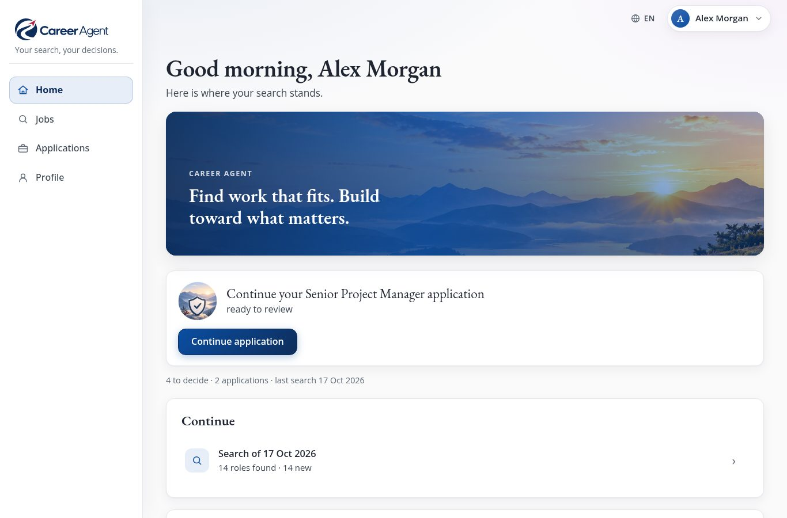
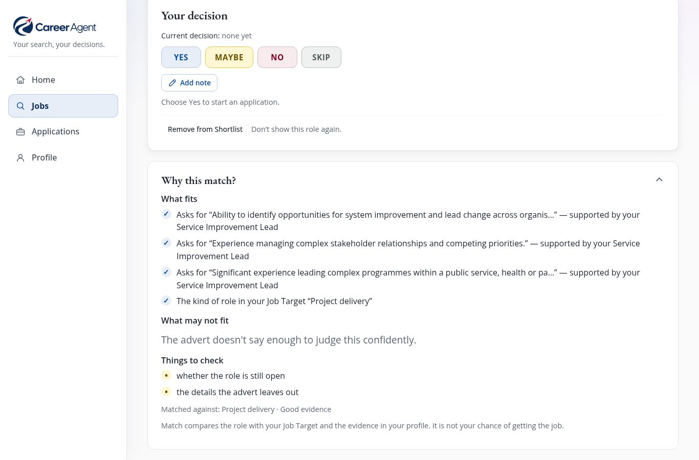
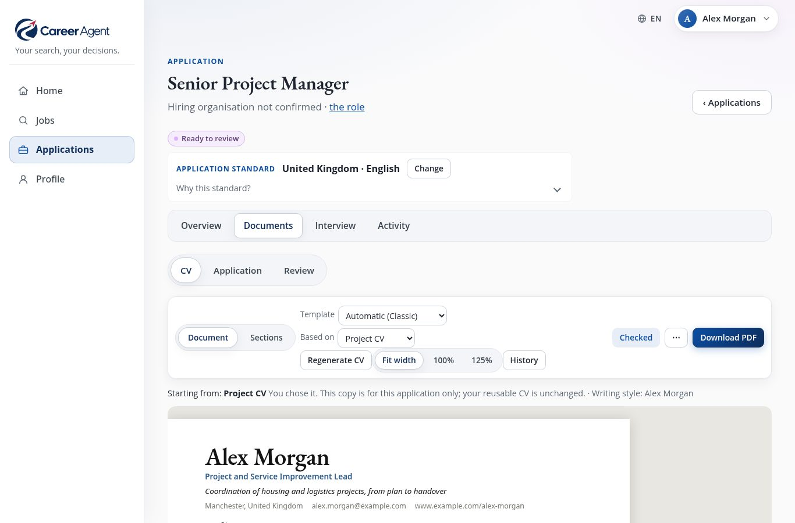
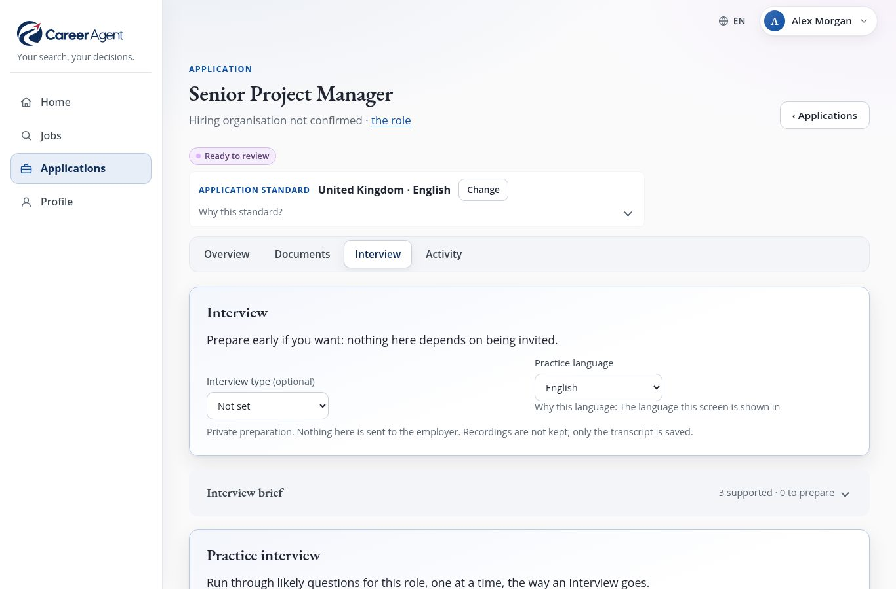

# Career Agent: the user guide

**English** · [Deutsch](manual.de.md) · [한국어](manual.ko.md) · [Français](manual.fr.md) · [Español](manual.es.md) · [Português](manual.pt.md)

<b>Your search, your decisions.</b> Free · runs on your own computer · six languages · version 1.0

---

## Career Agent in one minute

Looking for a new job usually means hours of scrolling job sites, copying adverts into notes, rewriting your CV
for every application and trying to remember who you wrote to and when.

**Career Agent does the heavy lifting for you, and leaves every decision to you.**

You tell it, in your own words, what kind of work you want. It then:

1. **searches the web for matching jobs**: job sites, employer websites, official listings;
2. **reads every advert** and checks the important facts (pay, location, contract, closing date) on the
   advert's own page;
3. **judges each job against what you asked for** and explains why, in plain sentences;
4. **keeps one tidy Shortlist** where you simply answer Yes, Maybe, No or Skip;
5. **writes a CV and cover letter tailored to the job**, using only facts from your own career history;
6. **helps you prepare for the interview**, including a practice interview you can answer out loud;
7. **keeps track of every application** and reminds you when to follow up.

It can even run a search for you **every week, on its own**, and send a short summary to your phone.

And one promise matters above all: **Career Agent never applies for a job, never contacts an employer and
never sends anything in your name.** It prepares; you decide and you send.

---

## What makes it different

- **It tells you why.** Every job comes with *What fits*, *What may not fit* and *Things to check*, not just
  a number.
- **Two questions, kept apart.** "Does this job suit me now?" (pay, hours, place, contract) and "Does it take
  me where I want to go?" are judged separately, because a job can be good for one and not the other.
- **It is honest about what it doesn't know.** If an advert doesn't mention the pay, Career Agent says so. A
  fact counts as *checked* only when it was read on the employer's page, an official listing or a reputable
  recruiter, never from a search summary.
- **Your CV stays true.** New documents are written from your own career information. Invented numbers, dates,
  job titles, names and qualifications are caught by automatic checks: an AI draft that invents them is not
  accepted, and your own edits that add them are shown to you as *Needs review*.
- **Your data stays with you.** Everything is stored on your own computer, not in someone else's cloud.
- **Seven interface languages.** English, German, Korean, French, Spanish and Portuguese (Portugal and
  Brazil). Applications can be written in any of them.

---

## New in version 1.0

- **Clearer scores.** The percentage is now the job's **fit with your job target**, with **Now** and **Career
  direction** beside it. Pay is only compared on the same basis, and "not essential" is no longer read as required.
- **A calmer Shortlist.** A **New** badge marks what the latest search found, **Find in this list** narrows it down,
  and one advert stays one job even when it is reached by a slightly different link. Changing a decision keeps the
  note you wrote.
- **Stricter honesty checks.** Invented organisations, degrees, certificates and licences are now caught as well.
- **Letters as PDFs.** The cover letter and the supporting statement download as PDFs, just like the CV.
- **After you apply.** Record an interview, an offer or a rejection straight after sending, with the **date it
  happened**.
- **Plain words when something goes wrong**, always with a way on.

---

## A quick tour: four areas

***Home** tells you what to do next. The pictures show the built-in example profile: a fictional person, real job adverts.*

You always see the same four areas: in a menu at the side on a computer or tablet, and in a bar at the bottom on
a phone.

| Area | What you do there |
| --- | --- |
| **Home** | See the one thing worth doing next, what is *Coming up*, and your latest searches. |
| **Jobs** | The **Shortlist** (jobs to decide on) and **Searches** (start a search, see past ones). |
| **Applications** | Every application you started, each with *Overview*, *Documents*, *Interview* and *Activity*, plus **Progress**, which shows where everything stands. |
| **Profile** | Everything about you: *About you*, *What I'm looking for*, *CVs and writing* and *Settings*. |

Home always offers **one** clear next step, for example *"5 roles need your decision"* with a **Review
shortlist** button. When there is nothing to do, it offers **Find opportunities**.

> **Tip:** if you are new, small guidance cards explain each page. You can switch them off and on again under
> **Profile → Settings → Show guidance**.

---

## Before you start: what you need

**Career Agent itself is free.** There is no subscription and no account, and it is open source (MIT licence).
The only cost is the AI it uses, which you pay to OpenAI directly (see below).

Career Agent is a program you run yourself, on your own computer or a small home server. It is not a website
you sign up to. That is what keeps your data private, but it means **the first setup needs someone
comfortable with computers**, once, for about an hour. The technical steps are in the
[README](../README.md#install) ("Install").

What you need:

- **A computer that can stay switched on**, ideally running Linux, if you want the weekly automatic search.
  For occasional use, any computer that can run it while you use it is enough.
- **An OpenAI account and an API key.** Career Agent uses OpenAI's AI to search, read adverts and write. The
  key is like a password that lets Career Agent use your account. OpenAI charges by use; set a monthly
  spending limit in your OpenAI account so there are no surprises.
- **A private network.** Career Agent has no login screen, so it must only be reachable from your own computer
  or your own private network, never from the open internet. Your helper will set this up.
- **Optional:** a Telegram account, if you would like the weekly summary on your phone.

What works **without** the AI key: reading everything already found, your decisions, editing your profile and
CVs, templates, the interview brief, reminders and tracking. Searching, writing documents, AI suggestions,
interview questions and feedback need the key.

### Your profile is created once

Your helper creates your profile by copying the included example profile (a fictional person called Alex
Morgan) and adjusting it. After that, **nearly everything is done in the browser**: your details, your career
history, what you are looking for, your CVs and your writing style.

---

## Step 1: Tell Career Agent about yourself

Open **Profile → About you**.

- **Personal details** and **Contact details**: what appears at the top of your CV.
- **Career information**: the facts your CVs and letters may use, as cards: jobs, qualifications,
  achievements, volunteering, skills. Use **Add entry** to add one.

The more honest detail you add here, the better your applications become. Career Agent only writes what it
can find here. If a job asks for something you haven't described, it says so (*Not evidenced*) instead of
making something up.

> **Example:** instead of "Managed projects", write "Led a team of 6 to move 400 customers to a new booking
> system in 2024, three weeks ahead of plan." Career Agent can then use those real numbers, and only those.

---

## Step 2: Say what you are looking for

Open **Profile → What I'm looking for** and choose **+ Add job target**. A *job target* is one kind of job you
want. You can have several, for example "Project management" and "Operations".

For each one you describe:

- **The kind of work**: job titles and the kind of role, in normal words.
- **What makes a role a match**: what the job really has to be about.
- **Location and remote**: where you can work, and whether remote or hybrid is fine.
- **Pay** and **Working pattern**: what you need to earn, and the days or hours that suit you.
- **What matters for this kind of job**, at four levels: *Required*, *Important*, *Useful* and *Avoid*.

How Career Agent treats your wishes:

| You say | What happens |
| --- | --- |
| **Must have / Required** | A job can be set aside if the advert **clearly** doesn't meet it. If the advert simply doesn't say, the job is **not** ruled out. |
| **Prefer / Important / Useful** | Makes a job a better match, but never rules one out on its own. |
| **Avoid** | Places you rule out leave out on-site jobs there. Anything else you list here is noted, not filtered. |

Each job target can be switched on or off, duplicated or deleted. Only switched-on targets are searched.

> **Tip:** you don't need to be perfect on the first try. Run a search, look at the results, and adjust.

---

## Step 3: Find jobs

Go to **Jobs → Searches** and choose **Find opportunities**.

1. Career Agent asks: **What should Career Agent look for?** Tick one or more job targets and choose **Find
   opportunities**.
2. A confirmation asks **Start the search?** It says what will be searched, that it can take several minutes,
   and that nothing is sent to anyone. Choose **Start search**. Nothing is set up before you confirm: if you
   cancel, no search is left behind.
3. The search's page opens. You can close it and keep using the app: the search carries on. Home and Searches
   show that a search is running and what it is doing right now, for example *"Checking the adverts"*.

While a search runs, Career Agent:

- searches the web for jobs that fit each target;
- sorts what it found and removes duplicates (the same job advertised on several sites appears **once**);
- sets aside jobs that clearly don't fit;
- opens each remaining advert and **checks** its facts on the advert's own page;
- compares every job with what you want and writes its reasoning.

When it finishes, the search page says **Search complete**, for example:

> *32 roles found · 9 ready to review · 23 filtered out. 7 are new. 2 were already known.*

and offers one button: **Review shortlist**. Beside the new roles, **See the new roles on your Shortlist**
opens the Shortlist with only the roles this search found for the first time.

Sometimes a search can't do all of its work:

- **Some web searches couldn't be done.** The result then says so, for example *"3 of its 40 web searches
  couldn't be done, so some roles may be missing. A new search will try them again."*
- **The search couldn't be done.** None of its web searches worked, so no roles were found. Choose **Search
  again**: Career Agent sets up a new search for the same job targets and asks **Start the search?** first, as
  usual.
- **The search stopped while it was reading the adverts.** Choose **Finish checking adverts**. It only reads
  the adverts already found; nothing is searched again, so it doesn't ask for confirmation.

If a search was interrupted (say the computer was switched off), its page offers **Continue search**. It picks
up where it stopped and doesn't repeat work it already finished.

---

## Step 4: Decide on your Shortlist

*The **Shortlist**: every job with its fit and four buttons to decide.*

**Jobs → Shortlist** collects the jobs that could suit you, from **every** search, in one list.

Each job shows the role, **who is hiring** (or *Hiring organisation not confirmed*, when an agency hides the
employer), its fit such as **"86% fit with your job target"**, a line such as **"Now: Strong · Career
direction: Limited"**, and four buttons. A **New** badge marks the jobs the latest search found for the first
time.

| Button | Meaning |
| --- | --- |
| **Yes** | I want to apply. This also **starts an application** for it. |
| **Maybe** | Interesting; decide later. |
| **No** | Not for me. |
| **Skip** | Not now. |

You can change your mind at any time; earlier decisions stay in the history. If you change only the decision,
the note you wrote with it is kept.

**What the percentage means:** how well the job fits what this job target asks for and the evidence in your
profile. It is **not** your chance of getting the job. The two other questions are rated separately, on the
line below: **Now** (does the job suit you now: pay, hours, place, contract?) and **Career direction** (does it
take you where you want to go?). Each reads *Strong*, *Mixed*, *Limited* or *Not enough information*.

Useful controls:

- **All · To decide · Yes · Maybe · No · Skip** to filter the list.
- **Looking for** to see only one job target; **Best match** or **Newest** to sort.
- **Find in this list**: type part of a role's name or an organisation to narrow the list.
- A very long list is loaded in parts: **Showing 500 of 620** and **Show more** at the bottom say so.
- **N filtered out · see why**: the jobs that can't fit (the advert has gone, it clearly fails a must have,
  or it didn't match closely enough). Nothing is deleted, and each one says why, quoting the advert.
- **Remove from Shortlist** hides a job you never want to see again. **Restore to Shortlist** brings it back.

---

## Step 5: Look at a job closely

***Why this match?** on a job's page: what fits, what may not fit and what to check.*

Click a job to open its page. At the top:

- the role, employer and place, and a line with the fit, pay, contract and closing date;
- **At a glance**: two or three sentences on what the job really is, written from the advert;
- **Your decision**: the four buttons, plus **Add note** for a reason or reminder to yourself. The note kept
  with your current decision is shown here.

The closing date is taken from the advert, also when it is only written in the text, for example *"Closing
date: 1 September 2026"*. Only a complete date counts; Career Agent never guesses one.

Below, three sections open when you click them:

- **Why this match?** *What fits*, *What may not fit*, *Useful for where you want to go* and *Things to check*.
- **Advert details**: every fact from the advert, each marked checked or not checked, a link to the original
  advert, and the sources.
- **Technical details**: for the curious; you never need it.

When Career Agent has little to go on, it says exactly why, for example *"We only have limited information
about this role"* or *"Advert no longer available"*.

---

## Step 6: Prepare an application

Choosing **Yes** on a job starts an application. Open it from the job (**Open application**) or from
**Applications**.

### Overview

Shows the next step as one button (for example **Generate CV**), the state of each document (*Ready*, *Needs
work*, *Missing*, *Not needed*), what your CV covers and what it doesn't yet. **Prepare everything at once**
does all the steps in one go and gives you a draft.

### Documents: CV, Application, Review

*A CV written for this one job, ready to check and download as a PDF.*

- **CV**: choose **Generate CV**. Career Agent tailors one of your reusable CVs to this job, using your career
  information, the job's requirements and your writing style. The CV appears **as the real page**, and you
  edit it right there, like a document.
- **Application**: the cover letter, a supporting statement, and answers to any questions you paste in from
  the employer's form.
- **AI help on any paragraph:** select text and choose **Improve wording**, **Shorten**, **Make it more
  concise**, **Emphasise relevance to this role** or **Ask AI…**. You always get a *suggestion* first: **Apply**, **Try again** or **Cancel**.
  Nothing changes until you apply it, and nothing is saved until you save.
- **Templates** change the look, never the words. **Sections** lets you reorder or hide parts of this CV
  without touching your profile.
- **History** keeps every version; you can go back to any of them.
- **Download PDF** for the CV, the cover letter and the supporting statement. If a PDF is missing, **Create
  PDF** makes it. When PDFs can't be made on this installation, Career Agent says so: open the preview and
  print it, or save it as a PDF from your browser. Downloaded files are named after the employer and the role.

**Checks.** Every document is checked against your career information: dates, numbers, names (of employers
and other organisations, for example) and qualifications such as degrees, certificates and licences. If the AI
writes something your evidence doesn't support, Career Agent tries again; if it still fails, it tells you and
saves nothing. What you write yourself is never blocked: it is marked *Needs review: 2 claims need
attention*, and you decide what to keep. When everything passes, you'll see *Dates, numbers, names and
qualifications checked against your evidence* with a reminder: *The checks cannot judge everything: read every
sentence before approving.*

### Review and approval

When you are happy, open **Review**. Career Agent shows exactly what you are approving: the CV, the letter,
the answers and the checks, and anything still to finish. Choose **Approve application**.

If you change anything after approving, Career Agent notices and asks you to review again. You can also **Ask
for changes**, **Put on hold** or **Withdraw**, with a short reason.

### Sending it: always you

**There is no "send" button, on purpose.** You send the application yourself, by email, on the employer's
website or by post. Then, under **Activity**, choose **Record submission** and note how you sent it. If you
sent it a few days ago, fill in the **date it happened** (left empty, it is today); the follow-up reminder
counts from that day. From that moment the documents are **kept as sent**, so you always know exactly what the
employer received.

---

## Step 7: Get ready for the interview

*Interview preparation: a short brief, likely questions and a practice interview.*

Every application has an **Interview** section. You can prepare long before an invitation.

- **Interview brief**: the organisation, what matters for this job, why you may fit, the gaps to prepare for,
  and good questions to ask them. It uses no AI.
- **Research [organisation] online** (optional): a short, focused look at the organisation on the web, offered
  when the advert names who is hiring.
- **Suggest likely questions**: the questions you are likely to be asked, each with points to cover taken
  from your own experience. Where you have no evidence yet, it says so honestly.
- **Practice**: answer a question **by typing or out loud**. Choose **Analyse answer** to get *What worked*,
  *What to improve* and *Try next time*, plus how often you used filler words. You can correct the written-down
  version of a spoken answer with **Edit transcript** first.
- **Practice interview**: five to seven questions in a row, with follow-ups and a summary at the end, like a
  real interview.

Career Agent can **read questions aloud** using your browser's own voice, free. Recordings are turned into text
and **never stored**: only the text is kept. Feedback is about what you said, never about how confident you
sounded.

> Speaking your answers needs a secure connection (an address starting with **https**, or the computer itself).
> If the microphone is unavailable, type your answers instead.

---

## Step 8: Follow up and keep track

- **Activity** (in each application): **Record a reply**, **Record interview**, **Record rejection**,
  **Record an offer** or **Record as closed**, with the full history below. Only the steps that fit where the
  application stands are offered. Straight after the submission you can record what actually came next (an
  interview, a rejection, an offer, or **Record as closed** when you never heard back) without recording a
  reply first. For a reply, and for a rejection or offer that is the first answer, you can give the **date it
  happened** (never a future one).
- **Applications → Progress**: all your applications at a glance, from *Preparing* to *Offer* or *Closed*.
- **Reminders**: Career Agent suggests them automatically: the interview, preparation two days before, a
  follow-up two weeks after you applied, and closing dates. You can add your own. They appear on Home under
  **Coming up**.
- **Add to calendar (.ics)** downloads a reminder you can open in your usual calendar app.

When an offer comes in, Career Agent records it, and that's all. Accepting, negotiating and deciding are yours.

---

## The weekly search and your phone

Once set up, Career Agent can search **automatically once a week** (the standard is Thursday at 7 in the
morning) and send a short summary to your **Telegram**: how many new jobs it found and what is coming up, with
links straight back into the app.

Your helper sets up the schedule and the Telegram connection. Afterwards you can switch messages on or off and
send yourself a test message under **Profile → Settings → Notifications & integrations**. If the computer was
off at the scheduled time, the search runs when it is next switched on.

The weekly search runs **with Telegram switched off too**: its roles appear on your Shortlist as usual; only
the message is left out. With Telegram on, if a weekly search fails or can't start, you get **one** short
message saying so and at which step it stopped. It never contains error details; your helper finds those on
the computer.

---

## Languages and countries

- Change the interface language with the **Language** selector. All seven languages are complete.
- Each application can be written in its own language, and for its own country's habits (for example, a UK CV
  differs from a German one). UK and International are ready to use; Germany, South Korea, the US and Ghana are
  included as drafts you review and approve first.

---

## Your data and your privacy

- Everything (your profile, searches, decisions, applications) is stored as ordinary files **on your own
  computer**. There is no Career Agent company account and no cloud database.
- **What goes to OpenAI**, only when you use an AI feature: search terms, the text of job adverts, and, when
  writing or practising, the parts of your career information, writing style and answers needed for that task.
  Career Agent asks OpenAI not to store these. Voice recordings are never kept.
- **Nothing is sent to employers.** The only messages Career Agent ever sends go to your own Telegram, if you
  switch it on: the weekly summary, or a short notice when a weekly search fails.
- **Back up your data.** Because it lives on your computer, make sure your helper sets up a regular backup.

---

## Honest limits

Career Agent is powerful, but it is good to know what it doesn't do:

- It never applies or contacts anyone for you. That is a promise, not a missing feature.
- There is no login screen. Keep it on your own computer or private network only.
- Your first profile is set up with files, once, by a helper.
- The CV, the cover letter and the supporting statement become PDFs; answers to an employer's questions do
  not. There is no Word format.
- Calendars get a downloadable file; there is no live connection to Google or Outlook calendars.
- Automatic checks catch invented numbers, dates, titles, names and qualifications, but not every subtle
  exaggeration. Always read your documents before you approve them.
- The AI can misjudge a job now and then. That is why every judgement comes with its reasons, and why you
  decide.

---

## When something goes wrong

| You see | What it means and what to do |
| --- | --- |
| *AI is busy right now* | OpenAI is overloaded. Career Agent already tried again; wait a minute and choose Retry. |
| *AI usage limit reached* | Your OpenAI account has reached its spending limit. Raise it in your OpenAI account; retrying won't help. |
| *AI generation is not configured* | The AI key is missing. Ask your helper to add it. |
| *Not fully checked* | The advert's own page couldn't be read, so its facts are unconfirmed. Open the original advert and check yourself. |
| *Hiring organisation not confirmed* | The advert (often an agency's) doesn't say who the employer is. |
| *This changed since you opened it. Reload before saving.* | The document was changed elsewhere (another tab). Reload, then make your edit again. |
| The microphone doesn't work | Use a secure (https) address, allow the microphone in your browser, or type your answer. |
| *Career Agent isn't answering* or *This page could not be loaded* | Check that Career Agent is still running (ask your helper if needed), then choose **Reload**. |
| *The search couldn't be done* | None of its web searches worked. Nothing was sent. Choose **Search again**; if it fails again, ask your helper to check the AI key. |
| *3 of its 40 web searches couldn't be done* | The search finished, but some roles may be missing. Nothing to do: the next search tries them again. |
| A search seems stuck | Open it from **Searches**. If it was interrupted, choose **Continue search**. If it stopped while reading the adverts, choose **Finish checking adverts**. |

---

## Small dictionary

| Word | Meaning |
| --- | --- |
| **Job target** | One kind of job you want Career Agent to look for. |
| **Search** | One trip through the web looking for your job targets. |
| **Shortlist** | Every job that could suit you, from all searches, in one list. |
| **Checked** | A fact read on the advert's own page or another reliable source. |
| **Filtered out** | Set aside because it can't fit; never deleted, always explained. |
| **Reusable CV** | Your own starting CV. Each application gets a tailored copy; the original stays unchanged. |
| **Approve** | Your explicit "yes, these documents are ready", tied to their exact content. |
| **Kept as sent** | After you record a submission, the documents are frozen as the employer received them. |

---

*Career Agent is free, open-source software (MIT licence). For installation and technical documentation, see
the [README](../README.md).*
