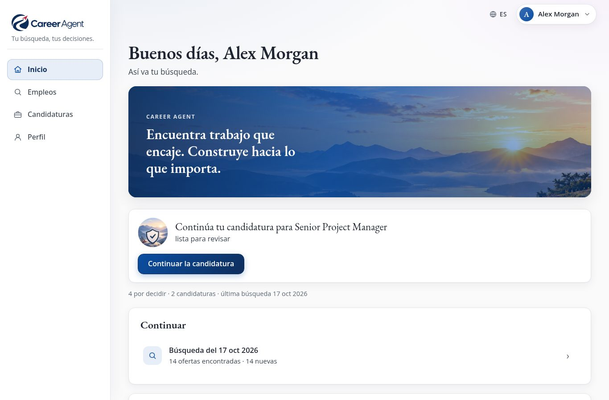
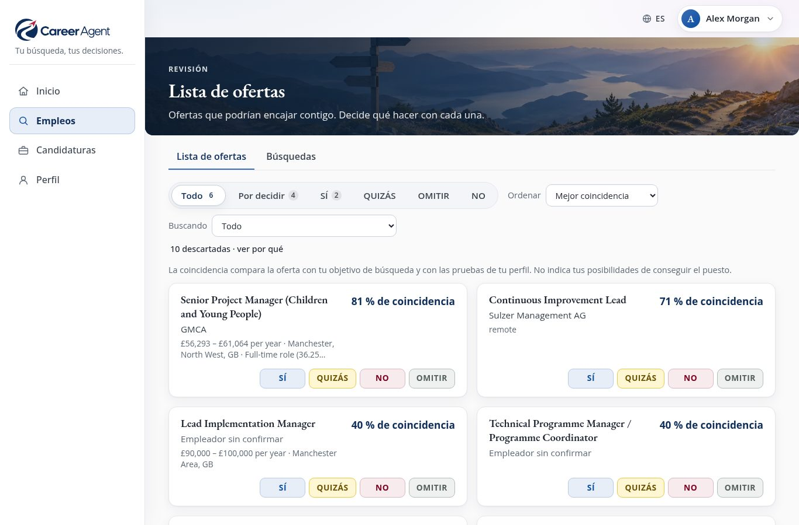
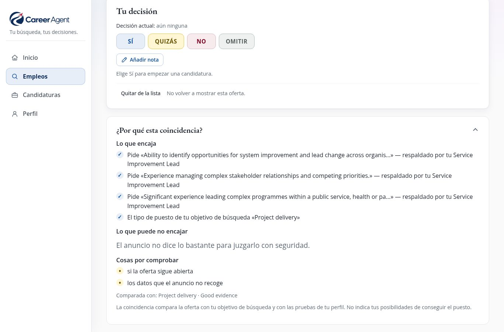
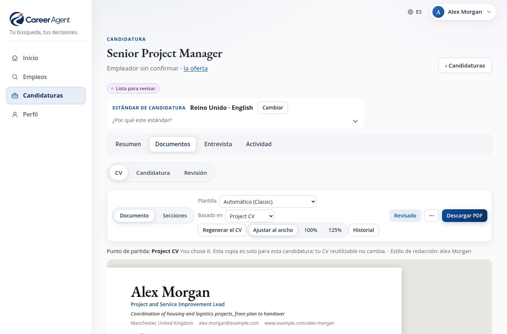
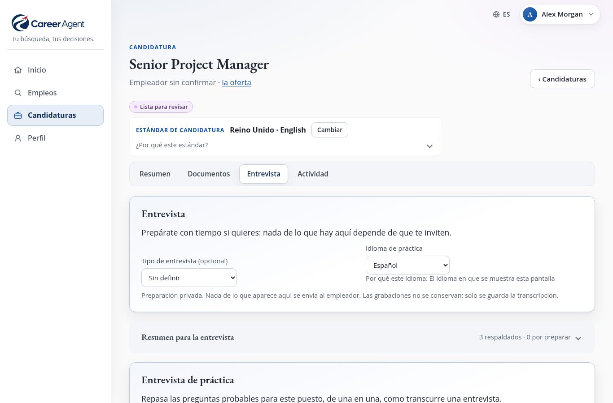

# Career Agent: la guía de uso

[English](manual.en.md) · [Deutsch](manual.de.md) · [한국어](manual.ko.md) · [Français](manual.fr.md) · **Español** · [Português](manual.pt.md)

<b>Tu búsqueda, tus decisiones.</b> Gratis · funciona en tu propio ordenador · seis idiomas · versión 1.0

---

## Career Agent en un minuto

Buscar un trabajo nuevo suele significar horas recorriendo portales de empleo, copiando anuncios en notas,
reescribiendo el CV para cada candidatura e intentando recordar a quién escribiste y cuándo.

**Career Agent hace el trabajo pesado por ti y deja todas las decisiones en tus manos.**

Le cuentas, con tus propias palabras, qué tipo de trabajo quieres. Después:

1. **busca en internet empleos que encajen**: portales de empleo, webs de empleadores, convocatorias oficiales;
2. **lee cada anuncio** y comprueba los datos importantes (salario, ubicación, contrato, fecha límite) en la
   propia página del anuncio;
3. **valora cada empleo según lo que pediste** y te explica por qué, con frases sencillas;
4. **mantiene una única Lista de ofertas ordenada**, en la que solo tienes que responder Sí, Quizás, No u Omitir;
5. **redacta un CV y una carta de presentación adaptados al puesto**, usando solo datos de tu propia trayectoria;
6. **te ayuda a preparar la entrevista**, incluida una entrevista de práctica que puedes responder en voz alta;
7. **lleva el seguimiento de cada candidatura** y te recuerda cuándo conviene volver a escribir.

Incluso puede hacer una búsqueda por ti **cada semana, por su cuenta**, y enviarte un breve resumen al móvil.

Y hay una promesa que importa por encima de todo: **Career Agent nunca se postula a un empleo, nunca contacta con
un empleador y nunca envía nada en tu nombre.** Él prepara; tú decides y tú envías.

---

## Qué lo hace diferente

- **Te dice por qué.** Cada empleo viene con *Lo que encaja*, *Lo que puede no encajar* y *Cosas por comprobar*,
  no solo con una cifra.
- **Dos preguntas, por separado.** «¿Me conviene este empleo ahora?» (salario, horario, lugar, contrato) y «¿Me
  lleva adonde quiero llegar?» se valoran por separado, porque un empleo puede ser bueno para una cosa y no para
  la otra.
- **Es sincero sobre lo que no sabe.** Si un anuncio no menciona el salario, Career Agent lo dice. Un dato solo
  cuenta como *comprobado* cuando se ha leído en la página del empleador, en una convocatoria oficial o en una
  empresa de selección de confianza, nunca en un resumen de búsqueda.
- **Tu CV sigue siendo verdadero.** Los documentos nuevos se redactan a partir de tu propia información
  profesional. Las cifras, fechas, cargos, nombres y titulaciones inventados se detectan con comprobaciones
  automáticas: un borrador de la IA que los invente no se acepta, y los cambios tuyos que los añadan se te
  muestran como *Por revisar*.
- **Tus datos se quedan contigo.** Todo se guarda en tu propio ordenador, no en la nube de otra persona.
- **Siete idiomas de interfaz.** Inglés, alemán, coreano, francés, español y portugués (de Portugal y de Brasil).
  Las candidaturas se pueden redactar en cualquiera de ellos.

---

## Novedades de la versión 1.0

- **Puntuaciones más claras.** El porcentaje es ahora la **coincidencia con tu objetivo de búsqueda**, con
  **Ahora** y **Trayectoria profesional** al lado. El salario solo se compara sobre la misma base, y «no
  imprescindible» ya no se lee como un requisito.
- **Una Lista de ofertas más tranquila.** Una etiqueta **Nuevo** marca lo que encontró la última búsqueda,
  **Buscar en esta lista** la acota, y un mismo anuncio sigue siendo un solo empleo aunque llegue por un enlace algo
  distinto. Cambiar una decisión conserva la nota que escribiste.
- **Comprobaciones de honestidad más estrictas.** Ahora también se detectan organizaciones, títulos, certificados y
  licencias inventados.
- **Cartas en PDF.** La carta de presentación y la declaración de adecuación al puesto se descargan en PDF, igual
  que el CV.
- **Después de enviar.** Registra una entrevista, una propuesta o un rechazo justo después del envío, con la
  **fecha en que ocurrió**.
- **Palabras claras cuando algo falla**, siempre con un siguiente paso.

---

## Un recorrido rápido: cuatro áreas

*La página de **Inicio** te dice qué hacer a continuación. Las imágenes muestran el perfil de ejemplo incluido: una persona ficticia, ofertas de empleo reales.*

Siempre ves las mismas cuatro áreas: en un menú lateral en el ordenador o la tableta, y en una barra inferior en
el móvil.

| Área | Qué haces allí |
| --- | --- |
| **Inicio** | Ves lo único que merece la pena hacer a continuación, lo que viene *Próximamente* y tus búsquedas más recientes. |
| **Empleos** | La **Lista de ofertas** (empleos sobre los que decidir) y **Búsquedas** (iniciar una búsqueda, ver las anteriores). |
| **Candidaturas** | Todas las candidaturas que has empezado, cada una con *Resumen*, *Documentos*, *Entrevista* y *Actividad*, además de **Progreso**, que muestra en qué punto está todo. |
| **Perfil** | Todo sobre ti: *Sobre ti*, *Lo que busco*, *CV y redacción* y *Ajustes*. |

Inicio siempre te propone **un** paso siguiente claro, por ejemplo *«5 ofertas necesitan tu decisión»* con un
botón **Revisar la lista**. Cuando no hay nada pendiente, te propone **Buscar ofertas**.

> **Consejo:** si eres nuevo, unas pequeñas tarjetas de orientación explican cada página. Puedes desactivarlas y
> volver a activarlas en **Perfil → Ajustes → Mostrar orientación**.

---

## Antes de empezar: lo que necesitas

**Career Agent en sí es gratuito.** Sin suscripción ni cuenta, y su código es abierto (licencia MIT). El único
coste es el de la IA, que pagas directamente a OpenAI (ver más abajo).

Career Agent es un programa que instalas y ejecutas tú, en tu propio ordenador o en un pequeño servidor
doméstico. No es una web en la que te registras. Eso es lo que mantiene tus datos en privado, pero significa que
**la primera configuración necesita a alguien que se maneje bien con los ordenadores**, una sola vez y durante
más o menos una hora. Los pasos técnicos están en el [README](../README.md#install) («Install»).

Lo que necesitas:

- **Un ordenador que pueda quedarse encendido**, idealmente con Linux, si quieres la búsqueda automática
  semanal. Para un uso ocasional basta con cualquier ordenador que pueda ejecutarlo mientras lo usas.
- **Una cuenta de OpenAI y una clave de API.** Career Agent usa la IA de OpenAI para buscar, leer anuncios y
  redactar. La clave es como una contraseña que permite a Career Agent usar tu cuenta. OpenAI cobra según el
  uso; fija un límite de gasto mensual en tu cuenta de OpenAI para evitar sorpresas.
- **Una red privada.** Career Agent no tiene pantalla de inicio de sesión, así que solo debe ser accesible
  desde tu propio ordenador o tu propia red privada, nunca desde internet abierto. La persona que te ayude lo
  dejará configurado.
- **Opcional:** una cuenta de Telegram, si quieres recibir el resumen semanal en el móvil.

Lo que funciona **sin** la clave de IA: leer todo lo que ya se ha encontrado, tus decisiones, editar tu perfil y
tus CV, las plantillas, el resumen para la entrevista, los recordatorios y el seguimiento. Para buscar, redactar
documentos, las sugerencias de la IA, las preguntas de entrevista y los comentarios sobre tus respuestas hace
falta la clave.

### Tu perfil se crea una sola vez

La persona que te ayude crea tu perfil copiando el perfil de ejemplo incluido (una persona ficticia llamada Alex
Morgan) y adaptándolo. A partir de ahí, **casi todo se hace en el navegador**: tus datos, tu trayectoria, lo que
buscas, tus CV y tu estilo de redacción.

---

## Paso 1: Cuéntale a Career Agent quién eres

Abre **Perfil → Sobre ti**.

- **Datos personales** y **Datos de contacto**: lo que aparece en la parte superior de tu CV.
- **Trayectoria profesional**: los datos que pueden usar tus CV y cartas, en forma de tarjetas: empleos,
  titulaciones, logros, voluntariado, competencias. Usa **Añadir entrada** para añadir una.

Cuanto más detalle sincero añadas aquí, mejores serán tus candidaturas. Career Agent solo escribe lo que puede
encontrar aquí. Si un empleo pide algo que no has descrito, lo dice (*Sin pruebas*) en lugar de inventárselo.

> **Ejemplo:** en lugar de «Gestioné proyectos», escribe «Dirigí un equipo de 6 personas para pasar a 400
> clientes a un nuevo sistema de reservas en 2024, tres semanas antes de lo previsto». Así Career Agent puede
> usar esas cifras reales, y solo esas.

---

## Paso 2: Di qué estás buscando

Abre **Perfil → Lo que busco** y elige **+ Añadir objetivo de búsqueda**. Un *objetivo de búsqueda* es un tipo
de empleo que quieres. Puedes tener varios, por ejemplo «Gestión de proyectos» y «Operaciones».

Para cada uno describes:

- **El tipo de trabajo**: cargos y tipo de puesto, con palabras normales.
- **Qué hace que una oferta coincida**: de qué tiene que tratar realmente el empleo.
- **Ubicación y remoto**: dónde puedes trabajar y si te va bien el trabajo en remoto o híbrido.
- **Salario** y **Jornada y disponibilidad**: lo que necesitas ganar y los días u horas que te convienen.
- **Lo que importa en este tipo de empleo**, en cuatro niveles: *Imprescindible*, *Importante*, *Útil* y
  *Evitar*.

Cómo trata Career Agent tus deseos:

| Tú dices | Qué ocurre |
| --- | --- |
| **Requisito obligatorio / Imprescindible** | Un empleo puede quedar apartado si el anuncio **claramente** no lo cumple. Si el anuncio simplemente no lo dice, el empleo **no** se descarta. |
| **Preferencias / Importante / Útil** | Hace que un empleo coincida mejor, pero por sí solo nunca descarta ninguno. |
| **Evitar** | Los lugares que descartas dejan fuera los empleos presenciales allí. Todo lo demás que pongas aquí se tiene en cuenta, pero no se filtra. |

Cada objetivo de búsqueda se puede activar o desactivar, duplicar o eliminar. Solo se buscan los objetivos
activados.

> **Consejo:** no hace falta que te salga perfecto a la primera. Haz una búsqueda, mira los resultados y ajusta.

---

## Paso 3: Encuentra empleos

Ve a **Empleos → Búsquedas** y elige **Buscar ofertas**.

1. Career Agent te pregunta: **¿Qué debe buscar Career Agent?** Marca uno o varios objetivos de búsqueda y elige
   **Buscar ofertas**.
2. Una confirmación pregunta **¿Iniciar la búsqueda?** Dice qué se va a buscar, que puede tardar varios minutos y
   que no se envía nada a nadie. Elige **Iniciar búsqueda**. No se crea nada antes de que confirmes: si cancelas,
   no queda ninguna búsqueda en el historial.
3. Se abre la página de la búsqueda. Puedes cerrarla y seguir usando la aplicación: la búsqueda sigue adelante.
   Inicio y Búsquedas muestran que hay una búsqueda en curso y lo que está haciendo en ese momento, por ejemplo
   *«Comprobando los anuncios»*.

Mientras se hace una búsqueda, Career Agent:

- busca en internet empleos que encajen con cada objetivo;
- ordena lo que ha encontrado y elimina los duplicados (el mismo empleo anunciado en varios sitios aparece
  **una sola vez**);
- aparta los empleos que claramente no encajan;
- abre cada anuncio restante y **comprueba** sus datos en la propia página del anuncio;
- compara cada empleo con lo que quieres y escribe su razonamiento.

Cuando termina, la página de la búsqueda dice **Búsqueda completada**, por ejemplo:

> *32 ofertas encontradas · 9 listas para revisar · 23 descartadas. 7 son nuevas. 2 ya eran conocidas.*

y te ofrece un solo botón: **Revisar la lista**. Junto a las ofertas nuevas, **Ver las ofertas nuevas en tu
lista** abre la Lista de ofertas solo con las que esta búsqueda encontró por primera vez.

A veces una búsqueda no puede hacer todo su trabajo:

- **Algunas búsquedas en la web no se pudieron hacer.** El resultado lo dice, por ejemplo *«3 de sus 40
  búsquedas en la web no se pudieron hacer, así que pueden faltar algunas ofertas. Una nueva búsqueda las
  intentará de nuevo.»*
- **No se pudo hacer la búsqueda.** Ninguna de sus búsquedas en la web funcionó, así que no se encontró ninguna
  oferta. Elige **Buscar de nuevo**: Career Agent prepara una búsqueda nueva para los mismos objetivos y, como
  siempre, pregunta antes **¿Iniciar la búsqueda?**
- **La búsqueda se detuvo mientras leía los anuncios.** Elige **Terminar de comprobar los anuncios**. Solo se leen
  los anuncios ya encontrados; no se vuelve a buscar nada, por eso no pide confirmación.

Si una búsqueda se interrumpió (por ejemplo, porque se apagó el ordenador), su página te ofrece **Continuar
búsqueda**. Retoma el trabajo donde se quedó y no repite lo que ya había terminado.

---

## Paso 4: Decide sobre tu Lista de ofertas

*La **Lista de ofertas**: cada empleo con su coincidencia con tu objetivo y cuatro botones para decidir.*

**Empleos → Lista de ofertas** reúne en una sola lista los empleos que podrían encajar contigo, procedentes de
**todas** las búsquedas.

Cada empleo muestra el puesto, **quién contrata** (o *Empleador sin confirmar*, cuando una agencia oculta al
empleador), su coincidencia, como **«86 % de coincidencia con tu objetivo de búsqueda»**, una línea como
**«Ahora: Alta · Trayectoria profesional: Limitada»** y cuatro botones. Una etiqueta **Nuevo** marca los empleos
que la última búsqueda encontró por primera vez.

| Botón | Significado |
| --- | --- |
| **Sí** | Quiero postularme. Además, **inicia una candidatura** para ese empleo. |
| **Quizás** | Me interesa; lo decido más adelante. |
| **No** | No es para mí. |
| **Omitir** | Ahora no. |

Puedes cambiar de opinión en cualquier momento; las decisiones anteriores se quedan en el historial. Si solo
cambias la decisión, la nota que escribiste con ella se conserva.

**Qué significa el porcentaje:** lo bien que encaja el empleo con lo que pide este objetivo de búsqueda y con las
pruebas de tu perfil. **No** indica tus posibilidades de conseguir el puesto. Las otras dos preguntas se valoran
por separado, en la línea de debajo: **Ahora** (¿me conviene el empleo ahora: salario, horario, lugar,
contrato?) y **Trayectoria profesional** (¿me lleva adonde quiero llegar?). Cada una dice *Alta*, *Mixta*,
*Limitada* o *Información insuficiente*.

Controles útiles:

- **Todo · Por decidir · Sí · Quizás · No · Omitir** para filtrar la lista.
- **Buscando** para ver un solo objetivo de búsqueda; **Mejor coincidencia** o **Más recientes** para ordenar.
- **Buscar en esta lista**: escribe parte del nombre de un puesto o de una organización para acotar la lista.
- Una lista muy larga se carga por partes: **Mostrando 500 de 620** y **Mostrar más**, al final, lo indican.
- **N descartadas · ver por qué**: los empleos que no pueden encajar (el anuncio ya no está, claramente no
  cumple un requisito obligatorio o no coincidía lo suficiente). No se borra nada, y cada uno explica por qué,
  citando el anuncio.
- **Quitar de la lista** oculta un empleo que no quieres volver a ver nunca. **Restaurar en la lista** lo
  recupera.

---

## Paso 5: Mira un empleo de cerca

***¿Por qué esta coincidencia?** en la página de un empleo: lo que encaja, lo que puede no encajar y lo que conviene comprobar.*

Haz clic en un empleo para abrir su página. Arriba verás:

- el puesto, el empleador y el lugar, y una línea con la coincidencia, el salario, el contrato y la fecha límite;
- **De un vistazo**: dos o tres frases sobre lo que es realmente el empleo, redactadas a partir del anuncio;
- **Tu decisión**: los cuatro botones, más **Añadir nota** para apuntarte un motivo o un recordatorio. Aquí se
  muestra la nota que acompaña a tu decisión actual.

La fecha límite se toma del anuncio, también cuando solo aparece escrita en el texto, por ejemplo *«Fecha límite:
1 de septiembre de 2026»*. Solo cuenta una fecha completa; Career Agent nunca la adivina.

Debajo, tres secciones se abren al hacer clic en ellas:

- **¿Por qué esta coincidencia?** *Lo que encaja*, *Lo que puede no encajar*, *Útil para la dirección que
  quieres seguir* y *Cosas por comprobar*.
- **Detalles del anuncio**: cada dato del anuncio, marcado como comprobado o sin comprobar, un enlace al anuncio
  original y las fuentes.
- **Detalles técnicos**: para curiosos; nunca te hará falta.

Cuando Career Agent tiene poca información, te dice exactamente por qué, por ejemplo *«Solo tenemos información
limitada sobre este puesto»* o *«Anuncio ya no disponible»*.

---

## Paso 6: Prepara una candidatura

Al elegir **Sí** en un empleo se inicia una candidatura. Ábrela desde el empleo (**Abrir candidatura**) o desde
**Candidaturas**.

### Resumen

Muestra el siguiente paso como un solo botón (por ejemplo **Generar el CV**), el estado de cada documento
(*Listo*, *Por mejorar*, *Falta*, *No hace falta*), lo que cubre tu CV y lo que todavía no. **Preparar todo de
una vez** hace todos los pasos de una sola vez y te entrega un borrador.

### Documentos: CV, Candidatura, Revisión

*Un CV escrito para este empleo concreto, listo para revisar y descargar en PDF.*

- **CV**: elige **Generar el CV**. Career Agent adapta uno de tus CV reutilizables a este empleo, usando tu
  información profesional, los requisitos del puesto y tu estilo de redacción. El CV aparece **como la página
  real**, y lo editas ahí mismo, como un documento.
- **Candidatura**: la carta de presentación, una declaración de apoyo y las respuestas a las preguntas que
  pegues del formulario del empleador.
- **Ayuda de la IA en cualquier párrafo:** selecciona un texto y elige **Mejorar la redacción**, **Acortar**,
  **Hacerlo más conciso**, **Destacar la relevancia para este puesto** o **Preguntar a la IA…**. Siempre recibes primero una *sugerencia*:
  **Aplicar**, **Intentar de nuevo** o **Cancelar**. No cambia nada hasta que la aplicas, y no se guarda nada
  hasta que guardas.
- **Plantillas** cambian el aspecto, nunca las palabras. **Secciones** te permite reordenar u ocultar partes de
  este CV sin tocar tu perfil.
- **Historial** guarda todas las versiones; puedes volver a cualquiera de ellas.
- **Descargar PDF** para el CV, la carta de presentación y la declaración de adecuación al puesto. Si falta un
  PDF, **Crear PDF** lo genera. Si en esta instalación no se pueden crear PDF, Career Agent lo dice: abre la vista
  previa e imprímela, o guárdala como PDF desde el navegador. Los archivos descargados llevan el nombre del
  empleador y del puesto.

**Comprobaciones.** Cada documento se comprueba con tu información profesional: fechas, cifras, nombres (por
ejemplo, de empleadores y otras organizaciones) y titulaciones como títulos, certificados y licencias. Si la IA
escribe algo que tus pruebas no respaldan, Career Agent lo intenta de nuevo; si sigue fallando, te lo dice y no
guarda nada. Lo que escribes tú nunca se bloquea: se marca como *Revisar: 2 afirmaciones requieren atención*, y
tú decides qué conservar. Cuando todo pasa, verás *Fechas, cifras, nombres y titulaciones comprobados con tus
pruebas* con un recordatorio: *Las comprobaciones no lo pueden juzgar todo: lee cada frase antes de aprobar.*

### Revisión y aprobación

Cuando estés conforme, abre **Revisión**. Career Agent te muestra exactamente lo que vas a aprobar: el CV, la
carta, las respuestas y las comprobaciones, y todo lo que aún falte por terminar. Elige **Aprobar candidatura**.

Si cambias algo después de aprobarla, Career Agent lo detecta y te pide que la revises de nuevo. También puedes
**Pedir cambios**, **Poner en pausa** o **Retirar**, indicando un breve motivo.

### El envío: siempre lo haces tú

**No hay ningún botón de «enviar», y es a propósito.** Tú envías la candidatura, por correo electrónico, en la
web del empleador o por correo postal. Después, en **Actividad**, elige **Registrar el envío** y anota cómo la
enviaste. Si la enviaste hace unos días, indica la **fecha en que ocurrió** (si la dejas vacía, es hoy); el
recordatorio de seguimiento cuenta desde ese día. A partir de ese momento los documentos se **conservan tal como
se enviaron**, así que siempre sabes exactamente qué recibió el empleador.

---

## Paso 7: Prepárate para la entrevista

*La preparación de la entrevista: un breve resumen, las preguntas probables y una entrevista de práctica.*

Cada candidatura tiene una sección **Entrevista**. Puedes prepararte mucho antes de recibir una invitación.

- **Resumen para la entrevista**: la organización, lo que importa en este puesto, por qué podrías encajar, las
  carencias que conviene preparar y buenas preguntas para hacerles. No usa la IA.
- **Investigar [organización] en internet** (opcional): un vistazo breve y centrado a la organización en
  internet, disponible cuando el anuncio indica quién contrata.
- **Sugerir preguntas probables**: las preguntas que probablemente te harán, cada una con puntos que tratar
  sacados de tu propia experiencia. Cuando todavía no tienes pruebas de algo, lo dice con sinceridad.
- **Práctica**: responde a una pregunta **por escrito o en voz alta**. Elige **Analizar respuesta** para obtener
  *Lo que funcionó*, *Qué mejorar* y *Para la próxima vez*, además de cuántas muletillas usaste. Antes puedes
  corregir la versión escrita de una respuesta hablada con **Editar transcripción**.
- **Entrevista de práctica**: de cinco a siete preguntas seguidas, con repreguntas y un resumen al final, como
  en una entrevista real.

Career Agent puede **leer las preguntas en voz alta** con la voz de tu propio navegador, gratis. Las
grabaciones se convierten en texto y **nunca se guardan**: solo se conserva el texto. Los comentarios tratan
sobre lo que dijiste, nunca sobre lo seguro que sonabas.

> Para responder hablando necesitas una conexión segura (una dirección que empiece por **https**, o el propio
> ordenador). Si el micrófono no está disponible, escribe tus respuestas.

---

## Paso 8: Haz el seguimiento y no pierdas el hilo

- **Actividad** (en cada candidatura): **Registrar una respuesta**, **Registrar una entrevista**, **Registrar un
  rechazo**, **Registrar una propuesta** o **Registrar como cerrada**, con el historial completo debajo. Solo se
  ofrecen los pasos que corresponden a la situación de la candidatura. Justo después del envío puedes registrar
  lo que realmente pasó después (una entrevista, un rechazo, una propuesta, o **Registrar como cerrada** si nunca
  te contestaron) sin registrar antes una respuesta. Para una respuesta, y para un rechazo o una propuesta que sea
  la primera respuesta, puedes indicar la **fecha en que ocurrió** (nunca una futura).
- **Candidaturas → Progreso**: todas tus candidaturas de un vistazo, desde *En preparación* hasta *Propuesta* o
  *Cerradas*.
- **Recordatorios**: Career Agent los sugiere automáticamente: la entrevista, la preparación dos días antes, un
  seguimiento dos semanas después de postularte y las fechas límite. Puedes añadir los tuyos. Aparecen en Inicio,
  en **Próximamente**.
- **Añadir al calendario (.ics)** descarga un recordatorio que puedes abrir en tu aplicación de calendario
  habitual.

Cuando llega una propuesta, Career Agent la registra, y nada más. Aceptar, negociar y decidir te corresponde a
ti.

---

## La búsqueda semanal y tu móvil

Una vez configurado, Career Agent puede buscar **automáticamente una vez por semana** (por defecto, los jueves a
las 7 de la mañana) y enviarte un breve resumen a **Telegram**: cuántos empleos nuevos ha encontrado y lo que
viene próximamente, con enlaces que te llevan directamente a la aplicación.

La persona que te ayude configura la programación y la conexión con Telegram. Después puedes activar o
desactivar los mensajes y enviarte un mensaje de prueba en **Perfil → Ajustes → Notificaciones e
integraciones**. Si el ordenador estaba apagado a la hora programada, la búsqueda se hace la próxima vez que se
encienda.

La búsqueda semanal se hace **también con Telegram desactivado**: sus ofertas aparecen en tu Lista de ofertas
como siempre; solo se omite el mensaje. Con Telegram activado, si una búsqueda semanal falla o no puede empezar,
recibes **un único** mensaje breve que lo dice e indica en qué paso se detuvo. Nunca contiene detalles del
error; la persona que te ayude los encuentra en el ordenador.

---

## Idiomas y países

- Cambia el idioma de la interfaz con el selector **Idioma**. Los siete idiomas están completos.
- Cada candidatura puede redactarse en su propio idioma y según las costumbres de su país (por ejemplo, un CV
  del Reino Unido es distinto de uno alemán). Reino Unido e Internacional están listos para usar; Alemania,
  Corea del Sur, Estados Unidos y Ghana se incluyen como borradores que revisas y apruebas primero.

---

## Tus datos y tu privacidad

- Todo (tu perfil, tus búsquedas, decisiones y candidaturas) se guarda como archivos normales **en tu propio
  ordenador**. No hay ninguna cuenta en una empresa Career Agent ni ninguna base de datos en la nube.
- **Lo que va a OpenAI**, solo cuando usas una función de IA: los términos de búsqueda, el texto de los anuncios
  y, cuando redactas o practicas, las partes de tu información profesional, tu estilo de redacción y tus
  respuestas que hacen falta para esa tarea. Career Agent pide a OpenAI que no los guarde. Las grabaciones de voz
  nunca se conservan.
- **No se envía nada a los empleadores.** Los únicos mensajes que envía Career Agent van a tu propio Telegram, si
  lo activas: el resumen semanal, o un aviso breve cuando una búsqueda semanal falla.
- **Haz copias de seguridad de tus datos.** Como están en tu ordenador, asegúrate de que la persona que te ayude
  configure una copia de seguridad periódica.

---

## Límites, con sinceridad

Career Agent es potente, pero conviene saber lo que no hace:

- Nunca se postula ni contacta con nadie por ti. Es una promesa, no una función que falte.
- No hay pantalla de inicio de sesión. Mantenlo solo en tu propio ordenador o en tu red privada.
- Tu primer perfil se configura con archivos, una sola vez, con ayuda de otra persona.
- El CV, la carta de presentación y la declaración de adecuación al puesto se convierten en PDF; las respuestas a
  las preguntas de un empleador, no. No hay formato Word.
- Para el calendario se descarga un archivo; no hay conexión directa con los calendarios de Google ni de Outlook.
- Las comprobaciones automáticas detectan cifras, fechas, cargos, nombres y titulaciones inventados, pero no
  todas las exageraciones sutiles. Lee siempre tus documentos antes de aprobarlos.
- La IA puede equivocarse al valorar un empleo de vez en cuando. Por eso cada valoración viene con sus motivos, y
  por eso decides tú.

---

## Cuando algo no funciona

| Ves | Qué significa y qué hacer |
| --- | --- |
| *La IA está ocupada en este momento* | OpenAI está saturado. Career Agent ya lo ha vuelto a intentar; espera un minuto y elige Reintentar. |
| *Se alcanzó el límite de uso de la IA* | Tu cuenta de OpenAI ha llegado a su límite de gasto. Súbelo en tu cuenta de OpenAI; volver a intentarlo no servirá. |
| *La generación con IA no está configurada* | Falta la clave de IA. Pide a la persona que te ayuda que la añada. |
| *No comprobada del todo* | No se pudo leer la propia página del anuncio, así que sus datos están sin confirmar. Abre el anuncio original y compruébalo tú. |
| *Empleador sin confirmar* | El anuncio (a menudo de una agencia) no dice quién es el empleador. |
| *Esto ha cambiado desde que lo abriste. Recarga antes de guardar.* | El documento se cambió en otro sitio (otra pestaña). Recarga y vuelve a hacer tu cambio. |
| El micrófono no funciona | Usa una dirección segura (https), permite el micrófono en tu navegador o escribe tu respuesta. |
| *Career Agent no responde* o *No se pudo cargar esta página* | Comprueba que Career Agent sigue en marcha (pregunta a la persona que te ayude si hace falta) y elige **Recargar**. |
| *No se pudo hacer la búsqueda* | Ninguna de sus búsquedas en la web funcionó. No se envió nada. Elige **Buscar de nuevo**; si vuelve a fallar, pide que revisen la clave de la IA. |
| *3 de sus 40 búsquedas en la web no se pudieron hacer* | La búsqueda terminó, pero pueden faltar algunas ofertas. No hace falta hacer nada: la próxima búsqueda las intentará de nuevo. |
| Una búsqueda parece atascada | Ábrela desde **Búsquedas**. Si se interrumpió, elige **Continuar búsqueda**. Si se detuvo mientras leía los anuncios, elige **Terminar de comprobar los anuncios**. |

---

## Pequeño diccionario

| Palabra | Significado |
| --- | --- |
| **Objetivo de búsqueda** | Un tipo de empleo que quieres que Career Agent busque. |
| **Búsqueda** | Un recorrido por internet en busca de tus objetivos de búsqueda. |
| **Lista de ofertas** | Todos los empleos que podrían encajar contigo, de todas las búsquedas, en una sola lista. |
| **Comprobado** | Un dato leído en la propia página del anuncio o en otra fuente fiable. |
| **Descartada** | Apartada porque no puede encajar; nunca se borra y siempre se explica por qué. |
| **CV reutilizable** | Tu propio CV de partida. Cada candidatura recibe una copia adaptada; el original no cambia. |
| **Aprobar** | Tu «sí, estos documentos están listos» explícito, vinculado a su contenido exacto. |
| **Conservados tal como se enviaron** | Después de registrar un envío, los documentos quedan fijados tal como los recibió el empleador. |

---

*Career Agent es software libre y de código abierto (licencia MIT). Para la instalación y la documentación
técnica, consulta el [README](../README.md).*
