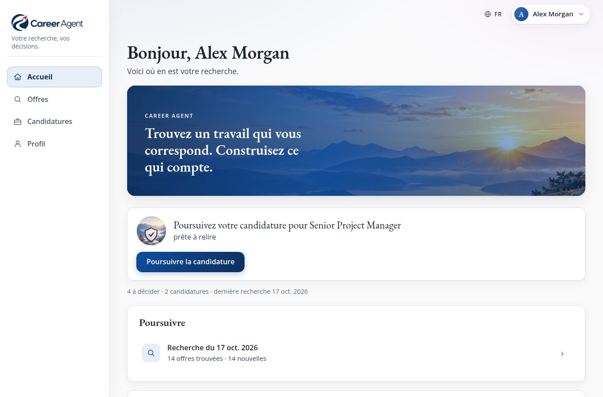
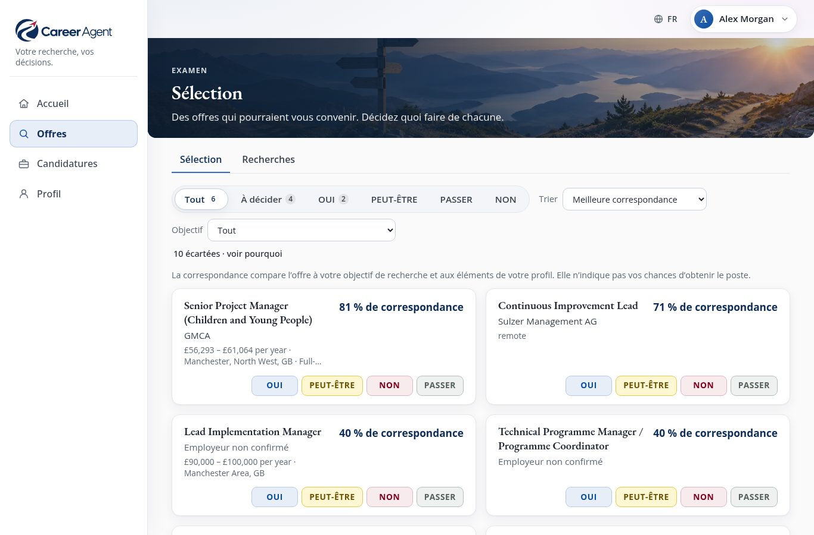
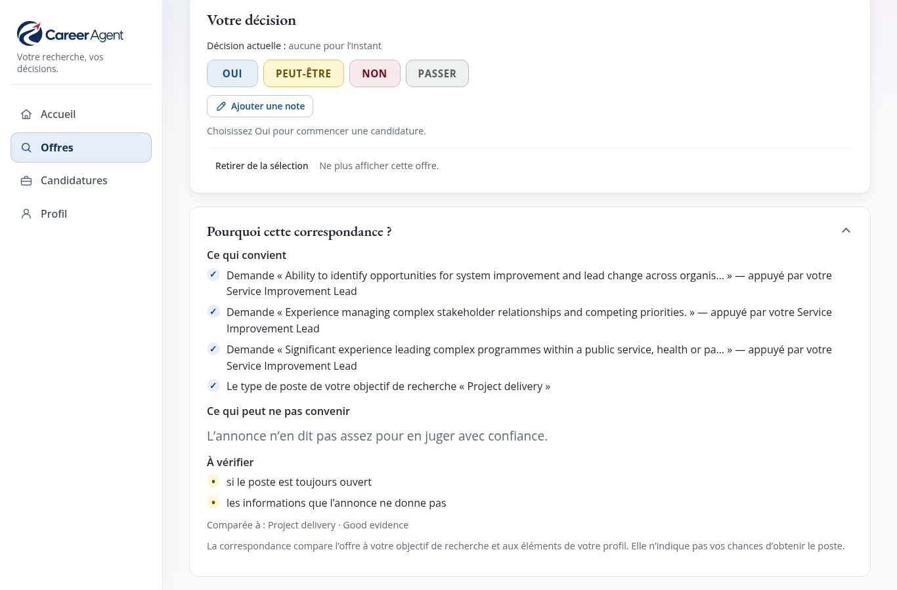
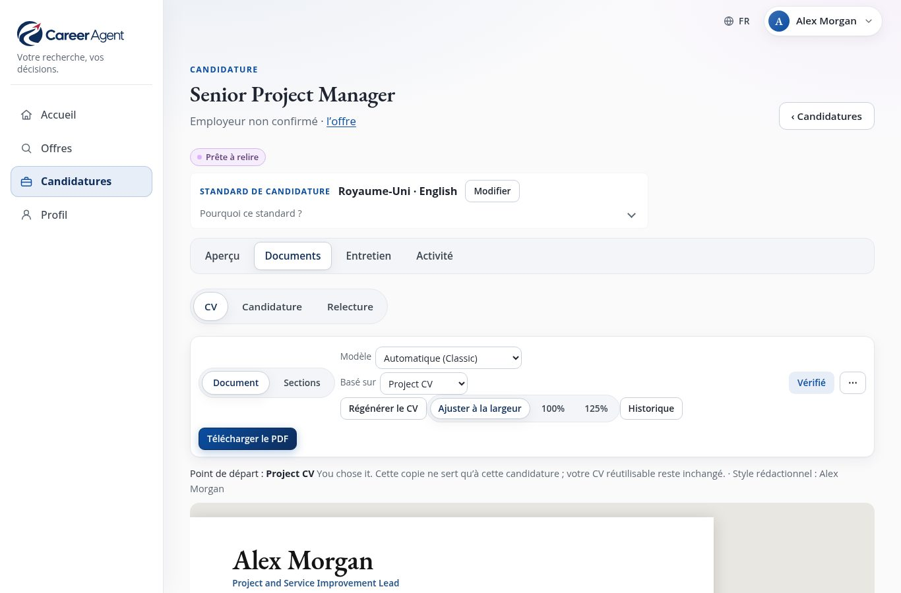
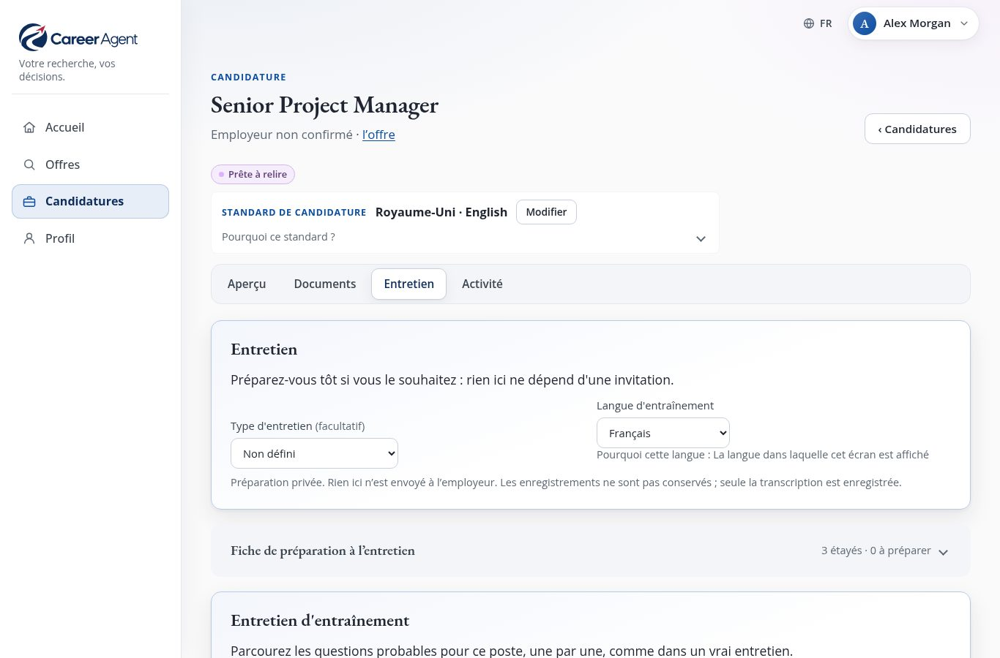

# Career Agent : le guide d’utilisation

[English](manual.en.md) · [Deutsch](manual.de.md) · [한국어](manual.ko.md) · **Français** · [Español](manual.es.md) · [Português](manual.pt.md)

<b>Votre recherche, vos décisions.</b> Gratuit · fonctionne sur votre propre ordinateur · six langues · version 1.0

---

## Career Agent en une minute

Chercher un nouvel emploi, c’est souvent passer des heures à faire défiler les sites d’annonces, recopier des
offres dans ses notes, réécrire son CV pour chaque candidature et essayer de se souvenir à qui l’on a écrit, et
quand.

**Career Agent fait le gros du travail à votre place, et vous laisse toutes les décisions.**

Vous lui dites, avec vos propres mots, quel type de travail vous recherchez. Ensuite, il :

1. **cherche sur le web les offres qui correspondent** : sites d’emploi, sites des employeurs, annonces
   officielles ;
2. **lit chaque annonce** et vérifie les informations importantes (rémunération, lieu, contrat, date limite)
   sur la page même de l’annonce ;
3. **évalue chaque offre par rapport à ce que vous avez demandé** et explique pourquoi, en phrases simples ;
4. **tient une seule Sélection bien rangée**, où il vous suffit de répondre Oui, Peut-être, Non ou Passer ;
5. **rédige un CV et une lettre de motivation adaptés à l’offre**, à partir des seuls faits de votre propre
   parcours ;
6. **vous aide à préparer l’entretien**, y compris avec un entretien d’entraînement auquel vous pouvez répondre
   à voix haute ;
7. **suit chacune de vos candidatures** et vous rappelle quand relancer.

Il peut même lancer une recherche pour vous **chaque semaine, tout seul**, et envoyer un court résumé sur votre
téléphone.

Et une promesse compte plus que tout : **Career Agent ne postule jamais à une offre, ne contacte jamais un
employeur et n’envoie jamais rien en votre nom.** Il prépare ; c’est vous qui décidez et vous qui envoyez.

---

## Ce qui le rend différent

- **Il vous dit pourquoi.** Chaque offre est accompagnée de *Ce qui convient*, *Ce qui peut ne pas convenir* et
  *À vérifier*, et pas seulement d’un chiffre.
- **Deux questions, bien séparées.** « Cette offre me convient-elle maintenant ? » (rémunération, horaires,
  lieu, contrat) et « Me mène-t-elle là où je veux aller ? » sont évaluées séparément, car une offre peut être
  bonne sur un point et pas sur l’autre.
- **Il est honnête sur ce qu’il ne sait pas.** Si une annonce ne mentionne pas la rémunération, Career Agent le
  dit. Une information n’est considérée comme *vérifiée* que si elle a été lue sur la page de l’employeur, dans
  une annonce officielle ou chez un cabinet de recrutement sérieux, jamais dans un simple résumé de recherche.
- **Votre CV reste fidèle à la réalité.** Les nouveaux documents sont rédigés à partir de vos propres
  informations professionnelles. Les chiffres, dates, intitulés de poste, noms et qualifications inventés sont
  repérés par des contrôles automatiques : un brouillon de l’IA qui en invente n’est pas accepté, et vos propres
  modifications qui en ajoutent vous sont signalées par *À vérifier*.
- **Vos données restent chez vous.** Tout est enregistré sur votre propre ordinateur, pas dans le cloud de
  quelqu’un d’autre.
- **Sept langues d’interface.** Anglais, allemand, coréen, français, espagnol et portugais (Portugal et
  Brésil). Vos candidatures peuvent être rédigées dans chacune d’elles.

---

## Nouveautés de la version 1.0

- **Des scores plus clairs.** Le pourcentage est désormais la **correspondance avec votre objectif de recherche**,
  avec **Maintenant** et **Orientation professionnelle** à côté. La rémunération n’est comparée que sur une même
  base, et « non indispensable » n’est plus lu comme une exigence.
- **Une Sélection plus sereine.** Un badge **Nouveau** signale ce que la dernière recherche a trouvé, **Chercher
  dans cette liste** la réduit, et une même annonce reste une seule offre, même quand elle arrive par un lien
  légèrement différent. Changer une décision garde la note que vous aviez écrite.
- **Des contrôles d’honnêteté plus stricts.** Les organisations, diplômes, certificats et licences inventés sont
  désormais repérés aussi.
- **Les lettres en PDF.** La lettre de motivation et la présentation de l’adéquation au poste se téléchargent en
  PDF, comme le CV.
- **Après l’envoi.** Enregistrez un entretien, une proposition ou un refus juste après l’envoi, avec la **date à
  laquelle c’est arrivé**.
- **Des mots simples quand quelque chose ne va pas**, toujours avec une suite possible.

---

## Petite visite : quatre espaces

*L’**Accueil** indique quoi faire ensuite. Les images montrent le profil d’exemple fourni : une personne fictive, de vraies offres d’emploi.*

Vous retrouvez toujours les quatre mêmes espaces : dans un menu sur le côté sur ordinateur ou tablette, et dans
une barre en bas de l’écran sur téléphone.

| Espace | Ce que vous y faites |
| --- | --- |
| **Accueil** | Voir la prochaine chose qui vaut la peine d’être faite, ce qui est *À venir* et vos dernières recherches. |
| **Offres** | La **Sélection** (les offres sur lesquelles décider) et les **Recherches** (lancer une recherche, revoir les précédentes). |
| **Candidatures** | Toutes les candidatures que vous avez commencées, chacune avec *Aperçu*, *Documents*, *Entretien* et *Activité*, ainsi que le **Suivi**, qui montre où en est chaque chose. |
| **Profil** | Tout ce qui vous concerne : *À propos de vous*, *Ce que je cherche*, *CV et rédaction* et *Paramètres*. |

L’accueil vous propose toujours **une** prochaine étape claire, par exemple *« 5 offres attendent votre
décision »* avec un bouton **Examiner la sélection**. Quand il n’y a rien à faire, il vous propose **Trouver
des offres**.

> **Astuce :** si vous débutez, de petites cartes de conseils expliquent chaque page. Vous pouvez les masquer
> puis les réafficher dans **Profil → Paramètres → Afficher les conseils**.

---

## Avant de commencer : ce qu’il vous faut

**Career Agent lui-même est gratuit.** Pas d’abonnement, pas de compte, et son code est ouvert (licence MIT).
Le seul coût est celui de l’IA, que vous payez directement à OpenAI (voir plus bas).

Career Agent est un programme que vous faites tourner vous-même, sur votre propre ordinateur ou sur un petit
serveur à la maison. Ce n’est pas un site web auquel on s’inscrit. C’est ce qui garantit la confidentialité de
vos données, mais cela signifie que **la première installation demande quelqu’un d’à l’aise avec
l’informatique**, une seule fois, pendant environ une heure. Les étapes techniques se trouvent dans le
[README](../README.md#install) (« Install »).

Ce qu’il vous faut :

- **Un ordinateur qui peut rester allumé**, idéalement sous Linux, si vous voulez la recherche automatique
  hebdomadaire. Pour un usage occasionnel, n’importe quel ordinateur capable de le faire tourner pendant que
  vous l’utilisez suffit.
- **Un compte OpenAI et une clé API.** Career Agent utilise l’IA d’OpenAI pour chercher, lire les annonces et
  rédiger. La clé fonctionne comme un mot de passe qui permet à Career Agent d’utiliser votre compte. OpenAI
  facture à l’usage ; fixez une limite de dépenses mensuelle dans votre compte OpenAI pour éviter les
  mauvaises surprises.
- **Un réseau privé.** Career Agent n’a pas d’écran de connexion : il doit donc être accessible uniquement
  depuis votre propre ordinateur ou votre propre réseau privé, jamais depuis l’internet ouvert. La personne qui
  vous aide s’en chargera.
- **Facultatif :** un compte Telegram, si vous souhaitez recevoir le résumé hebdomadaire sur votre téléphone.

Ce qui fonctionne **sans** clé d’IA : consulter tout ce qui a déjà été trouvé, vos décisions, la modification
de votre profil et de vos CV, les modèles, la fiche de préparation à l’entretien, les rappels et le suivi. La
recherche, la rédaction de documents, les suggestions de l’IA, les questions d’entretien et les retours sur vos
réponses nécessitent la clé.

### Votre profil est créé une seule fois

La personne qui vous aide crée votre profil en copiant le profil d’exemple fourni (une personne fictive
appelée Alex Morgan) et en l’adaptant. Ensuite, **presque tout se fait dans le navigateur** : vos coordonnées,
votre parcours professionnel, ce que vous recherchez, vos CV et votre style d’écriture.

---

## Étape 1 : Présentez-vous à Career Agent

Ouvrez **Profil → À propos de vous**.

- **Informations personnelles** et **Coordonnées** : ce qui apparaît en haut de votre CV.
- **Parcours professionnel** : les faits que vos CV et vos lettres peuvent utiliser, sous forme de cartes :
  postes, diplômes, réalisations, bénévolat, compétences. Utilisez **Ajouter une entrée** pour en ajouter une.

Plus vous ajoutez ici de détails sincères, meilleures seront vos candidatures. Career Agent n’écrit que ce
qu’il trouve ici. Si une offre demande quelque chose que vous n’avez pas décrit, il le signale (*Sans preuve*)
au lieu d’inventer.

> **Exemple :** au lieu de « Gestion de projets », écrivez « J’ai dirigé une équipe de 6 personnes pour faire
> passer 400 clients à un nouveau système de réservation en 2024, avec trois semaines d’avance sur le
> calendrier. » Career Agent pourra alors utiliser ces vrais chiffres, et uniquement ceux-là.

---

## Étape 2 : Dites ce que vous recherchez

Ouvrez **Profil → Ce que je cherche** et choisissez **+ Ajouter un objectif de recherche**. Un *objectif de
recherche* correspond à un type de poste que vous voulez. Vous pouvez en avoir plusieurs, par exemple
« Gestion de projet » et « Opérations ».

Pour chacun, vous décrivez :

- **Type de poste** : les intitulés de poste et le genre de fonction, avec des mots de tous les jours.
- **Ce qui fait la correspondance d’une offre** : ce sur quoi le poste doit vraiment porter.
- **Lieu et télétravail** : où vous pouvez travailler, et si le télétravail ou le mode hybride vous convient.
- **Rémunération** et **Organisation du travail** : ce que vous avez besoin de gagner, et les jours ou horaires
  qui vous conviennent.
- **Ce qui compte pour ce type d’emploi**, sur quatre niveaux : *Indispensable*, *Important*, *Utile* et
  *À éviter*.

Comment Career Agent traite vos souhaits :

| Vous indiquez | Ce qui se passe |
| --- | --- |
| **Indispensable** | Une offre peut être écartée si l’annonce, **clairement**, n’y répond pas. Si l’annonce ne dit simplement rien à ce sujet, l’offre n’est **pas** écartée. |
| **Préféré / Important / Utile** | Rend une offre plus intéressante, mais n’en écarte jamais une à lui seul. |
| **À éviter** | Les lieux que vous excluez écartent les postes sur site situés à ces endroits. Tout le reste que vous indiquez ici est noté, mais ne sert pas de filtre. |

Chaque objectif de recherche peut être activé ou désactivé, dupliqué ou supprimé. Seuls les objectifs activés
sont utilisés pour la recherche.

> **Astuce :** pas besoin d’être parfait du premier coup. Lancez une recherche, regardez les résultats, puis
> ajustez.

---

## Étape 3 : Trouvez des offres

Allez dans **Offres → Recherches** et choisissez **Trouver des offres**.

1. Career Agent vous demande : **Que doit chercher Career Agent ?** Cochez un ou plusieurs objectifs de
   recherche et choisissez **Trouver des offres**.
2. Une confirmation demande **Lancer la recherche ?** Elle indique ce qui sera cherché, que cela peut prendre
   plusieurs minutes et que rien n’est envoyé à personne. Choisissez **Lancer la recherche**. Rien n’est créé
   avant votre confirmation : si vous annulez, aucune recherche ne reste dans l’historique.
3. La page de la recherche s’ouvre. Vous pouvez la fermer et continuer à utiliser l’application : la recherche
   continue. L’accueil et les Recherches indiquent qu’une recherche est en cours et ce qu’elle fait à ce moment
   précis, par exemple *« Vérification des annonces »*.

Pendant une recherche, Career Agent :

- cherche sur le web les offres qui correspondent à chaque objectif ;
- trie ce qu’il a trouvé et supprime les doublons (une même offre publiée sur plusieurs sites n’apparaît
  qu’**une seule fois**) ;
- écarte les offres qui ne conviennent clairement pas ;
- ouvre chacune des annonces restantes et **vérifie** ses informations sur la page même de l’annonce ;
- compare chaque offre avec ce que vous voulez et rédige son raisonnement.

Une fois terminée, la page de la recherche affiche **Recherche terminée**, par exemple :

> *32 offres trouvées · 9 à examiner · 23 écartées. 7 sont nouvelles. 2 étaient déjà connues.*

et vous propose un seul bouton : **Examiner la sélection**. À côté des nouvelles offres, **Voir les nouvelles
offres dans votre sélection** ouvre la Sélection avec uniquement les offres que cette recherche a trouvées pour
la première fois.

Parfois, une recherche ne peut pas faire tout son travail :

- **Certaines recherches sur le web n’ont pas pu être faites.** Le résultat le dit, par exemple *« 3 de ses 40
  recherches sur le web n’ont pas pu être faites : certaines offres peuvent manquer. Une nouvelle recherche les
  retentera. »*
- **La recherche n’a pas pu être effectuée.** Aucune de ses recherches sur le web n’a abouti, donc aucune offre
  n’a été trouvée. Choisissez **Relancer une recherche** : Career Agent prépare une nouvelle recherche pour les
  mêmes objectifs et demande d’abord **Lancer la recherche ?**, comme d’habitude.
- **La recherche s’est arrêtée pendant la lecture des annonces.** Choisissez **Terminer la vérification des
  annonces**. Seules les annonces déjà trouvées sont lues ; rien n’est recherché à nouveau, c’est pourquoi aucune
  confirmation n’est demandée.

Si une recherche a été interrompue (par exemple parce que l’ordinateur a été éteint), sa page propose
**Poursuivre la recherche**. Elle reprend là où elle s’était arrêtée, sans refaire ce qui était déjà terminé.

---

## Étape 4 : Décidez dans votre Sélection

*La **Sélection** : chaque offre avec sa correspondance à votre objectif et quatre boutons pour décider.*

**Offres → Sélection** rassemble en une seule liste les offres qui pourraient vous convenir, issues de
**toutes** vos recherches.

Chaque offre indique le poste, **qui recrute** (ou *Employeur non confirmé*, quand un cabinet de recrutement
cache le nom de l’employeur), sa correspondance comme **« 86 % de correspondance avec votre objectif de
recherche »**, une ligne comme **« Maintenant : Fort · Orientation professionnelle : Limité »**, et quatre
boutons. Un badge **Nouveau** signale les offres que la dernière recherche a trouvées pour la première fois.

| Bouton | Signification |
| --- | --- |
| **Oui** | Je veux postuler. Cela **commence aussi une candidature** pour cette offre. |
| **Peut-être** | Intéressant ; je déciderai plus tard. |
| **Non** | Pas pour moi. |
| **Passer** | Pas maintenant. |

Vous pouvez changer d’avis à tout moment ; vos décisions précédentes restent dans l’historique. Si vous ne
changez que la décision, la note que vous aviez écrite avec elle est conservée.

**Ce que signifie le pourcentage :** à quel point l’offre correspond à ce que demande cet objectif de recherche
et aux éléments de votre profil. Ce n’est **pas** votre chance d’obtenir le poste. Les deux autres questions
sont évaluées séparément, sur la ligne en dessous : **Maintenant** (l’offre me convient-elle maintenant :
rémunération, horaires, lieu, contrat ?) et **Orientation professionnelle** (me mène-t-elle là où je veux
aller ?). Chacune indique *Fort*, *Mitigé*, *Limité* ou *Informations insuffisantes*.

Commandes utiles :

- **Tout · À décider · Oui · Peut-être · Non · Passer** pour filtrer la liste.
- **Objectif** pour n’afficher qu’un seul objectif de recherche ; **Meilleure correspondance** ou **Plus
  récentes** pour trier.
- **Chercher dans cette liste** : tapez une partie de l’intitulé d’un poste ou d’un nom d’organisation pour
  réduire la liste.
- Une très longue liste se charge par parties : **500 sur 620 affichées** et **Afficher plus**, en bas, le
  signalent.
- **« 23 écartées · voir pourquoi »** : les offres qui ne peuvent pas convenir (l’annonce a disparu, elle ne
  remplit clairement pas un critère indispensable, ou elle ne correspondait pas assez). Rien n’est supprimé, et
  chacune indique pourquoi, en citant l’annonce.
- **Retirer de la sélection** masque une offre que vous ne voulez plus jamais voir. **Rétablir dans la
  sélection** la fait revenir.

---

## Étape 5 : Regardez une offre de plus près

***Pourquoi cette correspondance ?** sur la page d’une offre : ce qui convient, ce qui peut ne pas convenir et ce qu’il faut vérifier.*

Cliquez sur une offre pour ouvrir sa page. En haut, vous trouvez :

- le poste, l’employeur et le lieu, ainsi qu’une ligne avec la correspondance, la rémunération, le contrat et la
  date limite ;
- **En un coup d’œil** : deux ou trois phrases sur ce qu’est vraiment le poste, rédigées à partir de
  l’annonce ;
- **Votre décision** : les quatre boutons, plus **Ajouter une note** pour noter une raison ou un rappel pour
  vous-même. La note associée à votre décision actuelle s’affiche ici.

La date limite est reprise de l’annonce, même quand elle n’est écrite que dans le texte, par exemple *« Date
limite : 1er septembre 2026 »*. Seule une date complète compte ; Career Agent n’en devine jamais une.

En dessous, trois sections s’ouvrent quand vous cliquez dessus :

- **Pourquoi cette correspondance ?** *Ce qui convient*, *Ce qui peut ne pas convenir*, *Utile pour la
  direction que vous visez* et *À vérifier*.
- **Détails de l’annonce** : toutes les informations de l’annonce, chacune marquée vérifiée ou non vérifiée,
  un lien vers l’annonce d’origine, et les sources.
- **Détails techniques** : pour les curieux ; vous n’en aurez jamais besoin.

Quand Career Agent dispose de peu d’éléments, il dit exactement pourquoi, par exemple *« Nous n’avons que des
informations limitées sur ce poste »* ou *« Annonce plus disponible »*.

---

## Étape 6 : Préparez une candidature

Choisir **Oui** sur une offre commence une candidature. Ouvrez-la depuis l’offre (**Ouvrir la candidature**) ou
depuis **Candidatures**.

### Aperçu

Affiche la prochaine étape sous la forme d’un seul bouton (par exemple **Générer le CV**), l’état de chaque
document (*Prêt*, *À retravailler*, *Manquant*, *Inutile*), ce que votre CV couvre et ce qu’il ne couvre pas
encore. **Tout préparer d’un coup** réalise toutes les étapes en une fois et vous donne un brouillon.

### Documents : CV, Candidature, Relecture

*Un CV écrit pour cette offre précise, prêt à relire et à télécharger en PDF.*

- **CV** : choisissez **Générer le CV**. Career Agent adapte l’un de vos CV réutilisables à cette offre, à
  partir de vos informations professionnelles, des exigences du poste et de votre style d’écriture. Le CV
  s’affiche **comme la vraie page**, et vous le modifiez directement, comme un document.
- **Candidature** : la lettre de motivation, une déclaration à l’appui de votre candidature, et les réponses
  aux questions que vous collez depuis le formulaire de l’employeur.
- **L’aide de l’IA sur n’importe quel paragraphe :** sélectionnez du texte et choisissez **Améliorer la
  formulation**, **Raccourcir**, **Rendre plus concis**, **Souligner le lien avec ce poste** ou **Demander à
  l’IA…**. Vous obtenez toujours d’abord une *suggestion* : **Appliquer**, **Réessayer** ou **Annuler**. Rien ne
  change tant que vous ne l’appliquez pas, et rien n’est enregistré tant que vous n’enregistrez pas.
- Les **Modèles** changent l’apparence, jamais les mots. **Sections** vous permet de réordonner ou de masquer
  des parties de ce CV sans toucher à votre profil.
- L’**Historique** conserve chaque version ; vous pouvez revenir à n’importe laquelle.
- **Télécharger le PDF** pour le CV, la lettre de motivation et la présentation de l’adéquation au poste. S’il
  manque un PDF, **Créer le PDF** le produit. Si les PDF ne peuvent pas être créés sur cette installation, Career
  Agent le dit : ouvrez l’aperçu et imprimez-le, ou enregistrez-le en PDF depuis le navigateur. Les fichiers
  téléchargés portent le nom de l’employeur et du poste.

**Contrôles.** Chaque document est comparé à vos informations professionnelles : dates, chiffres, noms (par
exemple d’employeurs et d’autres organisations) et qualifications comme les diplômes, certificats et
autorisations d’exercer. Si l’IA écrit quelque chose que vos éléments ne justifient pas, Career Agent réessaie ;
si cela échoue encore, il vous le dit et n’enregistre rien. Ce que vous écrivez vous-même n’est jamais bloqué :
c’est signalé par *À vérifier : 2 affirmations demandent votre attention*, et c’est vous qui décidez de ce que
vous gardez. Quand tout passe, vous voyez *Dates, chiffres, noms et qualifications vérifiés par rapport à vos
éléments de preuve*, avec un rappel : *Les contrôles ne peuvent pas tout juger : lisez chaque phrase avant
d’approuver.*

### Relecture et approbation

Quand vous êtes satisfait, ouvrez **Relecture**. Career Agent vous montre exactement ce que vous approuvez :
le CV, la lettre, les réponses et les contrôles, ainsi que tout ce qui reste à terminer. Choisissez
**Approuver la candidature**.

Si vous modifiez quoi que ce soit après l’approbation, Career Agent s’en aperçoit et vous demande de relire à
nouveau. Vous pouvez aussi **Demander des modifications**, **Mettre en attente** ou **Retirer**, avec une
courte raison.

### L’envoi : toujours par vous

**Il n’y a pas de bouton « Envoyer », et c’est voulu.** Vous envoyez la candidature vous-même, par e-mail, sur
le site de l’employeur ou par courrier. Ensuite, dans **Activité**, choisissez **Enregistrer l’envoi** et
indiquez comment vous l’avez envoyée. Si vous l’avez envoyée il y a quelques jours, indiquez la **date à
laquelle c’est arrivé** (vide, c’est aujourd’hui) ; le rappel de relance compte à partir de ce jour. À partir de
ce moment, les documents sont **conservés tels qu’envoyés** : vous savez donc toujours exactement ce que
l’employeur a reçu.

---

## Étape 7 : Préparez-vous pour l’entretien

*La préparation à l’entretien : une courte note, les questions probables et un entretien d’entraînement.*

Chaque candidature a une partie **Entretien**. Vous pouvez vous préparer bien avant de recevoir une
convocation.

- **Fiche de préparation à l’entretien** : l’organisation, ce qui compte pour ce poste, pourquoi vous pourriez
  convenir, les lacunes à préparer et de bonnes questions à poser. Elle n’utilise pas l’IA.
- **Rechercher [organisation] en ligne** (facultatif) : un court tour d’horizon ciblé de l’organisation sur le
  web, proposé quand l’annonce indique qui recrute.
- **Proposer des questions probables** : les questions qu’on vous posera probablement, chacune avec des points
  à aborder tirés de votre propre expérience. Quand vous n’avez encore aucun élément, il le dit honnêtement.
- **Entraînement** : répondez à une question **par écrit ou à voix haute**. Choisissez **Analyser la réponse**
  pour obtenir *Ce qui a bien fonctionné*, *Ce qu’il faut améliorer* et *À essayer la prochaine fois*, ainsi
  que la fréquence de vos mots de remplissage. Vous pouvez d’abord corriger la version écrite d’une réponse
  orale avec **Modifier la transcription**.
- **Entretien d’entraînement** : cinq à sept questions à la suite, avec des relances et un bilan à la fin,
  comme dans un vrai entretien.

Career Agent peut **lire les questions à voix haute** grâce à la voix intégrée de votre navigateur,
gratuitement. Les enregistrements sont transformés en texte et **jamais conservés** : seul le texte est gardé.
Les retours portent sur ce que vous avez dit, jamais sur l’assurance que vous aviez l’air d’avoir.

> Répondre à voix haute nécessite une connexion sécurisée (une adresse commençant par **https**, ou
> l’ordinateur lui-même). Si le microphone n’est pas disponible, tapez plutôt vos réponses.

---

## Étape 8 : Relancez et gardez le fil

- **Activité** (dans chaque candidature) : **Enregistrer une réponse**, **Enregistrer un entretien**,
  **Enregistrer un refus**, **Enregistrer une proposition** ou **Enregistrer comme clôturée**, avec tout
  l’historique en dessous. Seules les étapes qui correspondent à l’état de la candidature sont proposées. Juste
  après l’envoi, vous pouvez enregistrer ce qui s’est réellement passé ensuite (un entretien, un refus, une
  proposition, ou **Enregistrer comme clôturée** si vous n’avez jamais eu de réponse) sans enregistrer d’abord
  une réponse. Pour une réponse, et pour un refus ou une proposition qui est la première réponse, vous pouvez
  indiquer la **date à laquelle c’est arrivé** (jamais une date future).
- **Candidatures → Suivi** : toutes vos candidatures en un coup d’œil, de *En préparation* jusqu’à
  *Proposition* ou *Clôturées*.
- **Rappels** : Career Agent vous les propose automatiquement : l’entretien, la préparation deux jours avant,
  une relance deux semaines après votre candidature, et les dates limites. Vous pouvez ajouter les vôtres. Ils
  apparaissent sur l’accueil sous **À venir**.
- **Ajouter à l’agenda (.ics)** télécharge un rappel que vous pouvez ouvrir dans votre application d’agenda
  habituelle.

Quand une proposition arrive, Career Agent l’enregistre, et c’est tout. Accepter, négocier et décider, c’est
à vous.

---

## La recherche hebdomadaire et votre téléphone

Une fois configuré, Career Agent peut chercher **automatiquement une fois par semaine** (par défaut le jeudi à
7 heures du matin) et envoyer un court résumé sur votre **Telegram** : combien de nouvelles offres il a
trouvées et ce qui arrive bientôt, avec des liens qui ramènent directement dans l’application.

La personne qui vous aide configure le planning et la connexion à Telegram. Ensuite, vous pouvez activer ou
désactiver les messages et vous envoyer un message de test dans **Profil → Paramètres → Notifications et
intégrations**. Si l’ordinateur était éteint à l’heure prévue, la recherche se lance dès qu’il est rallumé.

La recherche hebdomadaire a lieu **même quand Telegram est désactivé** : ses offres apparaissent dans votre
Sélection comme d’habitude ; seul le message est omis. Quand Telegram est activé et qu’une recherche
hebdomadaire échoue ou ne peut pas démarrer, vous recevez **un seul** message court qui le dit et indique
l’étape où elle s’est arrêtée. Il ne contient jamais de détails d’erreur ; la personne qui vous aide les trouve
sur l’ordinateur.

---

## Langues et pays

- Changez la langue de l’interface avec le sélecteur **Langue**. Les sept langues sont complètes.
- Chaque candidature peut être rédigée dans sa propre langue, et selon les usages de son propre pays (par
  exemple, un CV britannique diffère d’un CV allemand). Le Royaume-Uni et l’international sont prêts à
  l’emploi ; l’Allemagne, la Corée du Sud, les États-Unis et le Ghana sont inclus sous forme de brouillons que
  vous relisez et approuvez d’abord.

---

## Vos données et votre vie privée

- Tout (votre profil, vos recherches, vos décisions, vos candidatures) est enregistré sous forme de fichiers
  ordinaires **sur votre propre ordinateur**. Il n’y a ni compte auprès d’une société Career Agent, ni base de
  données dans le cloud.
- **Ce qui part chez OpenAI**, uniquement quand vous utilisez une fonction d’IA : les termes de recherche, le
  texte des annonces et, lorsque vous rédigez ou vous entraînez, les parties de vos informations
  professionnelles, de votre style d’écriture et de vos réponses nécessaires à cette tâche. Career Agent
  demande à OpenAI de ne pas les conserver. Les enregistrements vocaux ne sont jamais gardés.
- **Rien n’est envoyé aux employeurs.** Les seuls messages que Career Agent envoie jamais vont sur votre propre
  Telegram, si vous l’activez : le résumé hebdomadaire, ou un court avis quand une recherche hebdomadaire échoue.
- **Sauvegardez vos données.** Comme elles se trouvent sur votre ordinateur, veillez à ce que la personne qui
  vous aide mette en place une sauvegarde régulière.

---

## Des limites, en toute honnêteté

Career Agent est puissant, mais il est bon de savoir ce qu’il ne fait pas :

- Il ne postule jamais et ne contacte jamais personne à votre place. C’est une promesse, pas une fonction qui
  manque.
- Il n’y a pas d’écran de connexion. Gardez-le uniquement sur votre propre ordinateur ou votre réseau privé.
- Votre premier profil est configuré à l’aide de fichiers, une seule fois, par une personne qui vous aide.
- Le CV, la lettre de motivation et la présentation de l’adéquation au poste deviennent des PDF ; les réponses
  aux questions d’un employeur, non. Il n’y a pas de format Word.
- Pour les agendas, vous obtenez un fichier à télécharger ; il n’y a pas de connexion directe avec les agendas
  Google ou Outlook.
- Les contrôles automatiques repèrent les chiffres, dates, intitulés, noms et qualifications inventés, mais pas
  chaque exagération subtile. Relisez toujours vos documents avant de les approuver.
- L’IA peut de temps en temps mal juger une offre. C’est pour cela que chaque évaluation est accompagnée de ses
  raisons, et que c’est vous qui décidez.

---

## En cas de problème

| Vous voyez | Ce que cela signifie et ce qu’il faut faire |
| --- | --- |
| *L’IA est actuellement occupée* | OpenAI est surchargé. Career Agent a déjà réessayé ; attendez une minute et choisissez Réessayer. |
| *Limite d’utilisation de l’IA atteinte* | Votre compte OpenAI a atteint sa limite de dépenses. Relevez-la dans votre compte OpenAI ; réessayer n’y changera rien. |
| *La génération par IA n’est pas configurée* | La clé d’IA est absente. Demandez à la personne qui vous aide de l’ajouter. |
| *Vérification incomplète* | La page même de l’annonce n’a pas pu être lue : ses informations ne sont donc pas confirmées. Ouvrez l’annonce d’origine et vérifiez vous-même. |
| *Employeur non confirmé* | L’annonce (souvent celle d’un cabinet de recrutement) ne dit pas qui est l’employeur. |
| *Ceci a changé depuis que vous l’avez ouvert. Rechargez avant d’enregistrer.* | Le document a été modifié ailleurs (dans un autre onglet). Rechargez, puis refaites votre modification. |
| Le microphone ne fonctionne pas | Utilisez une adresse sécurisée (https), autorisez le microphone dans votre navigateur, ou tapez votre réponse. |
| *Career Agent ne répond pas* ou *Cette page n’a pas pu être chargée* | Vérifiez que Career Agent est toujours en marche (demandez à la personne qui vous aide si besoin), puis choisissez **Recharger**. |
| *La recherche n’a pas pu être effectuée* | Aucune de ses recherches sur le web n’a abouti. Rien n’a été envoyé. Choisissez **Relancer une recherche** ; si cela échoue encore, faites vérifier la clé d’IA. |
| *3 de ses 40 recherches sur le web n’ont pas pu être faites* | La recherche est terminée, mais certaines offres peuvent manquer. Rien à faire : la prochaine recherche les retentera. |
| Une recherche semble bloquée | Ouvrez-la depuis **Recherches**. Si elle a été interrompue, choisissez **Poursuivre la recherche**. Si elle s’est arrêtée pendant la lecture des annonces, choisissez **Terminer la vérification des annonces**. |

---

## Petit lexique

| Mot | Signification |
| --- | --- |
| **Objectif de recherche** | Un type de poste que vous voulez que Career Agent recherche. |
| **Recherche** | Un passage sur le web à la recherche de vos objectifs de recherche. |
| **Sélection** | Toutes les offres qui pourraient vous convenir, issues de toutes vos recherches, en une seule liste. |
| **Vérifié** | Une information lue sur la page même de l’annonce ou dans une autre source fiable. |
| **Écartée** | Mise de côté parce qu’elle ne peut pas convenir ; jamais supprimée, toujours expliquée. |
| **CV réutilisable** | Votre propre CV de départ. Chaque candidature en reçoit une copie adaptée ; l’original reste inchangé. |
| **Approuver** | Votre « oui, ces documents sont prêts » explicite, lié à leur contenu exact. |
| **Conservés tels qu’envoyés** | Une fois l’envoi enregistré, les documents sont figés tels que l’employeur les a reçus. |

---

*Career Agent est un logiciel libre et gratuit (licence MIT). Pour l’installation et la documentation
technique, consultez le [README](../README.md).*
