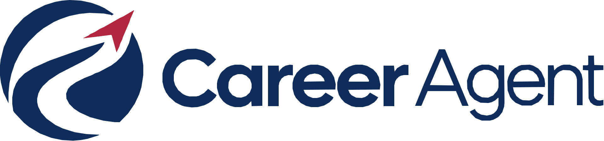
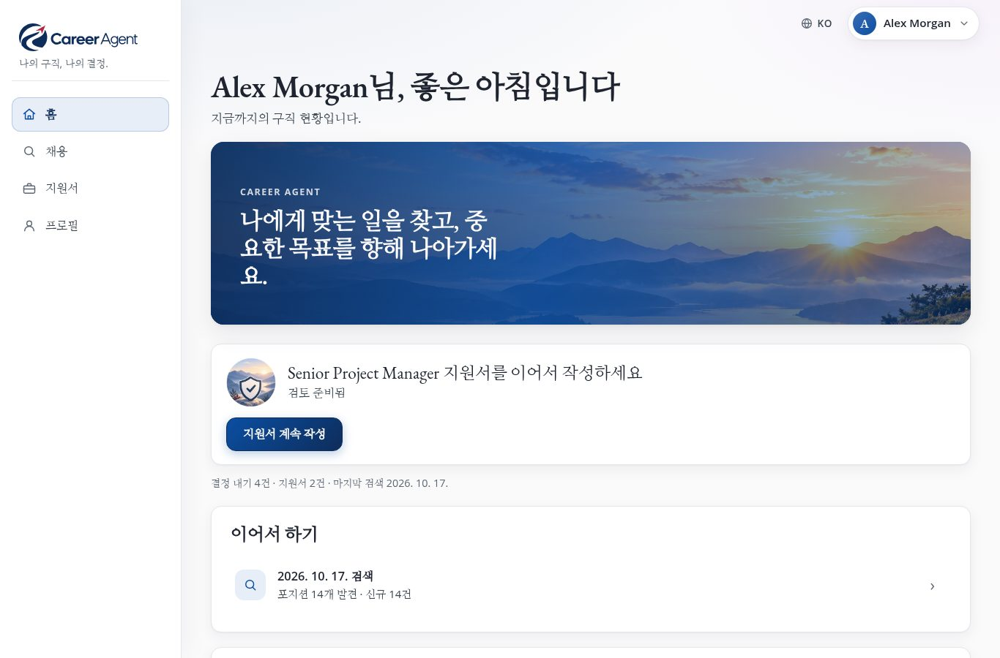
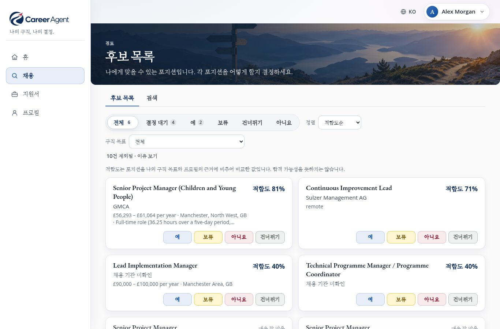
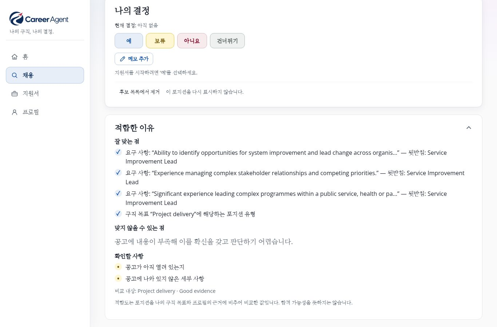
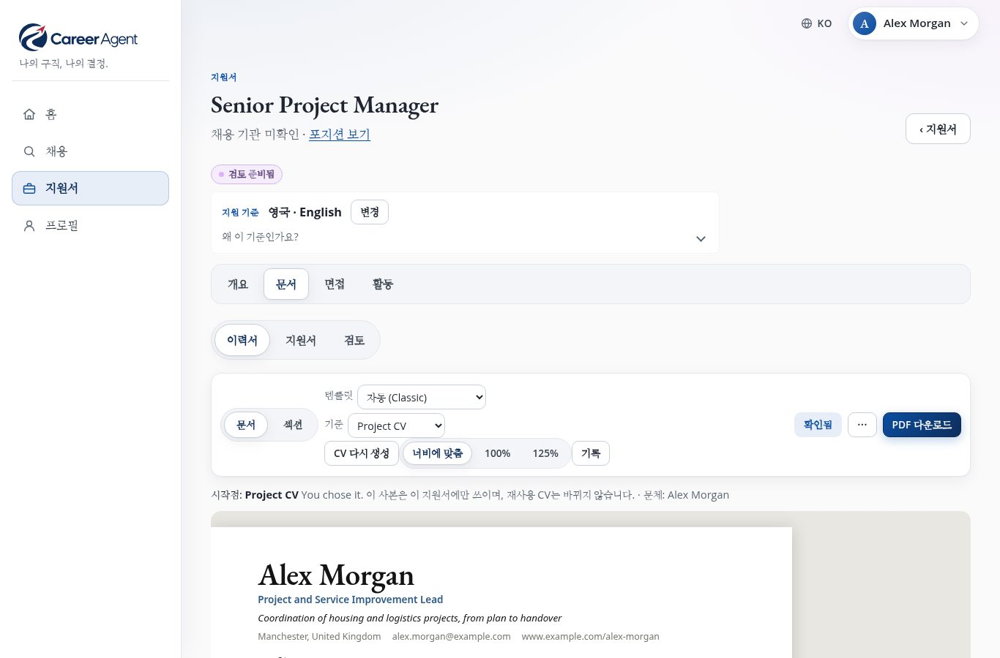
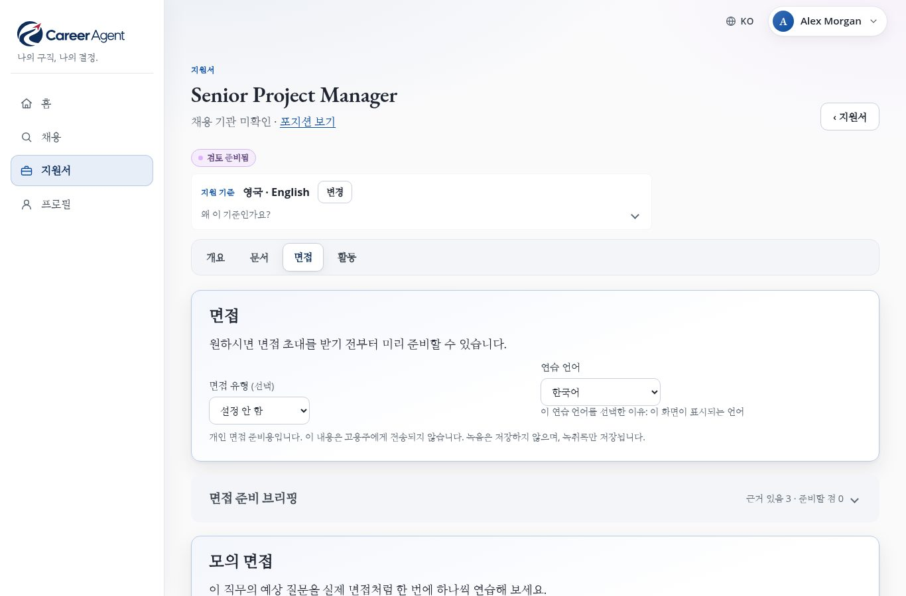

# Career Agent: 사용 안내서

[English](manual.en.md) · [Deutsch](manual.de.md) · **한국어** · [Français](manual.fr.md) · [Español](manual.es.md) · [Português](manual.pt.md)

<b>나의 구직, 나의 결정.</b> 무료 · 내 컴퓨터에서 실행 · 6개 언어 · 버전 1.0

---

## 1분 만에 알아보는 Career Agent

새 일자리를 찾다 보면 보통 몇 시간씩 채용 사이트를 뒤지고, 공고를 메모장에 옮겨 적고, 지원할 때마다 이력서를
고쳐 쓰고, 누구에게 언제 연락했는지 기억해 내느라 애를 먹습니다.

**힘든 일은 Career Agent가 대신하고, 모든 결정은 여러분이 내립니다.**

원하는 일을 평소 쓰는 말로 알려 주기만 하면, Career Agent는 다음과 같은 일을 합니다.

1. **웹에서 맞는 일자리를 찾습니다**: 채용 사이트, 기업 홈페이지, 공식 채용 공고까지 살펴봅니다.
2. **공고를 하나하나 읽고** 중요한 사실(급여, 근무지, 계약 형태, 마감일)을 공고 원문 페이지에서 직접
   확인합니다.
3. **각 일자리가 여러분이 원하는 조건에 맞는지 판단하고**, 그 이유를 쉬운 문장으로 설명합니다.
4. **깔끔한 후보 목록 하나**에 모아 두므로, 여러분은 예, 보류, 아니요, 건너뛰기 중 하나만 고르면 됩니다.
5. **그 일자리에 맞춘 이력서와 자기소개서를 작성합니다.** 이때 여러분의 실제 경력에 있는 사실만 사용합니다.
6. **면접 준비를 돕습니다.** 소리 내어 답해 볼 수 있는 모의 면접도 있습니다.
7. **모든 지원 내역을 관리하고**, 후속 연락이 필요한 때를 알려 줍니다.

**매주 알아서** 검색을 돌리고, 짧은 요약을 휴대전화로 보내 줄 수도 있습니다.

그리고 무엇보다 중요한 약속이 하나 있습니다. **Career Agent는 절대로 대신 지원하지 않고, 기업에 연락하지
않으며, 여러분의 이름으로 아무것도 보내지 않습니다.** Career Agent는 준비하고, 결정과 제출은 여러분이 합니다.

---

## 무엇이 다를까요

- **이유를 알려 줍니다.** 일자리마다 점수만 덩그러니 있는 것이 아니라 *잘 맞는 점*, *맞지 않을 수 있는 점*,
  *확인할 사항*이 함께 나옵니다.
- **두 가지 질문을 따로 봅니다.** "이 일이 지금 나에게 맞을까?"(급여, 근무 시간, 장소, 계약 형태)와 "이 일이
  내가 가고 싶은 방향으로 이끌어 줄까?"를 각각 판단합니다. 한쪽으로는 좋아도 다른 쪽으로는 아닐 수 있기
  때문입니다.
- **모르는 것은 모른다고 솔직하게 말합니다.** 공고에 급여가 나와 있지 않으면 Career Agent도 그렇다고
  알려 줍니다. 어떤 사실이 *확인됨*으로 표시되려면 기업 페이지, 공식 채용 공고, 믿을 만한 채용 대행사에서
  직접 읽은 것이어야 합니다. 검색 결과 요약만 보고 확인됐다고 하지는 않습니다.
- **이력서는 사실 그대로입니다.** 새 문서는 여러분의 경력 정보를 바탕으로 작성됩니다. 지어낸 숫자, 날짜,
  직함, 이름, 자격은 자동 검사에서 걸러집니다. AI 초안이 이런 내용을 지어내면 받아들이지 않고, 여러분이 직접
  고친 부분에 이런 내용이 들어가면 *검토 필요*로 표시됩니다.
- **내 데이터는 내 곁에 있습니다.** 모든 것이 다른 누군가의 클라우드가 아니라 여러분 자신의 컴퓨터에
  저장됩니다.
- **화면 언어는 일곱 가지입니다.** 영어, 독일어, 한국어, 프랑스어, 스페인어, 포르투갈어(포르투갈과
  브라질)를 지원합니다. 지원서는 이 중 어떤 언어로든 작성할 수 있습니다.

---

## 버전 1.0의 새로운 점

- **더 명확한 점수.** 퍼센트는 이제 **구직 목표 적합도**이고, 옆에 **현재**와 **커리어 방향**이 함께
  표시됩니다. 급여는 같은 기준끼리만 비교하며, "필수 아님"을 더 이상 필수 조건으로 읽지 않습니다.
- **더 차분한 후보 목록.** 가장 최근 검색에서 찾은 일자리에는 **신규** 표시가 붙고, **이 목록에서 찾기**로
  목록을 좁힐 수 있습니다. 조금 다른 링크로 들어온 같은 공고는 하나의 일자리로 남고, 결정을 바꿔도 적어 둔
  메모는 그대로 남습니다.
- **더 엄격한 정직성 검사.** 지어낸 기관, 학위, 자격증, 면허도 이제 잡아냅니다.
- **커버레터도 PDF로.** 커버레터와 직무 적합성 기술서도 이력서처럼 PDF로 내려받을 수 있습니다.
- **지원한 뒤에도.** 지원서를 보낸 직후 면접, 제안, 불합격을 바로 기록하고 **일어난 날짜**도 남길 수
  있습니다.
- **문제가 생기면 쉬운 말로** 알려 주고, 다음에 할 일도 함께 보여 줍니다.

---

## 둘러보기: 네 가지 메뉴

***홈**에서 다음에 할 일을 한눈에 볼 수 있습니다. 그림은 기본 제공 예시 프로필입니다. 사람은 가상이고 채용 공고는 실제입니다.*

화면에는 언제나 같은 네 가지 메뉴가 있습니다. 컴퓨터나 태블릿에서는 옆쪽 메뉴에, 휴대전화에서는 아래쪽
막대에 나타납니다.

| 메뉴 | 하는 일 |
| --- | --- |
| **홈** | 지금 해 볼 만한 다음 할 일 한 가지, *다가오는 일정*, 최근 검색을 봅니다. |
| **채용** | **후보 목록**(결정할 일자리)과 **검색**(검색 시작, 지난 검색 보기)이 있습니다. |
| **지원서** | 시작한 모든 지원서가 모여 있고, 지원서마다 *개요*, *문서*, *면접*, *활동*이 있습니다. 전체 상황은 **진행 상황**에서 한눈에 볼 수 있습니다. |
| **프로필** | 나에 관한 모든 것: *내 정보*, *구직 목표*, *이력서와 글쓰기*, *설정*. |

홈에서는 언제나 분명한 다음 단계 **하나**를 보여 줍니다. 예를 들어 *"포지션 5개가 결정을 기다립니다"*라는
문구와 함께 **후보 목록 검토** 버튼이 나옵니다. 할 일이 없을 때는 **공고 찾기**를 권합니다.

> **팁:** 처음 사용하는 분을 위해 페이지마다 작은 안내 카드가 설명을 덧붙입니다. 이 카드는
> **프로필 → 설정 → 안내 표시**에서 끄고 다시 켤 수 있습니다.

---

## 시작하기 전에 필요한 것

**Career Agent 자체는 무료입니다.** 구독도 계정도 필요 없고, 소스 코드가 공개되어 있습니다(MIT 라이선스).
비용은 AI 사용료뿐이며, OpenAI에 직접 냅니다(아래 참고).

Career Agent는 가입해서 쓰는 웹사이트가 아니라, 여러분의 컴퓨터나 작은 가정용 서버에서 직접 실행하는
프로그램입니다. 그래서 데이터가 안전하게 지켜지지만, 대신 **처음 설치할 때는 컴퓨터를 잘 다루는 분의 도움이
한 번, 한 시간 정도 필요합니다.** 기술적인 절차는 [README](../README.md#install)의 "Install"에 나와 있습니다.

필요한 것:

- **계속 켜 둘 수 있는 컴퓨터.** 매주 자동 검색을 원한다면 Linux가 설치된 컴퓨터가 가장 좋습니다. 가끔만
  쓴다면 사용할 때 실행할 수 있는 컴퓨터면 충분합니다.
- **OpenAI 계정과 API 키.** Career Agent는 OpenAI의 AI로 검색하고, 공고를 읽고, 글을 씁니다. API 키는
  Career Agent가 여러분의 계정을 쓸 수 있게 해 주는 비밀번호 같은 것입니다. OpenAI 요금은 사용한 만큼
  나오므로, 예상치 못한 청구가 없도록 OpenAI 계정에서 월 사용 한도를 정해 두세요.
- **개인 네트워크.** Career Agent에는 로그인 화면이 없습니다. 그래서 여러분의 컴퓨터나 집 안의 개인
  네트워크에서만 접속할 수 있어야 하고, 인터넷에 공개되어서는 안 됩니다. 이 부분은 도와주시는 분이 설정해
  줄 것입니다.
- **선택 사항:** 주간 요약을 휴대전화로 받고 싶다면 Telegram 계정.

AI 키 **없이도** 되는 일: 이미 찾은 내용 모두 읽기, 결정 내리기, 프로필과 이력서 수정, 템플릿, 면접 준비
브리핑, 알림, 지원 관리. 검색, 문서 작성, AI 제안, 면접 질문과 피드백에는 키가 필요합니다.

### 프로필은 한 번만 만들면 됩니다

도와주시는 분이 함께 들어 있는 예시 프로필(Alex Morgan이라는 가상 인물)을 복사해 여러분에게 맞게 고쳐
프로필을 만들어 줍니다. 그다음부터는 **거의 모든 일을 브라우저에서 할 수 있습니다**: 개인 정보, 경력,
구직 목표, 이력서, 글쓰기 스타일까지요.

---

## 1단계: Career Agent에 나를 소개하기

**프로필 → 내 정보**를 여세요.

- **개인 정보**와 **연락처**: 이력서 맨 위에 들어가는 내용입니다.
- **경력 정보**: 이력서와 자기소개서에 쓸 수 있는 사실들이 카드로 정리됩니다. 경력, 자격, 성과, 봉사 활동,
  기술 등입니다. **항목 추가**로 하나씩 더할 수 있습니다.

여기에 솔직하고 자세하게 적을수록 지원서가 좋아집니다. Career Agent는 여기서 찾을 수 있는 내용만 씁니다.
공고에서 요구하는 내용을 아직 적지 않았다면, 지어내지 않고 그렇다고 알려 줍니다(*근거 없음*).

> **예시:** "프로젝트를 관리했습니다" 대신 "2024년에 6명으로 구성된 팀을 이끌고 고객 400명을 새 예약
> 시스템으로 옮겼으며, 계획보다 3주 일찍 마쳤습니다"라고 적어 보세요. 그러면 Career Agent는 이 실제
> 숫자를, 그리고 오직 이 숫자만 사용할 수 있습니다.

---

## 2단계: 원하는 일 알려 주기

**프로필 → 구직 목표**를 열고 **+ 구직 목표 추가**를 고르세요. *구직 목표*란 원하는 일자리의 한 종류를
말합니다. 예를 들어 "프로젝트 관리"와 "운영"처럼 여러 개를 둘 수 있습니다.

목표마다 다음 내용을 적습니다.

- **직무 유형**: 직함과 원하는 역할을 평소 쓰는 말로 적습니다.
- **포지션이 적합하다고 보는 기준**: 그 일이 정말로 어떤 일이어야 하는지 적습니다.
- **위치 및 원격**: 일할 수 있는 지역, 그리고 원격 근무나 하이브리드 근무가 괜찮은지 적습니다.
- **급여**와 **근무 조건**: 받아야 하는 급여, 그리고 나에게 맞는 근무 요일이나 시간을 적습니다.
- **이 직무에서 중요한 조건**: *필수*, *중요*, *유용*, *피하기*의 네 단계로 나누어 적습니다.

Career Agent는 여러분의 바람을 이렇게 다룹니다.

| 이렇게 정하면 | 이렇게 됩니다 |
| --- | --- |
| **필수 조건 / 필수** | 공고가 이 조건을 **분명히** 충족하지 못할 때 그 일자리는 제외될 수 있습니다. 공고에 관련 내용이 없을 뿐이라면 제외되지 **않습니다**. |
| **선호 / 중요 / 유용** | 더 잘 맞는 일자리로 평가되지만, 이것만으로 제외되는 일은 없습니다. |
| **피하기** | 피하겠다고 정한 지역의 현장 근무 일자리는 빠집니다. 그 밖에 여기에 적은 내용은 참고만 하고 걸러내지는 않습니다. |

구직 목표는 하나씩 켜고 끄거나, 복제하거나, 삭제할 수 있습니다. 켜져 있는 목표만 검색합니다.

> **팁:** 처음부터 완벽할 필요는 없습니다. 검색을 한번 해 보고, 결과를 살펴본 다음 고쳐 나가면 됩니다.

---

## 3단계: 일자리 찾기

**채용 → 검색**으로 가서 **공고 찾기**를 고르세요.

1. Career Agent가 **Career Agent가 무엇을 찾아야 할까요?**라고 묻습니다. 구직 목표를 하나 이상 선택하고
   **공고 찾기**를 고르세요.
2. **검색을 시작할까요?**라는 확인 창이 나옵니다. 무엇을 찾을지, 몇 분 걸릴 수 있다는 것, 누구에게도
   아무것도 보내지 않는다는 것을 알려 줍니다. **검색 시작**을 고르세요. 확인하기 전에는 아무것도 만들어지지
   않으므로, 취소하면 검색 기록에 아무것도 남지 않습니다.
3. 검색 페이지가 열립니다. 이 페이지를 닫고 앱을 계속 사용하셔도 검색은 계속 진행됩니다. 홈과 검색 화면에서
   검색이 진행 중이라는 것과 지금 무엇을 하고 있는지 볼 수 있습니다. 예: *"채용 공고를 확인하는 중"*.

검색하는 동안 Career Agent는 다음 일을 합니다.

- 구직 목표마다 맞는 일자리를 웹에서 찾습니다.
- 찾은 결과를 정리하고 중복을 없앱니다(여러 사이트에 올라온 같은 공고는 **한 번만** 나옵니다).
- 분명히 맞지 않는 일자리는 걸러 둡니다.
- 남은 공고를 하나씩 열어 공고 원문 페이지에서 사실을 **확인합니다**.
- 모든 일자리를 여러분이 원하는 조건과 비교하고, 그렇게 판단한 이유를 적습니다.

검색이 끝나면 검색 페이지에 **검색 완료**가 표시됩니다. 예를 들면 이렇습니다.

> *포지션 발견 32 · 검토 대기 9 · 제외됨 23. 7건이 신규입니다. 2건은 이미 알고 있던 공고입니다.*

그리고 버튼 하나를 보여 줍니다: **후보 목록 검토**. 신규 건수 옆의 **후보 목록에서 신규 포지션 보기**를
누르면, 이 검색에서 처음 찾은 포지션만 담긴 후보 목록이 열립니다.

검색이 할 일을 다 하지 못할 때도 있습니다.

- **일부 웹 검색을 하지 못한 경우.** 결과에 그렇다고 나옵니다. 예: *"웹 검색 40건 중 3건을 하지 못해 일부
  포지션이 빠졌을 수 있습니다. 새 검색에서 다시 시도합니다."*
- **검색을 할 수 없었던 경우.** 웹 검색이 하나도 되지 않아 찾은 포지션이 없습니다. **다시 검색**을 고르세요.
  Career Agent가 같은 구직 목표로 새 검색을 준비하고, 평소처럼 먼저 **검색을 시작할까요?**라고 묻습니다.
- **공고를 읽는 중에 검색이 멈춘 경우.** **공고 확인 마치기**를 고르세요. 이미 찾은 공고만 읽고 다시
  검색하지는 않으므로, 확인 창 없이 바로 진행됩니다.

검색이 중간에 끊겼다면(예를 들어 컴퓨터가 꺼졌다면) 검색 페이지에 **검색 이어서 하기**가 나옵니다. 멈춘
곳에서 다시 시작하고, 이미 끝낸 일은 반복하지 않습니다.

---

## 4단계: 후보 목록에서 결정하기

***후보 목록**: 일자리마다 구직 목표 적합도와 결정을 위한 네 개의 버튼이 있습니다.*

**채용 → 후보 목록**에는 **모든** 검색에서 찾은, 나에게 맞을 수 있는 일자리가 한 목록으로 모입니다.

일자리마다 포지션, **채용하는 곳**(채용 대행사가 기업 이름을 숨긴 경우에는 *채용 기관 미확인*),
**"구직 목표 적합도 86%"** 같은 적합도, **"현재: 높음 · 커리어 방향: 낮음"** 같은 한 줄, 그리고 버튼 네 개가
보입니다. 가장 최근 검색에서 처음 찾은 일자리에는 **신규** 표시가 붙습니다.

| 버튼 | 뜻 |
| --- | --- |
| **예** | 지원하고 싶습니다. 이 버튼을 누르면 해당 일자리의 **지원서도 시작됩니다**. |
| **보류** | 관심은 있으니 나중에 정하겠습니다. |
| **아니요** | 나와 맞지 않습니다. |
| **건너뛰기** | 지금은 넘어가겠습니다. |

마음은 언제든지 바꿀 수 있으며, 이전 결정은 기록에 남습니다. 결정만 바꾸면 그 결정과 함께 적어 둔 메모는
그대로 남습니다.

**적합도 퍼센트의 뜻:** 이 일자리가 해당 구직 목표가 요구하는 내용과 프로필의 근거에 얼마나 잘 맞는지를
나타냅니다. 합격 가능성이 **아닙니다**. 나머지 두 질문은 그 아래 줄에서 따로 평가합니다. **현재**(급여,
근무 시간, 근무지, 계약 형태로 볼 때 지금 나에게 맞는가?)와 **커리어 방향**(내가 가고 싶은 방향으로
이끌어 줄까?)이며, 각각 *높음*, *엇갈림*, *낮음*, *정보 부족* 중 하나로 표시됩니다.

쓸모 있는 기능:

- **전체 · 결정 대기 · 예 · 보류 · 아니요 · 건너뛰기**로 목록을 걸러 볼 수 있습니다.
- **구직 목표**로 한 가지 목표만 볼 수 있고, **적합도순** 또는 **최신순**으로 정렬할 수 있습니다.
- **이 목록에서 찾기**: 포지션 이름이나 기관 이름의 일부를 입력하면 목록이 좁혀집니다.
- 목록이 아주 길면 나누어 불러옵니다. 맨 아래의 **620건 중 500건 표시**와 **더 보기**가 이를 알려 줍니다.
- **12건 제외됨 · 이유 보기**: 맞을 수 없는 일자리들입니다(공고가 내려갔거나, 필수 조건을 분명히 충족하지
  못하거나, 충분히 맞지 않는 경우). 아무것도 삭제되지 않으며, 일자리마다 공고 문구를 인용해 이유를
  알려 줍니다.
- **후보 목록에서 제거**를 누르면 다시는 보고 싶지 않은 일자리를 숨길 수 있습니다. **후보 목록으로 복원**을
  누르면 다시 돌아옵니다.

---

## 5단계: 일자리 자세히 보기

*일자리 페이지의 **적합한 이유**: 잘 맞는 점, 맞지 않을 수 있는 점, 확인할 사항을 보여 줍니다.*

일자리를 클릭하면 해당 페이지가 열립니다. 맨 위에는 다음 내용이 있습니다.

- 포지션, 기업, 근무지, 그리고 적합도, 급여, 계약 형태, 마감일을 담은 한 줄
- **한눈에 보기**: 이 일이 실제로 어떤 일인지 공고를 바탕으로 두세 문장으로 정리한 내용
- **나의 결정**: 버튼 네 개와, 이유나 스스로를 위한 메모를 남기는 **메모 추가**. 현재 결정과 함께 적어 둔
  메모도 여기에 보입니다.

마감일은 공고에서 가져옵니다. 본문에만 적혀 있어도 읽습니다(예: *"마감일: 2026년 9월 1일"*). 연월일이 모두
있는 날짜만 쓰며, Career Agent가 날짜를 짐작하는 일은 없습니다.

그 아래에는 클릭하면 펼쳐지는 세 부분이 있습니다.

- **적합한 이유**: *잘 맞는 점*, *맞지 않을 수 있는 점*, *앞으로의 방향에 도움이 되는 점*, *확인할 사항*.
- **공고 상세**: 공고에 나온 모든 사실이 확인됨 또는 미확인으로 표시되고, 공고 원문 링크와 출처도 함께
  나옵니다.
- **기술 정보**: 궁금한 분을 위한 내용으로, 볼 필요는 전혀 없습니다.

판단할 정보가 부족할 때는 그 이유를 정확히 알려 줍니다. 예: *"이 포지션에 대한 정보가 제한적입니다"*,
*"공고가 더 이상 게시되지 않음"*.

---

## 6단계: 지원서 준비하기

일자리에서 **예**를 고르면 지원서가 시작됩니다. 일자리 페이지(**지원서 열기**)나 **지원서** 메뉴에서 열 수
있습니다.

### 개요

다음 단계가 버튼 하나로 나오고(예: **CV 생성**), 각 문서의 상태(*준비됨*, *보완 필요*, *없음*, *불필요*),
그리고 이력서가 다루고 있는 내용과 아직 다루지 못한 내용이 표시됩니다. **한 번에 모두 준비**를 누르면 모든
단계를 한꺼번에 진행해 초안을 만들어 줍니다.

### 문서: 이력서, 지원서, 검토

*이 일자리 하나만을 위해 작성된 이력서. 확인한 뒤 PDF로 내려받을 수 있습니다.*

- **이력서**: **CV 생성**을 고르세요. Career Agent가 여러분의 재사용 CV 중 하나를 이 일자리에 맞게
  다듬습니다. 이때 경력 정보, 일자리의 요구 사항, 여러분의 글쓰기 스타일을 활용합니다. 이력서는 **실제
  페이지 모습 그대로** 나타나고, 문서를 고치듯 그 자리에서 바로 수정할 수 있습니다.
- **지원서**: 자기소개서, 지원 동기서, 그리고 기업의 지원 양식에서 복사해 붙여 넣은 질문에 대한 답변이
  들어갑니다.
- **어느 문단이든 AI의 도움을 받을 수 있습니다:** 글을 선택하고 **표현 다듬기**, **줄이기**, **더 간결하게**,
  **이 직무와의 관련성 강조** 또는 **AI에게 요청…**을 고르세요. 언제나 먼저 *제안*이 나오고, **적용**,
  **다시 시도**, **취소** 중에서 고를 수 있습니다. 적용하기 전에는 아무것도 바뀌지 않고, 저장하기 전에는
  아무것도 저장되지 않습니다.
- **템플릿**은 모양만 바꾸고 내용은 절대 바꾸지 않습니다. **섹션**에서는 프로필을 건드리지 않고 이 이력서의
  순서를 바꾸거나 일부를 숨길 수 있습니다.
- **기록**에는 모든 버전이 남아 있어서, 언제든지 원하는 버전으로 되돌아갈 수 있습니다.
- 이력서, 커버레터, 직무 적합성 기술서는 **PDF 다운로드**로 받을 수 있습니다. PDF가 없으면 **PDF 만들기**로
  만듭니다. 이 설치 환경에서 PDF를 만들 수 없을 때는 Career Agent가 그렇다고 알려 줍니다. 그럴 때는 미리
  보기를 열어 인쇄하거나 브라우저에서 PDF로 저장하세요. 내려받은 파일 이름에는 기업과 포지션이 들어갑니다.

**검사.** 모든 문서는 여러분의 경력 정보와 대조해 검사합니다. 날짜, 숫자, 이름(예: 고용주와 다른 기관의
이름), 학위·자격증·면허 같은 자격이 대상입니다. AI가 근거 자료로 뒷받침되지 않는 내용을 쓰면 Career Agent가
다시 시도하고, 그래도 안 되면 그렇다고 알려 주며 아무것도 저장하지 않습니다. 여러분이 직접 쓴 내용은 막지
않습니다. *검토 필요: 주장 2건을 확인해야 합니다*로 표시될 뿐이며, 무엇을 남길지는 여러분이 정합니다. 모두
통과하면 *날짜, 숫자, 이름, 자격을 근거 자료와 대조함*과 함께 *검사로 모든 것을 판단할 수는 없습니다. 승인하기
전에 모든 문장을 읽어 보세요.*라는 안내가 나옵니다.

### 검토와 승인

마음에 들면 **검토**를 여세요. Career Agent가 여러분이 승인하는 내용을 정확히 보여 줍니다. 이력서,
자기소개서, 답변, 검사 결과, 그리고 아직 마무리해야 할 부분까지요. 그다음 **지원서 승인**을 고르세요.

승인한 뒤에 무언가를 바꾸면 Career Agent가 이를 알아차리고 다시 검토해 달라고 요청합니다. 짧은 사유와 함께
**수정 요청**, **보류**, **철회**를 고를 수도 있습니다.

### 제출은 언제나 여러분이

**"보내기" 버튼은 일부러 없습니다.** 지원서는 이메일, 기업 웹사이트, 우편 등으로 여러분이 직접 보냅니다.
그런 다음 **활동**에서 **제출 기록**을 고르고 어떻게 보냈는지 적어 두세요. 며칠 전에 보냈다면 **일어난
날짜**를 입력하세요(비워 두면 오늘). 후속 연락 알림은 그날부터 계산합니다. 그 순간부터 문서는 **제출한
그대로 보관**되므로, 기업이 무엇을 받았는지 언제나 정확히 알 수 있습니다.

---

## 7단계: 면접 준비하기

*면접 준비: 짧은 요약, 예상 질문, 모의 면접.*

지원서마다 **면접** 부분이 있습니다. 면접 연락을 받기 훨씬 전부터 준비할 수 있습니다.

- **면접 준비 브리핑**: 기관 소개, 이 일자리에서 중요한 점, 내가 잘 맞을 수 있는 이유, 미리 준비해야 할
  부족한 부분, 그리고 면접관에게 하면 좋은 질문을 정리해 줍니다. AI를 사용하지 않습니다.
- **[기관명] 온라인 조사**(선택 사항): 웹에서 해당 기관을 짧고 집중적으로 살펴봅니다. 공고에 채용하는 곳이
  나와 있을 때 이용할 수 있습니다.
- **예상 질문 제안받기**: 받을 가능성이 높은 질문과 함께, 질문마다 여러분의 경험에서 뽑은 답변 포인트를
  알려 줍니다. 아직 근거가 없는 부분은 솔직하게 그렇다고 말해 줍니다.
- **연습**: 질문에 **글로 쓰거나 소리 내어** 답해 보세요. **답변 분석**을 고르면 *잘된 점*, *개선할 점*,
  *다음에 시도해 볼 것*, 그리고 군말을 얼마나 자주 썼는지 알려 줍니다. 말로 한 답변은 먼저 **녹취록 수정**으로
  받아 적은 내용을 고칠 수 있습니다.
- **모의 면접**: 실제 면접처럼 질문 다섯 개에서 일곱 개가 이어지고, 꼬리 질문과 마지막 요약까지 있습니다.

Career Agent는 브라우저에 내장된 음성으로 **질문을 소리 내어 읽어 줄** 수 있으며, 무료입니다. 녹음은 글로
바뀐 뒤 **절대 저장되지 않고**, 글만 남습니다. 피드백은 무엇을 말했는지에 관한 것이며, 얼마나 자신감 있게
들렸는지는 평가하지 않습니다.

> 말로 답하려면 보안 연결(**https**로 시작하는 주소 또는 그 컴퓨터 자체)이 필요합니다.
> 마이크를 쓸 수 없을 때는 답을 글로 써 주세요.

---

## 8단계: 후속 관리와 기록

- **활동**(지원서마다 있음): **답변 기록**, **면접 기록**, **불합격 기록**, **제안 기록**, **종료로 기록**을
  고를 수 있고, 아래에 전체 기록이 나옵니다. 지원서가 있는 단계에 맞는 항목만 보입니다. 제출 직후에는 답변을
  먼저 기록하지 않아도, 실제로 다음에 일어난 일(면접, 불합격, 제안, 또는 끝내 연락이 없었을 때 **종료로
  기록**)을 바로 기록할 수 있습니다. 답변, 그리고 첫 회신인 불합격이나 제안에는 **일어난 날짜**를 적을 수
  있습니다(미래 날짜는 안 됩니다).
- **지원서 → 진행 상황**: *준비 중*부터 *제안*이나 *종료*까지, 모든 지원서를 한눈에 볼 수 있습니다.
- **알림**: Career Agent가 알아서 알림을 제안합니다. 면접 당일, 이틀 전 면접 준비, 지원 2주 뒤 후속 연락,
  그리고 마감일입니다. 직접 알림을 추가할 수도 있습니다. 알림은 홈의 **다가오는 일정**에 나타납니다.
- **캘린더에 추가(.ics)**를 누르면 평소 쓰는 캘린더 앱에서 열 수 있는 알림 파일을 내려받습니다.

일자리 제안을 받으면 Career Agent는 이를 기록하고, 거기까지입니다. 수락, 협상, 결정은 모두 여러분의
몫입니다.

---

## 주간 검색과 휴대전화

한 번 설정해 두면 Career Agent는 **일주일에 한 번 자동으로** 검색하고(기본값은 매주 목요일 오전 7시),
**Telegram**으로 짧은 요약을 보내 줍니다. 새로 찾은 일자리 수와 다가오는 일정이 담기고, 앱으로 바로
돌아가는 링크도 함께 옵니다.

일정과 Telegram 연결은 도와주시는 분이 설정해 줍니다. 그다음부터는 **프로필 → 설정 → 알림 및 연동**에서
메시지를 켜고 끄거나 나에게 테스트 메시지를 보낼 수 있습니다. 예정된 시각에 컴퓨터가 꺼져 있었다면, 다음에
컴퓨터를 켤 때 검색이 실행됩니다.

주간 검색은 **Telegram을 꺼 두어도 실행됩니다**. 찾은 일자리는 평소처럼 후보 목록에 나오고, 메시지만 보내지
않습니다. Telegram을 켜 둔 상태에서 주간 검색이 실패하거나 시작하지 못하면, 그 사실과 어느 단계에서 멈췄는지
알려 주는 짧은 메시지가 **한 번** 옵니다. 오류의 자세한 내용은 담기지 않으며, 도와주시는 분이 컴퓨터에서
확인할 수 있습니다.

---

## 언어와 국가

- 화면 언어는 **언어** 선택 메뉴에서 바꿀 수 있습니다. 일곱 가지 언어 모두 번역이 완료되어 있습니다.
- 지원서마다 각기 다른 언어로, 그리고 그 나라의 관행에 맞게 작성할 수 있습니다(예를 들어 영국 이력서는 독일
  이력서와 다릅니다). 영국과 국제 기준은 바로 쓸 수 있고, 독일, 한국, 미국, 가나 기준은 먼저 검토하고
  승인해야 하는 초안으로 들어 있습니다.

---

## 내 데이터와 개인정보

- 모든 것(프로필, 검색, 결정, 지원서)은 **여러분 자신의 컴퓨터에** 일반 파일로 저장됩니다. Career Agent
  회사 계정도, 클라우드 데이터베이스도 없습니다.
- **OpenAI로 보내지는 것**은 AI 기능을 쓸 때뿐입니다: 검색어, 채용 공고 내용, 그리고 글을 쓰거나 연습할 때는
  그 작업에 필요한 만큼의 경력 정보, 글쓰기 스타일, 답변입니다. Career Agent는 OpenAI에 이 내용을 저장하지
  말라고 요청합니다. 음성 녹음은 절대 보관하지 않습니다.
- **기업에는 아무것도 보내지 않습니다.** Career Agent가 보내는 메시지는 여러분이 켜 둔 경우에 한해, 여러분
  자신의 Telegram으로 가는 주간 요약과, 주간 검색이 실패했을 때의 짧은 알림뿐입니다.
- **데이터를 백업하세요.** 데이터가 여러분의 컴퓨터에 있으므로, 도와주시는 분에게 정기 백업을 꼭 설정해 달라고
  하세요.

---

## 솔직한 한계

Career Agent는 강력하지만, 하지 않는 일도 알아 두시면 좋습니다.

- 여러분 대신 지원하거나 누구에게 연락하는 일은 절대 없습니다. 이것은 빠진 기능이 아니라 약속입니다.
- 로그인 화면이 없습니다. 여러분의 컴퓨터나 개인 네트워크에서만 사용하세요.
- 처음 프로필은 도와주시는 분이 파일로 한 번 설정합니다.
- 이력서, 커버레터, 직무 적합성 기술서는 PDF로 만들 수 있지만, 기업의 질문에 대한 답변은 PDF가 되지 않습니다.
  Word 형식은 없습니다.
- 캘린더는 내려받는 파일로 제공되며, Google이나 Outlook 캘린더와 실시간으로 연결되지는 않습니다.
- 자동 검사는 지어낸 숫자, 날짜, 직함, 이름, 자격을 잡아내지만, 미묘한 과장까지 모두 잡아내지는 못합니다.
  승인하기 전에 문서를 꼭 직접 읽어 보세요.
- AI가 가끔 일자리를 잘못 판단할 수 있습니다. 그래서 모든 판단에는 이유가 함께 나오고, 결정은 여러분이
  내리는 것입니다.

---

## 문제가 생겼을 때

| 이런 메시지가 보이면 | 뜻과 해결 방법 |
| --- | --- |
| *AI가 현재 바쁩니다* | OpenAI에 요청이 몰려 있습니다. Career Agent가 이미 다시 시도해 봤습니다. 1분쯤 기다렸다가 다시 시도를 고르세요. |
| *AI 사용 한도에 도달했습니다* | OpenAI 계정이 사용 한도에 도달했습니다. OpenAI 계정에서 한도를 올려 주세요. 다시 시도해도 해결되지 않습니다. |
| *AI 생성이 설정되어 있지 않습니다* | AI 키가 없습니다. 도와주시는 분에게 추가해 달라고 하세요. |
| *완전히 확인되지 않음* | 공고 원문 페이지를 읽지 못해 내용이 확인되지 않았습니다. 공고 원문을 열어 직접 확인하세요. |
| *채용 기관 미확인* | 공고(대개 채용 대행사의 공고)에 실제 고용주가 누구인지 나와 있지 않습니다. |
| *열어 둔 사이에 내용이 바뀌었습니다. 저장하기 전에 다시 불러오세요.* | 다른 곳(다른 탭)에서 문서가 바뀌었습니다. 다시 불러온 다음 수정 내용을 다시 입력하세요. |
| 마이크가 작동하지 않을 때 | 보안 연결(https) 주소를 사용하거나, 브라우저에서 마이크를 허용하거나, 답을 글로 써 주세요. |
| *Career Agent가 응답하지 않습니다* 또는 *이 페이지를 불러오지 못했습니다* | Career Agent가 실행 중인지 확인한 다음(필요하면 도와주시는 분에게 물어보세요) **새로고침**을 고르세요. |
| *검색을 할 수 없었습니다* | 웹 검색이 하나도 되지 않았습니다. 아무것도 보내지 않았습니다. **다시 검색**을 고르세요. 또 실패하면 AI 키를 확인해 달라고 하세요. |
| *웹 검색 40건 중 3건을 하지 못해…* | 검색은 끝났지만 일부 포지션이 빠졌을 수 있습니다. 따로 할 일은 없습니다. 다음 검색에서 다시 시도합니다. |
| 검색이 멈춘 것 같을 때 | **검색**에서 해당 검색을 여세요. 중간에 끊긴 경우라면 **검색 이어서 하기**를 고르세요. 공고를 읽는 중에 멈췄다면 **공고 확인 마치기**를 고르세요. |

---

## 작은 용어 사전

| 용어 | 뜻 |
| --- | --- |
| **구직 목표** | Career Agent가 찾아 주기를 바라는 일자리의 한 종류입니다. |
| **검색** | 구직 목표에 맞는 일자리를 찾아 웹을 한 바퀴 도는 일입니다. |
| **후보 목록** | 모든 검색에서 찾은, 나에게 맞을 수 있는 일자리를 한데 모은 목록입니다. |
| **확인됨** | 공고 원문 페이지나 다른 믿을 만한 출처에서 직접 읽은 사실입니다. |
| **제외됨** | 맞을 수 없어서 따로 빼 둔 것입니다. 삭제되지 않으며, 언제나 이유가 설명됩니다. |
| **재사용 CV** | 여러분이 기본으로 쓰는 이력서입니다. 지원서마다 맞춤 사본이 만들어지고, 원본은 그대로 남습니다. |
| **승인** | "네, 이 문서들은 준비됐습니다"라는 여러분의 분명한 확인으로, 문서의 정확한 내용에 연결됩니다. |
| **제출한 그대로 보관** | 제출을 기록하고 나면, 문서는 기업이 받은 모습 그대로 고정됩니다. |

---

*Career Agent는 무료 오픈소스 소프트웨어입니다(MIT 라이선스). 설치 방법과 기술 문서는
[README](../README.md)를 참고하세요.*
