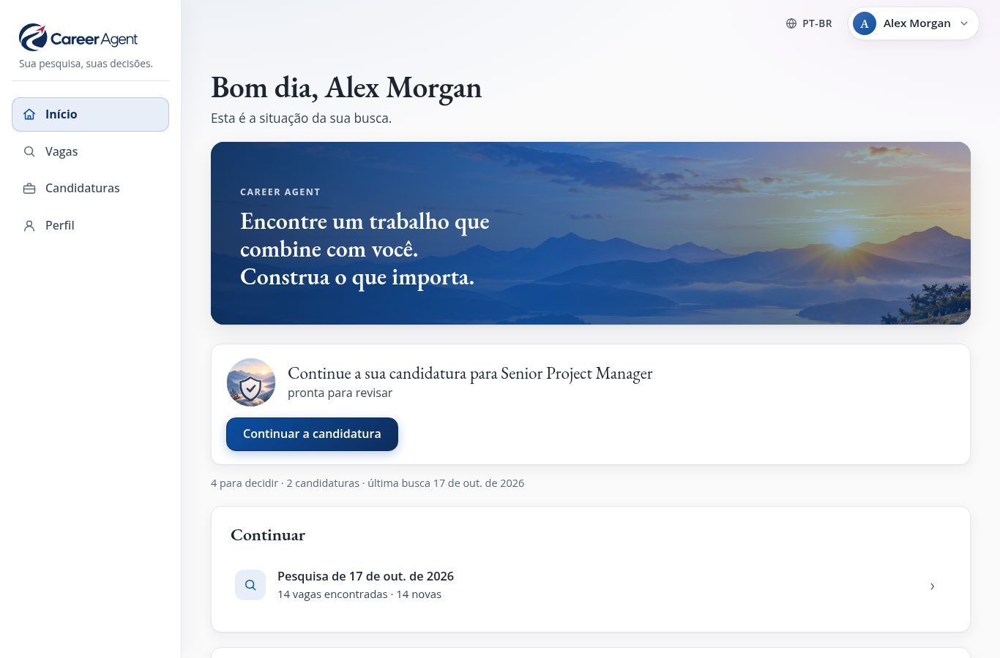
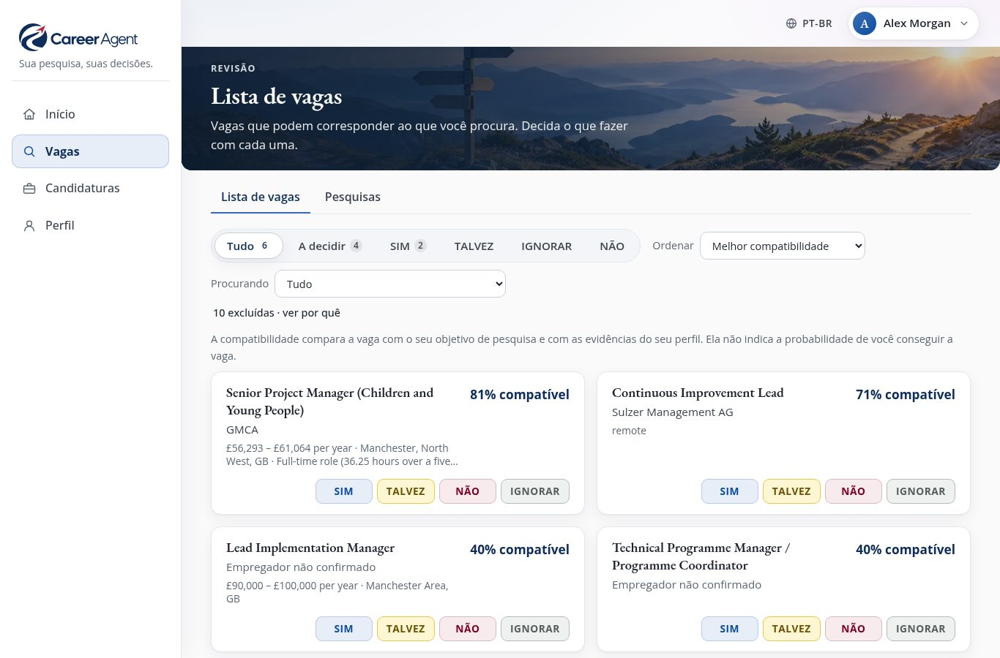
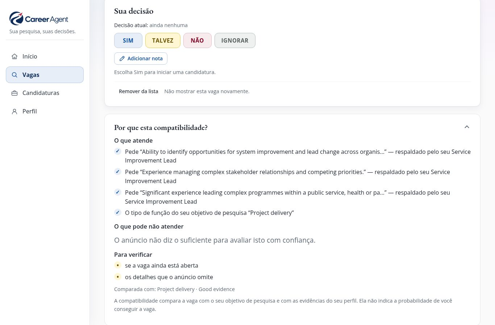
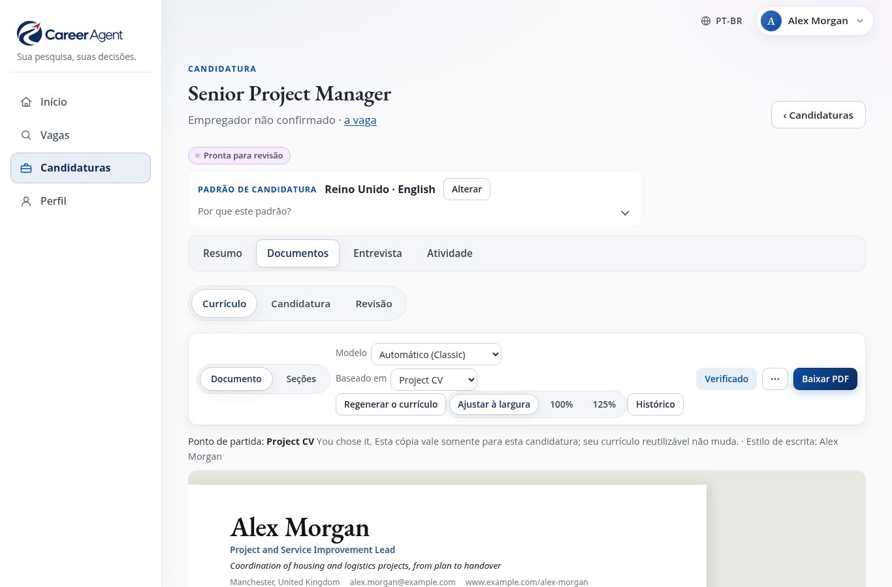
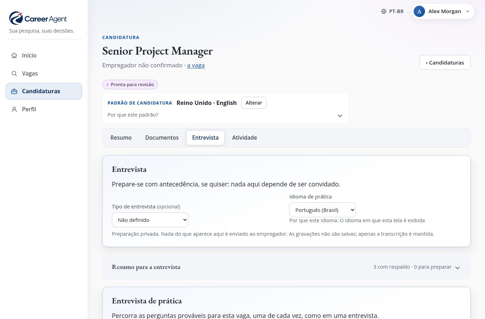

# Career Agent: o guia do usuário

[English](manual.en.md) · [Deutsch](manual.de.md) · [한국어](manual.ko.md) · [Français](manual.fr.md) · [Español](manual.es.md) · **Português**

*Este guia está em português do Brasil. O aplicativo também oferece o português europeu: basta escolher
**Português (Portugal)** no seletor **Idioma**.*

<b>Sua pesquisa, suas decisões.</b> Gratuito · roda no seu próprio computador · seis idiomas · versão 1.0

---

## O Career Agent em um minuto

Procurar um novo emprego costuma significar horas rolando sites de vagas, copiando anúncios para as suas
anotações, reescrevendo o currículo a cada candidatura e tentando lembrar para quem você escreveu e quando.

**O Career Agent faz o trabalho pesado por você e deixa todas as decisões nas suas mãos.**

Você conta, com as suas próprias palavras, que tipo de trabalho quer. A partir daí, ele:

1. **procura na internet vagas que combinam com você**: sites de vagas, sites de empregadores, anúncios
   oficiais;
2. **lê cada anúncio** e confere os fatos importantes (remuneração, local, contrato, prazo para se candidatar)
   na própria página do anúncio;
3. **avalia cada vaga em relação ao que você pediu** e explica o porquê, em frases simples;
4. **mantém uma única Lista de vagas organizada**, em que você só responde Sim, Talvez, Não ou Ignorar;
5. **escreve um currículo e uma carta de apresentação sob medida para a vaga**, usando apenas fatos da sua
   própria trajetória profissional;
6. **ajuda você a se preparar para a entrevista**, inclusive com uma entrevista de prática que você pode
   responder em voz alta;
7. **acompanha cada candidatura** e lembra você da hora de fazer follow-up.

Ele pode até fazer uma pesquisa **toda semana, sozinho**, e mandar um resumo curto para o seu celular.

E uma promessa vale mais do que tudo: **o Career Agent nunca se candidata a uma vaga, nunca entra em contato
com um empregador e nunca envia nada em seu nome.** Ele prepara; você decide e você envia.

---

## O que ele tem de diferente

- **Ele explica o porquê.** Cada vaga vem com *O que atende*, *O que pode não atender* e *Para verificar*, e
  não só com um número.
- **Duas perguntas, cada uma no seu lugar.** "Esta vaga serve para mim agora?" (remuneração, horário, local,
  contrato) e "Ela me leva aonde eu quero chegar?" são avaliadas separadamente, porque uma vaga pode ser boa
  em uma e não na outra.
- **Ele é honesto sobre o que não sabe.** Se um anúncio não fala da remuneração, o Career Agent avisa. Um fato
  só conta como *verificado* quando foi lido na página do empregador, em um anúncio oficial ou em uma empresa
  de recrutamento confiável, nunca em um resumo de busca.
- **O seu currículo continua verdadeiro.** Os novos documentos são escritos a partir das suas próprias
  informações profissionais. Números, datas, cargos, nomes e qualificações inventados são detectados por
  verificações automáticas: um rascunho da IA que os invente não é aceito, e as suas próprias edições que os
  acrescentem aparecem para você como *Revisar*.
- **Os seus dados ficam com você.** Tudo fica guardado no seu próprio computador, e não na nuvem de outra
  pessoa.
- **Sete idiomas na interface.** Inglês, alemão, coreano, francês, espanhol e português (de Portugal e do
  Brasil). As candidaturas podem ser escritas em qualquer um deles.

---

## Novidades da versão 1.0

- **Pontuações mais claras.** A porcentagem agora mostra o quanto a vaga é **compatível com seu objetivo de
  pesquisa**, com **Agora** e **Direção de carreira** ao lado. O salário só é comparado na mesma base, e "não
  essencial" não é mais lido como exigência.
- **Uma Lista de vagas mais tranquila.** Um selo **Nova** marca o que a última pesquisa encontrou, **Procurar
  nesta lista** filtra a lista, e um mesmo anúncio continua sendo uma só vaga, mesmo quando chega por um link um
  pouco diferente. Mudar uma decisão mantém a nota que você escreveu.
- **Verificações de honestidade mais rigorosas.** Organizações, diplomas, certificados e licenças inventados agora
  também são detectados.
- **Cartas em PDF.** A carta de apresentação e a declaração de adequação ao cargo podem ser baixadas em PDF, como o
  currículo.
- **Depois de enviar.** Registre uma entrevista, uma proposta ou uma recusa logo após o envio, com a **data em que
  aconteceu**.
- **Palavras simples quando algo dá errado**, sempre com um próximo passo.

---

## Um passeio rápido: quatro áreas

*A página **Início** mostra o que fazer em seguida. As imagens mostram o perfil de exemplo incluído: uma pessoa fictícia, anúncios de vagas reais.*

Você sempre vê as mesmas quatro áreas: em um menu lateral no computador ou no tablet, e em uma barra na parte
de baixo no celular.

| Área | O que você faz lá |
| --- | --- |
| **Início** | Vê a próxima coisa que vale a pena fazer, o que vem *Em breve* e as suas pesquisas mais recentes. |
| **Vagas** | A **Lista de vagas** (vagas para decidir) e as **Pesquisas** (iniciar uma pesquisa, ver as anteriores). |
| **Candidaturas** | Todas as candidaturas que você começou, cada uma com *Resumo*, *Documentos*, *Entrevista* e *Atividade*, além de **Progresso**, que mostra em que pé está cada uma. |
| **Perfil** | Tudo sobre você: *Sobre você*, *O que procuro*, *Currículos e escrita* e *Configurações*. |

O Início sempre oferece **um** próximo passo claro, por exemplo *"5 vagas precisam da sua decisão"*, com um
botão **Revisar a lista**. Quando não há nada a fazer, ele oferece **Encontrar vagas**.

> **Dica:** se você está começando, pequenos cartões de orientação explicam cada página. Você pode desativá-los
> e ativá-los de novo em **Perfil → Configurações → Mostrar orientações**.

---

## Antes de começar: o que você precisa

**O Career Agent em si é gratuito.** Sem assinatura e sem conta, e o código é aberto (licença MIT). O único
custo é o da IA, que você paga diretamente à OpenAI (veja abaixo).

O Career Agent é um programa que você mesmo roda, no seu próprio computador ou em um pequeno servidor em casa.
Não é um site em que você se cadastra. É isso que mantém os seus dados privados, mas significa que **a primeira
configuração precisa de alguém que se sinta à vontade com computadores**, uma única vez, por mais ou menos uma
hora. Os passos técnicos estão no [README](../README.md#install) ("Install").

O que você precisa:

- **Um computador que possa ficar ligado**, de preferência com Linux, se você quiser a pesquisa semanal
  automática. Para um uso de vez em quando, basta qualquer computador que consiga rodá-lo enquanto você usa.
- **Uma conta na OpenAI e uma chave de API.** O Career Agent usa a IA da OpenAI para pesquisar, ler anúncios e
  escrever. A chave funciona como uma senha que permite ao Career Agent usar a sua conta. A OpenAI cobra pelo
  uso; defina um limite de gastos mensal na sua conta da OpenAI para não ter surpresas.
- **Uma rede privada.** O Career Agent não tem tela de login, por isso ele só pode ser acessado a partir do seu
  próprio computador ou da sua rede privada, nunca da internet aberta. Quem ajudar você vai configurar isso.
- **Opcional:** uma conta no Telegram, se você quiser receber o resumo semanal no celular.

O que funciona **sem** a chave de IA: ler tudo o que já foi encontrado, as suas decisões, editar o seu perfil
e os seus currículos, os modelos, o resumo para a entrevista, os lembretes e o acompanhamento. Pesquisar,
escrever documentos, sugestões da IA, perguntas de entrevista e feedback precisam da chave.

### O seu perfil é criado uma única vez

Quem ajudar você cria o seu perfil copiando o perfil de exemplo incluído (uma pessoa fictícia chamada Alex
Morgan) e fazendo os ajustes. Depois disso, **quase tudo é feito no navegador**: os seus dados, a sua
trajetória profissional, o que você procura, os seus currículos e o seu estilo de escrita.

---

## Passo 1: Conte ao Career Agent sobre você

Abra **Perfil → Sobre você**.

- **Dados pessoais** e **Dados de contato**: o que aparece no alto do seu currículo.
- **Trajetória profissional**: os fatos que os seus currículos e cartas podem usar, em forma de cartões:
  empregos, formações, conquistas, trabalho voluntário, habilidades. Use **Adicionar item** para incluir um.

Quanto mais detalhes verdadeiros você colocar aqui, melhores ficam as suas candidaturas. O Career Agent só
escreve o que consegue encontrar aqui. Se uma vaga pede algo que você não descreveu, ele avisa (*Sem
evidências*) em vez de inventar.

> **Exemplo:** em vez de "Gerenciei projetos", escreva "Liderei uma equipe de 6 pessoas para migrar 400
> clientes para um novo sistema de agendamento em 2024, três semanas antes do prazo." Assim o Career Agent pode
> usar esses números reais, e só eles.

---

## Passo 2: Diga o que você procura

Abra **Perfil → O que procuro** e escolha **+ Adicionar objetivo de busca**. Um *objetivo de busca* é um tipo
de vaga que você quer. Você pode ter vários, por exemplo "Gestão de projetos" e "Operações".

Para cada um, você descreve:

- **O tipo de trabalho**: cargos e o tipo de função, com palavras do dia a dia.
- **O que faz uma vaga corresponder**: o que a vaga realmente precisa envolver.
- **Localização e trabalho remoto**: onde você pode trabalhar e se o trabalho remoto ou híbrido serve.
- **Remuneração** e **Horário e disponibilidade**: quanto você precisa ganhar e os dias ou horários que
  combinam com você.
- **O que importa neste tipo de trabalho**, em quatro níveis: *Obrigatório*, *Importante*, *Útil* e *Evitar*.

Como o Career Agent trata os seus desejos:

| Você diz | O que acontece |
| --- | --- |
| **Requisito obrigatório / Obrigatório** | Uma vaga pode ser deixada de lado se o anúncio **claramente** não atende ao requisito. Se o anúncio simplesmente não fala nada, a vaga **não** é descartada. |
| **Preferir / Importante / Útil** | Deixa a vaga mais compatível, mas nunca descarta uma vaga sozinho. |
| **Evitar** | Os lugares que você descarta deixam de fora as vagas presenciais nesses lugares. O resto que você colocar aqui é anotado, mas não filtrado. |

Cada objetivo de busca pode ser ativado ou desativado, duplicado ou excluído. Só os objetivos ativados entram
na pesquisa.

> **Dica:** não precisa acertar tudo na primeira vez. Faça uma pesquisa, olhe os resultados e ajuste.

---

## Passo 3: Encontre vagas

Vá em **Vagas → Pesquisas** e escolha **Encontrar vagas**.

1. O Career Agent pergunta: **O que o Career Agent deve procurar?** Marque um ou mais objetivos de busca e
   escolha **Encontrar vagas**.
2. Uma confirmação pergunta **Iniciar a pesquisa?** Ela diz o que será pesquisado, que pode levar alguns minutos
   e que nada é enviado a ninguém. Escolha **Iniciar pesquisa**. Nada é criado antes de você confirmar: se
   cancelar, nenhuma pesquisa fica no histórico.
3. A página da pesquisa se abre. Você pode fechá-la e continuar usando o aplicativo: a pesquisa continua. O
   Início e as Pesquisas mostram que há uma pesquisa em andamento e o que ela está fazendo naquele momento, por
   exemplo *"Verificando os anúncios"*.

Enquanto a pesquisa roda, o Career Agent:

- procura na internet vagas que combinam com cada objetivo;
- organiza o que encontrou e remove as duplicatas (a mesma vaga anunciada em vários sites aparece **uma vez
  só**);
- deixa de lado as vagas que claramente não servem;
- abre cada anúncio restante e **verifica** os fatos na própria página do anúncio;
- compara cada vaga com o que você quer e escreve o seu raciocínio.

Quando termina, a página da pesquisa mostra **Pesquisa concluída**, por exemplo:

> *32 vagas encontradas · 9 prontas para revisar · 23 excluídas. 7 são novas. 2 já eram conhecidas.*

e oferece um único botão: **Revisar a lista**. Ao lado das vagas novas, **Ver as vagas novas na sua lista** abre
a Lista de vagas só com as vagas que esta pesquisa encontrou pela primeira vez.

Às vezes uma pesquisa não consegue fazer todo o trabalho:

- **Algumas buscas na web não puderam ser feitas.** O resultado diz isso, por exemplo *"3 das suas 40 buscas na
  web não puderam ser feitas, então podem faltar algumas vagas. Uma nova pesquisa vai tentá-las de novo."*
- **Não foi possível fazer a pesquisa.** Nenhuma das suas buscas na web funcionou, então nenhuma vaga foi
  encontrada. Escolha **Pesquisar de novo**: o Career Agent prepara uma nova pesquisa para os mesmos objetivos e,
  como sempre, pergunta antes **Iniciar a pesquisa?**
- **A pesquisa parou enquanto lia os anúncios.** Escolha **Terminar a verificação dos anúncios**. Só os anúncios
  já encontrados são lidos; nada é pesquisado de novo, por isso não há confirmação.

Se uma pesquisa foi interrompida (digamos que o computador foi desligado), a página dela oferece **Continuar
pesquisa**. Ela retoma de onde parou e não repete o que já tinha terminado.

---

## Passo 4: Decida na sua Lista de vagas

*A **Lista de vagas**: cada vaga com a sua compatibilidade com o seu objetivo e quatro botões para decidir.*

**Vagas → Lista de vagas** reúne em uma só lista as vagas que podem servir para você, vindas de **todas** as
pesquisas.

Cada vaga mostra o cargo, **quem está contratando** (ou *Empregador não confirmado*, quando uma agência esconde
o empregador), a sua compatibilidade, como **"86% compatível com seu objetivo de pesquisa"**, uma linha como
**"Agora: Forte · Direção de carreira: Limitada"** e quatro botões. Um selo **Nova** marca as vagas que a última
pesquisa encontrou pela primeira vez.

| Botão | Significado |
| --- | --- |
| **Sim** | Quero me candidatar. Isso também **inicia uma candidatura** para a vaga. |
| **Talvez** | Interessante; decido depois. |
| **Não** | Não é para mim. |
| **Ignorar** | Agora não. |

Você pode mudar de ideia a qualquer momento; as decisões anteriores ficam no histórico. Se você mudar só a
decisão, a nota que escreveu com ela é mantida.

**O que a porcentagem quer dizer:** o quanto a vaga combina com o que este objetivo de busca pede e com as
evidências do seu perfil. Ela **não** é a sua chance de conseguir a vaga. As outras duas perguntas são avaliadas
separadamente, na linha de baixo: **Agora** (a vaga serve para mim agora: remuneração, horário, local,
contrato?) e **Direção de carreira** (ela me leva aonde eu quero chegar?). Cada uma diz *Forte*, *Mista*,
*Limitada* ou *Informações insuficientes*.

Controles úteis:

- **Tudo · A decidir · Sim · Talvez · Não · Ignorar** para filtrar a lista.
- **Procurando** para ver só um objetivo de busca; **Melhor compatibilidade** ou **Mais recentes** para
  ordenar.
- **Procurar nesta lista**: digite parte do nome de um cargo ou de uma organização para filtrar a lista.
- Uma lista muito longa é carregada em partes: **Mostrando 500 de 620** e **Mostrar mais**, no fim, avisam disso.
- **12 excluídas · ver por quê**: as vagas que não têm como servir (o anúncio saiu do ar, claramente não
  atende a um requisito obrigatório ou não era compatível o suficiente). Nada é apagado, e cada uma diz o
  porquê, citando o anúncio.
- **Remover da lista** esconde uma vaga que você nunca mais quer ver. **Restaurar na lista** traz a vaga de
  volta.

---

## Passo 5: Olhe uma vaga de perto

***Por que esta compatibilidade?** na página de uma vaga: o que atende, o que pode não atender e o que verificar.*

Clique em uma vaga para abrir a página dela. No alto:

- o cargo, o empregador e o local, e uma linha com a compatibilidade, a remuneração, o contrato e o prazo para
  se candidatar;
- **Em resumo**: duas ou três frases sobre o que a vaga realmente é, escritas a partir do anúncio;
- **Sua decisão**: os quatro botões, mais **Adicionar nota** para registrar um motivo ou um lembrete para você
  mesmo. A nota guardada com a sua decisão atual aparece aqui.

O prazo para se candidatar é tirado do anúncio, mesmo quando só está escrito no texto, por exemplo *"Prazo:
1º de setembro de 2026"*. Só conta uma data completa; o Career Agent nunca adivinha uma.

Mais abaixo, três seções se abrem quando você clica nelas:

- **Por que esta compatibilidade?** *O que atende*, *O que pode não atender*, *Útil para a direção que você
  quer seguir* e *Para verificar*.
- **Detalhes do anúncio**: cada fato do anúncio, marcado como verificado ou não verificado, um link para o
  anúncio original e as fontes.
- **Detalhes técnicos**: para os curiosos; você nunca vai precisar.

Quando o Career Agent tem pouca informação, ele diz exatamente por quê, por exemplo *"Temos apenas
informações limitadas sobre esta função."* ou *"Anúncio não está mais disponível"*.

---

## Passo 6: Prepare uma candidatura

Escolher **Sim** em uma vaga inicia uma candidatura. Abra-a pela vaga (**Abrir candidatura**) ou em
**Candidaturas**.

### Resumo

Mostra o próximo passo como um único botão (por exemplo **Gerar o currículo**), a situação de cada documento
(*Pronto*, *Precisa melhorar*, *Ausente*, *Não é necessário*), o que o seu currículo já cobre e o que ainda
não cobre. **Preparar tudo de uma vez** faz todos os passos de uma vez só e entrega um rascunho.

### Documentos: Currículo, Candidatura, Revisão

*Um currículo escrito para esta vaga específica, pronto para revisar e baixar em PDF.*

- **Currículo**: escolha **Gerar o currículo**. O Career Agent adapta um dos seus currículos reutilizáveis a
  esta vaga, usando as suas informações profissionais, os requisitos da vaga e o seu estilo de escrita. O
  currículo aparece **como a página de verdade**, e você edita ali mesmo, como um documento.
- **Candidatura**: a carta de apresentação, uma declaração de apoio e as respostas a perguntas que você colar
  do formulário do empregador.
- **Ajuda da IA em qualquer parágrafo:** selecione um texto e escolha **Melhorar a redação**, **Encurtar**,
  **Deixar mais conciso**, **Destacar a relevância para este cargo** ou **Perguntar à IA…**. Você sempre
  recebe primeiro uma *sugestão*: **Aplicar**, **Tentar novamente** ou **Cancelar**. Nada muda até você
  aplicar, e nada é salvo até você salvar.
- **Modelos** mudam a aparência, nunca as palavras. **Seções** permite reordenar ou esconder partes deste
  currículo sem mexer no seu perfil.
- **Histórico** guarda todas as versões; você pode voltar a qualquer uma delas.
- **Baixar PDF** para o currículo, a carta de apresentação e a declaração de adequação ao cargo. Se faltar um
  PDF, **Criar PDF** o gera. Quando não é possível criar PDF nesta instalação, o Career Agent avisa: abra a
  prévia e imprima, ou salve como PDF pelo navegador. Os arquivos baixados levam o nome do empregador e do cargo.

**Verificações.** Cada documento é conferido com as suas informações profissionais: datas, números, nomes (por
exemplo, de empregadores e de outras organizações) e qualificações como diplomas, certificados e licenças. Se a
IA escrever algo que as suas evidências não sustentam, o Career Agent tenta de novo; se ainda falhar, ele avisa
e não salva nada. O que você mesmo escreve nunca é bloqueado: aparece como *Revisar: 2 afirmações precisam de
atenção*, e você decide o que fica. Quando tudo passa, você vê *Datas, números, nomes e qualificações
verificados com base nas suas evidências*, com um lembrete: *As verificações não conseguem avaliar tudo: leia
cada frase antes de aprovar.*

### Revisão e aprovação

Quando estiver satisfeito, abra **Revisão**. O Career Agent mostra exatamente o que você está aprovando: o
currículo, a carta, as respostas e as verificações, e tudo o que ainda falta terminar. Escolha **Aprovar
candidatura**.

Se você mudar alguma coisa depois de aprovar, o Career Agent percebe e pede que você revise de novo. Você também
pode **Pedir alterações**, **Colocar em pausa** ou **Retirar**, com um motivo curto.

### O envio: sempre por você

**Não existe botão de "enviar", e é de propósito.** Você mesmo envia a candidatura, por e-mail, no site do
empregador ou pelo correio. Depois, em **Atividade**, escolha **Registrar o envio** e anote como você enviou. Se
enviou há alguns dias, informe a **data em que aconteceu** (vazia, vale hoje); o lembrete de acompanhamento conta
a partir desse dia. A partir desse momento, os documentos ficam **salvos exatamente como foram enviados**, para
você sempre saber exatamente o que o empregador recebeu.

---

## Passo 7: Prepare-se para a entrevista

*A preparação para a entrevista: um breve resumo, as perguntas prováveis e uma entrevista de treino.*

Cada candidatura tem uma seção **Entrevista**. Você pode se preparar bem antes de receber um convite.

- **Resumo para a entrevista**: a organização, o que importa nesta vaga, por que você pode se encaixar, as
  lacunas para as quais se preparar e boas perguntas para fazer a eles. Não usa IA.
- **Pesquisar [organização] na internet** (opcional): uma olhada rápida e focada na organização na internet,
  oferecida quando o anúncio diz quem está contratando.
- **Sugerir perguntas prováveis**: as perguntas que provavelmente vão fazer a você, cada uma com pontos a
  abordar tirados da sua própria experiência. Quando você ainda não tem evidências, ele diz isso com
  honestidade.
- **Prática**: responda a uma pergunta **digitando ou em voz alta**. Escolha **Analisar resposta** para receber
  *O que funcionou*, *O que melhorar* e *Para a próxima vez*, além de quantas vezes você usou palavras de
  preenchimento. Antes, você pode corrigir a versão escrita de uma resposta falada com
  **Editar transcrição**.
- **Entrevista de prática**: de cinco a sete perguntas seguidas, com perguntas de acompanhamento e um resumo no
  final, como em uma entrevista de verdade.

O Career Agent pode **ler as perguntas em voz alta** usando a voz do seu próprio navegador, de graça. As
gravações são transformadas em texto e **nunca são guardadas**: só o texto fica salvo. O feedback é sobre o que
você disse, nunca sobre o quanto você pareceu confiante.

> Para responder falando, é preciso uma conexão segura (um endereço que começa com **https**, ou o próprio
> computador). Se o microfone não estiver disponível, digite as respostas.

---

## Passo 8: Faça o follow-up e acompanhe tudo

- **Atividade** (em cada candidatura): **Registrar uma resposta**, **Registrar uma entrevista**, **Registrar
  uma recusa**, **Registrar uma proposta** ou **Registrar como encerrada**, com o histórico completo logo
  abaixo. Só aparecem os passos que combinam com a situação da candidatura. Logo depois do envio, você pode
  registrar o que realmente aconteceu em seguida (uma entrevista, uma recusa, uma proposta, ou **Registrar como
  encerrada** se nunca houve resposta) sem registrar uma resposta antes. Para uma resposta, e para uma recusa ou
  proposta que seja a primeira resposta, você pode informar a **data em que aconteceu** (nunca uma data futura).
- **Candidaturas → Progresso**: todas as suas candidaturas de relance, de *Em preparação* até *Proposta* ou
  *Encerradas*.
- **Lembretes**: o Career Agent sugere lembretes automaticamente: a entrevista, a preparação dois dias antes, um
  follow-up duas semanas depois da candidatura e os prazos. Você pode adicionar os seus. Eles aparecem no Início,
  em **Em breve**.
- **Adicionar à agenda (.ics)** baixa um lembrete que você pode abrir no seu aplicativo de agenda de sempre.

Quando chega uma proposta, o Career Agent registra, e só. Aceitar, negociar e decidir é com você.

---

## A pesquisa semanal e o seu celular

Depois de configurado, o Career Agent pode pesquisar **automaticamente uma vez por semana** (o padrão é
quinta-feira às 7 da manhã) e mandar um resumo curto para o seu **Telegram**: quantas vagas novas encontrou e o
que vem pela frente, com links que levam direto de volta ao aplicativo.

Quem ajudar você configura o agendamento e a conexão com o Telegram. Depois, você pode ativar ou desativar as
mensagens e mandar uma mensagem de teste para si mesmo em **Perfil → Configurações → Notificações e
integrações**. Se o computador estava desligado no horário marcado, a pesquisa roda na próxima vez em que ele
for ligado.

A pesquisa semanal roda **também com o Telegram desativado**: as vagas aparecem na sua Lista de vagas como
sempre; só a mensagem deixa de ser enviada. Com o Telegram ativado, se uma pesquisa semanal falhar ou não
conseguir começar, você recebe **uma única** mensagem curta avisando e dizendo em que etapa ela parou. Ela nunca
traz detalhes do erro; quem ajudar você encontra esses detalhes no computador.

---

## Idiomas e países

- Mude o idioma da interface no seletor **Idioma**. Os sete idiomas estão completos.
- Cada candidatura pode ser escrita no seu próprio idioma e seguindo os costumes do seu próprio país (por
  exemplo, um currículo do Reino Unido é diferente de um alemão). Reino Unido e Internacional já estão prontos
  para uso; Alemanha, Coreia do Sul, Estados Unidos e Gana vêm como rascunhos que você revisa e aprova antes.

---

## Os seus dados e a sua privacidade

- Tudo (o seu perfil, as pesquisas, as decisões, as candidaturas) fica guardado como arquivos comuns **no seu
  próprio computador**. Não existe conta em nenhuma empresa Career Agent nem banco de dados na nuvem.
- **O que vai para a OpenAI**, só quando você usa um recurso de IA: os termos de pesquisa, o texto dos anúncios
  e, quando você escreve ou pratica, as partes das suas informações profissionais, do seu estilo de escrita e
  das suas respostas necessárias para aquela tarefa. O Career Agent pede à OpenAI que não guarde esses dados. As
  gravações de voz nunca são guardadas.
- **Nada é enviado aos empregadores.** As únicas mensagens que o Career Agent chega a enviar vão para o seu
  próprio Telegram, se você ativar: o resumo semanal, ou um aviso curto quando uma pesquisa semanal falha.
- **Faça backup dos seus dados.** Como eles ficam no seu computador, garanta que quem ajudar você configure um
  backup regular.

---

## Limites, com toda a honestidade

O Career Agent é poderoso, mas é bom saber o que ele não faz:

- Ele nunca se candidata nem entra em contato com ninguém por você. Isso é uma promessa, não um recurso que
  falta.
- Não existe tela de login. Mantenha-o só no seu próprio computador ou na sua rede privada.
- O seu primeiro perfil é configurado com arquivos, uma única vez, por alguém que ajude você.
- O currículo, a carta de apresentação e a declaração de adequação ao cargo viram PDF; as respostas às perguntas
  de um empregador, não. Não há formato Word.
- As agendas recebem um arquivo para baixar; não há conexão direta com as agendas do Google ou do Outlook.
- As verificações automáticas pegam números, datas, cargos, nomes e qualificações inventados, mas não todo
  exagero sutil. Leia sempre os seus documentos antes de aprová-los.
- A IA pode avaliar mal uma vaga de vez em quando. É por isso que cada avaliação vem com os seus motivos, e é
  por isso que quem decide é você.

---

## Quando algo dá errado

| Você vê | O que significa e o que fazer |
| --- | --- |
| *A IA está ocupada neste momento* | A OpenAI está sobrecarregada. O Career Agent já tentou de novo; espere um minuto e escolha Tentar novamente. |
| *Limite de uso da IA atingido* | A sua conta da OpenAI chegou ao limite de gastos. Aumente o limite na sua conta da OpenAI; tentar de novo não vai adiantar. |
| *A geração por IA não está configurada* | Falta a chave de IA. Peça a quem ajuda você que a adicione. |
| *Verificação incompleta* | Não foi possível ler a própria página do anúncio, então os fatos dele não estão confirmados. Abra o anúncio original e confira você mesmo. |
| *Empregador não confirmado* | O anúncio (muitas vezes de uma agência) não diz quem é o empregador. |
| *Isto mudou desde que você abriu. Recarregue antes de salvar.* | O documento foi alterado em outro lugar (outra aba). Recarregue e faça a sua alteração de novo. |
| O microfone não funciona | Use um endereço seguro (https), permita o microfone no navegador ou digite a sua resposta. |
| *O Career Agent não está respondendo* ou *Não foi possível carregar esta página* | Verifique se o Career Agent continua em execução (pergunte a quem ajuda você, se precisar) e escolha **Recarregar**. |
| *Não foi possível fazer a pesquisa* | Nenhuma das suas buscas na web funcionou. Nada foi enviado. Escolha **Pesquisar de novo**; se falhar outra vez, peça para conferirem a chave da IA. |
| *3 das suas 40 buscas na web não puderam ser feitas* | A pesquisa terminou, mas podem faltar algumas vagas. Não é preciso fazer nada: a próxima pesquisa vai tentá-las de novo. |
| Uma pesquisa parece travada | Abra-a em **Pesquisas**. Se ela foi interrompida, escolha **Continuar pesquisa**. Se ela parou enquanto lia os anúncios, escolha **Terminar a verificação dos anúncios**. |

---

## Pequeno dicionário

| Palavra | Significado |
| --- | --- |
| **Objetivo de busca** | Um tipo de vaga que você quer que o Career Agent procure. |
| **Pesquisa** | Uma volta pela internet procurando os seus objetivos de busca. |
| **Lista de vagas** | Todas as vagas que podem servir para você, de todas as pesquisas, em uma só lista. |
| **Verificado** | Um fato lido na própria página do anúncio ou em outra fonte confiável. |
| **Excluída** | Deixada de lado porque não tem como servir; nunca apagada, sempre explicada. |
| **Currículo reutilizável** | O seu próprio currículo de partida. Cada candidatura recebe uma cópia sob medida; o original continua igual. |
| **Aprovar** | O seu "sim, estes documentos estão prontos" explícito, ligado ao conteúdo exato deles. |
| **Salvos exatamente como foram enviados** | Depois que você registra um envio, os documentos ficam congelados do jeito que o empregador recebeu. |

---

*O Career Agent é um software livre e de código aberto (licença MIT). Para a instalação e a documentação
técnica, veja o [README](../README.md).*
